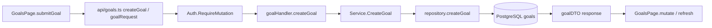
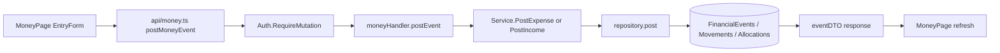
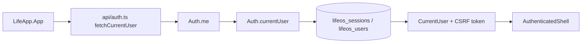

# LifeOS Codebase Map

**Current code:** Issue #25 Goals implementation, including the v5 migration. This is a navigation guide; [Architecture](ARCHITECTURE.md), [Domain Model](DOMAIN_MODEL.md), and accepted [ADRs](adr/README.md) define the rules.

## Start here

| Area | Entry point and ownership |
| --- | --- |
| Web | [`apps/web/src/main.tsx`](../apps/web/src/main.tsx) mounts [`App`](../apps/web/src/LifeApp.tsx) through [`App.tsx`](../apps/web/src/App.tsx). `LifeApp.tsx` confirms the session before rendering [`AuthenticatedShell`](../apps/web/src/LifeApp.tsx). [`navigation.ts`](../apps/web/src/navigation.ts) resolves Today, Money, Plans, Me, and Goal detail URLs. [`lifeos.css`](../apps/web/src/lifeos.css), [`money.css`](../apps/web/src/money.css), and [`goals.css`](../apps/web/src/goals.css) carry the Sage Green UI. |
| API | [`cmd/lifeos-api/main.go`](../cmd/lifeos-api/main.go) `run` creates services and registers identity, Finance, and Planning on one `/api/v1` chi router. [`httpapi.NewRouter`](../internal/platform/httpapi/router.go) mounts it beside health/readiness and request middleware. |
| Identity | [`internal/identity/auth.go`](../internal/identity/auth.go) owns Google OIDC, sessions, `Auth.RequireRead`, and `Auth.RequireMutation`; [`owner.go`](../internal/identity/owner.go) defines the server-derived `OwnerID`. [`repository.go`](../internal/identity/repository.go) persists identity and sessions. [`cmd/lifeos-admin/main.go`](../cmd/lifeos-admin/main.go) is the trusted local invitation operator. |
| Persistence | [`database.OpenPostgreSQL`](../internal/platform/database/postgres.go) opens the pool. [`db/migrations/`](../db/migrations/) holds numbered SQL; [`cmd/lifeos-migrate/main.go`](../cmd/lifeos-migrate/main.go) applies or reports them. v2/v3 add identity/sessions; v4 adds Money; v5 adds Goals. |
| Contracts and deployment | [`api/openapi/openapi.yaml`](../api/openapi/openapi.yaml) is the API contract; [`apps/web/src/api/generated/schema.ts`](../apps/web/src/api/generated/schema.ts) is generated from it. [`deploy/compose.yaml`](../deploy/compose.yaml) starts PostgreSQL, migration job, API, and web; the [`API`](../deploy/api.Dockerfile) and [`web`](../deploy/web.Dockerfile) Dockerfiles build their images. |

## Feature paths

**Status key:** Implemented = working persisted flow; partial = useful UI with a missing V0.1 capability; placeholder = navigation without its planned data; future = no product implementation.

| Feature | User-facing UI | Frontend API | HTTP Handler | Service | Repository | Database/Migration | Relevant Tests |
| --- | --- | --- | --- | --- | --- | --- | --- |
| Today **placeholder** | [`TodayPage`](../apps/web/src/LifeApp.tsx) links to Money/Plans | N/A | N/A | N/A | N/A | N/A | [`LifeApp.test.tsx`](../apps/web/src/LifeApp.test.tsx) |
| Money **implemented** | [`MoneyPage`](../apps/web/src/MoneyPage.tsx); [`moneyAmount.ts`](../apps/web/src/moneyAmount.ts) exact input | [`api/money.ts`](../apps/web/src/api/money.ts) | [`finance/http.go`](../internal/finance/http.go) `moneyHandler` | [`finance/service.go`](../internal/finance/service.go) `Service` | [`finance/repository.go`](../internal/finance/repository.go) `repository` | [`000004_money_ledger.up.sql`](../db/migrations/000004_money_ledger.up.sql) | [`finance_integration_test.go`](../internal/finance/finance_integration_test.go), [`http_integration_test.go`](../internal/finance/http_integration_test.go), [`LifeApp.test.tsx`](../apps/web/src/LifeApp.test.tsx), [`api/money.test.ts`](../apps/web/src/api/money.test.ts) |
| Plans/Goals **implemented** | [`GoalsPage`](../apps/web/src/GoalsPage.tsx) overview and detail | [`api/goals.ts`](../apps/web/src/api/goals.ts) | [`planning/http.go`](../internal/planning/http.go) `goalHandler` | [`planning/service.go`](../internal/planning/service.go) `Service` | [`planning/repository.go`](../internal/planning/repository.go) `repository` | [`000005_goals.up.sql`](../db/migrations/000005_goals.up.sql) | [`planning_integration_test.go`](../internal/planning/planning_integration_test.go), [`LifeApp.test.tsx`](../apps/web/src/LifeApp.test.tsx), [`api/goals.test.ts`](../apps/web/src/api/goals.test.ts) |
| Me **partial** | [`MePage`](../apps/web/src/LifeApp.tsx) profile/sign-out; data tools pending | [`api/auth.ts`](../apps/web/src/api/auth.ts) `fetchCurrentUser`, `signOut` | [`identity/auth.go`](../internal/identity/auth.go) `Auth.me`, `Auth.logout` | Session logic in `Auth` | [`identity/repository.go`](../internal/identity/repository.go) | [`000003_auth_sessions.up.sql`](../db/migrations/000003_auth_sessions.up.sql) | [`auth_integration_test.go`](../internal/identity/auth_integration_test.go), [`LifeApp.test.tsx`](../apps/web/src/LifeApp.test.tsx) |
| Google sign-in/invitations **implemented locally** | [`SignedOutScreen`](../apps/web/src/LifeApp.tsx), [`App`](../apps/web/src/LifeApp.tsx) | [`api/auth.ts`](../apps/web/src/api/auth.ts) | [`identity/auth.go`](../internal/identity/auth.go) `Auth.start`, `Auth.callback`, `Auth.me` | Admission/session in `Auth` | [`identity/repository.go`](../internal/identity/repository.go) | [`000002_identity_foundation.up.sql`](../db/migrations/000002_identity_foundation.up.sql), [`000003_auth_sessions.up.sql`](../db/migrations/000003_auth_sessions.up.sql) | [`auth_integration_test.go`](../internal/identity/auth_integration_test.go), [`repository_integration_test.go`](../internal/identity/repository_integration_test.go) |
| Owner boundary **implemented** | Session-gated [`AuthenticatedShell`](../apps/web/src/LifeApp.tsx) | Same-origin calls in `api/auth.ts`, `api/money.ts`, `api/goals.ts` | [`Auth.RequireRead`/`RequireMutation`](../internal/identity/auth.go) wrap Money/Goals routes | Finance/Planning `Service` methods accept `OwnerID` | Finance/Planning SQL filters owner and related IDs | Owner columns and foreign keys in v2/v4/v5 | [`owner_scope_integration_test.go`](../internal/identity/owner_scope_integration_test.go), Finance/Planning integration tests |
| Export, backup UI, offline sync, Wishlist **future** | N/A | N/A | N/A | N/A | N/A | N/A | N/A |

The Google login was manually verified locally in Issue #19. The isolated Goals browser test used a synthetic session with normal guards and does not substitute for a new live Google or public deployment check.

## Representative call chains

For inputs, outputs, errors, and tests at each function, read the [Goals](../learning/journal/2026-10-12-goals-checklists.md), [Money UI](../learning/journal/2026-10-09-money-ui.md), [Money API](../learning/journal/2026-10-09-money-api.md), [OIDC/session](../learning/journal/2026-10-09-google-oidc-sessions.md), and [owner boundary](../learning/journal/2026-10-09-owner-authorization-boundary.md) learning entries.

## Where do I change this?

| Task | Start with |
| --- | --- |
| Page layout or styling | [`LifeApp.tsx`](../apps/web/src/LifeApp.tsx) for shell/Today/Me, [`MoneyPage.tsx`](../apps/web/src/MoneyPage.tsx) or [`GoalsPage.tsx`](../apps/web/src/GoalsPage.tsx) for features; their CSS files above. |
| Add a Goal field | [Goal service/model](../internal/planning/service.go), [repository SQL](../internal/planning/repository.go), [new migration](../db/migrations/), [HTTP DTO](../internal/planning/http.go), [OpenAPI](../api/openapi/openapi.yaml), generated types and UI; update integration tests. |
| Add a Money API field | [Finance service/model](../internal/finance/service.go), [HTTP DTO](../internal/finance/http.go), [OpenAPI](../api/openapi/openapi.yaml), regenerated [TypeScript](../apps/web/src/api/generated/schema.ts), [frontend API](../apps/web/src/api/money.ts), and tests. |
| Add an authenticated endpoint | Register in [module `RegisterRoutes`](../internal/planning/http.go) from [`cmd/lifeos-api/main.go`](../cmd/lifeos-api/main.go); wrap reads with `Auth.RequireRead` and mutations with `Auth.RequireMutation`; pass only server-derived `OwnerID`. |
| Add a database column | Create the next numbered [up/down migration](../db/migrations/), test a populated upgrade and safe rollback, then update repository/service/DTO/contract in that order. Never rewrite a published migration. |
| Fix login/session | [`identity/auth.go`](../internal/identity/auth.go), [`identity/repository.go`](../internal/identity/repository.go), [`api/auth.ts`](../apps/web/src/api/auth.ts), and [local setup](AUTH_LOCAL_SETUP.md). Never log secrets or callback codes. |
| Add tests | Frontend: colocated [`*.test.ts(x)`](../apps/web/src/LifeApp.test.tsx). Backend: package [`*_test.go`](../internal/planning/planning_integration_test.go) on a fresh disposable PostgreSQL database. See [Development Guide](DEVELOPMENT_GUIDE.md). |
