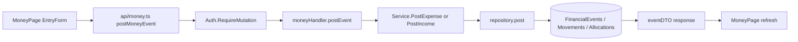
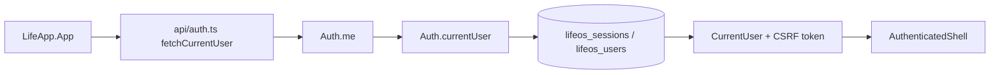
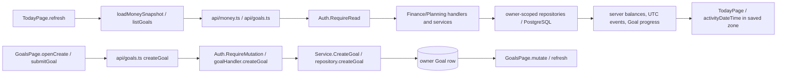
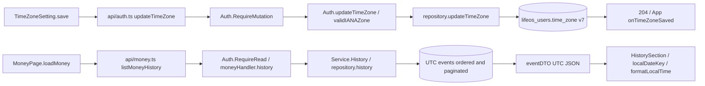
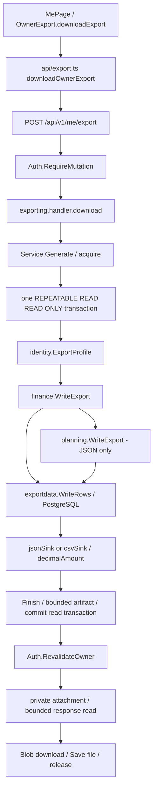
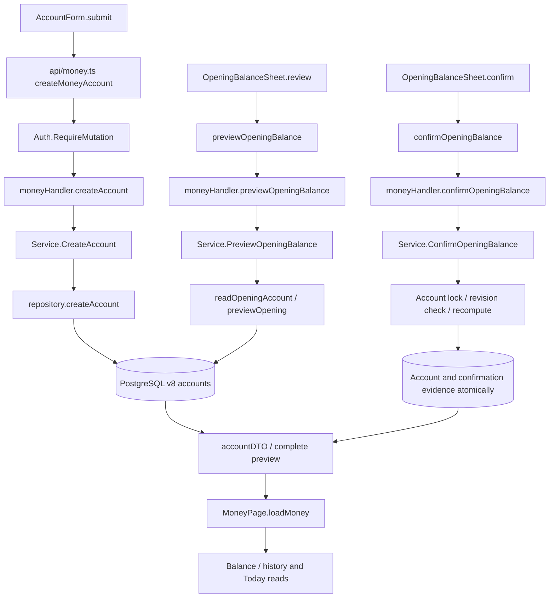

# LifeOS Codebase Map

**Current code:** Issues #26–#31 are complete, pushed and closed. Issue #32 Me / Owner Data Export is implemented and Product Owner approved under accepted ADR-017; see [Export Design](EXPORT_DESIGN.md). Issue #33 known-balance dates and v2 exports are implemented under accepted ADR-018 and Product Owner accepted for final delivery on 2026-10-23. This is a navigation guide; [Architecture](ARCHITECTURE.md), [Domain Model](DOMAIN_MODEL.md), and accepted [ADRs](adr/README.md) define the rules.

## Start here

| Area | Entry point and ownership |
| --- | --- |
| Web | [`apps/web/src/main.tsx`](../apps/web/src/main.tsx) mounts [`App`](../apps/web/src/LifeApp.tsx) through [`App.tsx`](../apps/web/src/App.tsx). `LifeApp.tsx` confirms the session before rendering [`AuthenticatedShell`](../apps/web/src/LifeApp.tsx). [`navigation.ts`](../apps/web/src/navigation.ts) resolves Today, Money, Plans, Me, and Goal detail URLs. [`lifeos.css`](../apps/web/src/lifeos.css), [`money.css`](../apps/web/src/money.css), and [`goals.css`](../apps/web/src/goals.css) carry the Sage Green UI. |
| API | [`cmd/lifeos-api/main.go`](../cmd/lifeos-api/main.go) `run` creates services and registers identity, Finance, Planning and Export on one `/api/v1` chi router. [`httpapi.NewRouter`](../internal/platform/httpapi/router.go) mounts it beside health/readiness and request middleware. |
| Identity | [`internal/identity/auth.go`](../internal/identity/auth.go) owns Google OIDC, sessions, `Auth.RequireRead`, and `Auth.RequireMutation`; [`owner.go`](../internal/identity/owner.go) defines the server-derived `OwnerID`. [`repository.go`](../internal/identity/repository.go) persists identity and sessions. [`cmd/lifeos-admin/main.go`](../cmd/lifeos-admin/main.go) is the trusted local invitation operator. |
| Persistence | [`database.OpenPostgreSQL`](../internal/platform/database/postgres.go) opens the pool. [`db/migrations/`](../db/migrations/) holds numbered SQL; [`cmd/lifeos-migrate/main.go`](../cmd/lifeos-migrate/main.go) applies or reports them. v2/v3 add identity/sessions; v4 adds Money; v5 adds Goals; v6 adds the nullable Finance Soft Delete marker; v7 adds nullable owner `time_zone`. [`migrations.CurrentVersion`](../internal/platform/migrations/version.go) makes `/readyz` require v7. |
| Contracts and deployment | [`api/openapi/openapi.yaml`](../api/openapi/openapi.yaml) is the API contract; [`apps/web/src/api/generated/schema.ts`](../apps/web/src/api/generated/schema.ts) is generated from it. [`deploy/compose.yaml`](../deploy/compose.yaml) starts PostgreSQL, migration job, API, and web; the [`API`](../deploy/api.Dockerfile) and [`web`](../deploy/web.Dockerfile) Dockerfiles build their images. |

## Feature paths

**Status key:** Implemented = working persisted flow; partial = useful UI with a missing V0.1 capability; placeholder = navigation without its planned data; future = no product implementation.

| Feature | User-facing UI | Frontend API | HTTP Handler | Service | Repository | Database/Migration | Relevant Tests |
| --- | --- | --- | --- | --- | --- | --- | --- |
| Today **implemented; Issue #26 approved** | [`TodayPage`](../apps/web/src/TodayPage.tsx) projects account balances, recent events, and active Goal progress | Existing [`api/money.ts`](../apps/web/src/api/money.ts) and [`api/goals.ts`](../apps/web/src/api/goals.ts) reads | Existing [`finance/http.go`](../internal/finance/http.go) and [`planning/http.go`](../internal/planning/http.go) read handlers | Existing Finance/Planning `Service` methods | Existing owner-scoped Finance/Planning repositories | Existing v4 Finance and v5 Goals tables; no new migration | [`TodayPage.test.ts`](../apps/web/src/TodayPage.test.ts), Finance/Goals integration tests, isolated real-stack browser checks |
| Money **implemented; Issues #27/#28 approved** | [`MoneyPage`](../apps/web/src/MoneyPage.tsx) shows Accounts then History, compact setup, category rename/archive/restore, optional Uncategorized entry, and optional Void note; [`moneyAmount.ts`](../apps/web/src/moneyAmount.ts) exact input | [`api/money.ts`](../apps/web/src/api/money.ts) typed mutations | [`finance/http.go`](../internal/finance/http.go) `moneyHandler` | [`finance/service.go`](../internal/finance/service.go) `Service` | [`finance/repository.go`](../internal/finance/repository.go) `repository` | [`000004_money_ledger.up.sql`](../db/migrations/000004_money_ledger.up.sql); no new migration | [`finance_integration_test.go`](../internal/finance/finance_integration_test.go), [`http_integration_test.go`](../internal/finance/http_integration_test.go), [`LifeApp.test.tsx`](../apps/web/src/LifeApp.test.tsx), [`api/money.test.ts`](../apps/web/src/api/money.test.ts), isolated real-stack browser flow |
| Money Soft Delete **implemented; Issue #29 approved** | [`HistorySection.confirmDelete`](../apps/web/src/MoneyPage.tsx) confirms and refreshes | [`deleteMoneyEvent`](../apps/web/src/api/money.ts) guarded POST | [`moneyHandler.deleteEvent`](../internal/finance/http.go) behind `Auth.RequireMutation` | [`Service.DeleteEvent`](../internal/finance/service.go) validates owner and ID | [`repository.deleteEvent`](../internal/finance/repository.go) locks owned event and affected accounts; `balanceSQL`, `categorySpending`, and `history` exclude deleted events | [`000006_financial_event_soft_delete.up.sql`](../db/migrations/000006_financial_event_soft_delete.up.sql) adds nullable `deleted_at`; linked rows retained | [`soft_delete_integration_test.go`](../internal/finance/soft_delete_integration_test.go), [`http_integration_test.go`](../internal/finance/http_integration_test.go), [`api/money.test.ts`](../apps/web/src/api/money.test.ts), real-stack browser checks |
| Money grouped history and timezone **Issue #30** | [`EntryForm`, `TransferForm`, `HistorySection`](../apps/web/src/MoneyPage.tsx), shared [`TimeZoneSetting`](../apps/web/src/TimeZoneSetting.tsx) hosted in Me, and [`moneyAmount.ts`](../apps/web/src/moneyAmount.ts) resolve wall times and group a server page by owner-local date | [`updateTimeZone`](../apps/web/src/api/auth.ts), [`listMoneyHistory`](../apps/web/src/api/money.ts) | [`Auth.updateTimeZone`](../internal/identity/auth.go) behind `RequireMutation`; [`moneyHandler.history`](../internal/finance/http.go) behind `RequireRead` | `Auth.validIANAZone`; Finance `Service.History` preserves UTC ordering | [`repository.updateTimeZone`](../internal/identity/repository.go) scopes preference to session owner; Finance `repository.history` filters then paginates | [`000007_owner_timezone.up.sql`](../db/migrations/000007_owner_timezone.up.sql) adds nullable `lifeos_users.time_zone`; v4 event UTC timestamps unchanged | [`auth_integration_test.go`](../internal/identity/auth_integration_test.go), [`moneyAmount.test.ts`](../apps/web/src/moneyAmount.test.ts), full Go/web suites, real guarded API/Edge 320/390px |
| Plans/Goals **implemented** | [`GoalsPage`](../apps/web/src/GoalsPage.tsx) overview and detail | [`api/goals.ts`](../apps/web/src/api/goals.ts) | [`planning/http.go`](../internal/planning/http.go) `goalHandler` | [`planning/service.go`](../internal/planning/service.go) `Service` | [`planning/repository.go`](../internal/planning/repository.go) `repository` | [`000005_goals.up.sql`](../db/migrations/000005_goals.up.sql) | [`planning_integration_test.go`](../internal/planning/planning_integration_test.go), [`LifeApp.test.tsx`](../apps/web/src/LifeApp.test.tsx), [`api/goals.test.ts`](../apps/web/src/api/goals.test.ts) |
| Me **implemented; Issue #32 approved** | [`MePage`](../apps/web/src/LifeApp.tsx), shared [`TimeZoneSetting`](../apps/web/src/TimeZoneSetting.tsx), [`me.css`](../apps/web/src/me.css); Money links here | Existing `fetchCurrentUser`, `signOut`, `updateTimeZone` in [`api/auth.ts`](../apps/web/src/api/auth.ts) | Existing `Auth.me`, `Auth.logout`, `Auth.updateTimeZone` | Existing session/timezone rules | Existing Identity repository | Existing v2/v3/v7; no migration | Auth/web regression suites and real guarded Edge 320/390/1280px checks |
| Google sign-in/invitations **implemented locally** | [`SignedOutScreen`](../apps/web/src/LifeApp.tsx), [`App`](../apps/web/src/LifeApp.tsx) | [`api/auth.ts`](../apps/web/src/api/auth.ts) | [`identity/auth.go`](../internal/identity/auth.go) `Auth.start`, `Auth.callback`, `Auth.me` | Admission/session in `Auth` | [`identity/repository.go`](../internal/identity/repository.go) | [`000002_identity_foundation.up.sql`](../db/migrations/000002_identity_foundation.up.sql), [`000003_auth_sessions.up.sql`](../db/migrations/000003_auth_sessions.up.sql) | [`auth_integration_test.go`](../internal/identity/auth_integration_test.go), [`repository_integration_test.go`](../internal/identity/repository_integration_test.go) |
| Owner boundary **implemented** | Session-gated [`AuthenticatedShell`](../apps/web/src/LifeApp.tsx) | Same-origin calls in `api/auth.ts`, `api/money.ts`, `api/goals.ts` | [`Auth.RequireRead`/`RequireMutation`](../internal/identity/auth.go) wrap Money/Goals routes | Finance/Planning `Service` methods accept `OwnerID` | Finance/Planning SQL filters owner and related IDs | Owner columns and foreign keys in v2/v4/v5 | [`owner_scope_integration_test.go`](../internal/identity/owner_scope_integration_test.go), Finance/Planning integration tests |
| Owner Export **implemented; Issue #32 approved** | [`OwnerExport.downloadExport`](../apps/web/src/OwnerExport.tsx) | [`downloadOwnerExport`](../apps/web/src/api/export.ts) | [`handler.download`](../internal/exporting/http.go), `Auth.RequireMutation` and `Auth.RevalidateOwner` | [`Service.Generate`](../internal/exporting/service.go), JSON/CSV sinks | Module-owned [`identity.ExportProfile`](../internal/identity/export.go), [`finance.WriteExport`](../internal/finance/export.go), [`planning.WriteExport`](../internal/planning/export.go); shared [`exportdata.WriteRows`](../internal/platform/exportdata/records.go) | One read-only repeatable-read snapshot; #33 adds v8 metadata and explicit native v2 alongside unchanged v1 | [`export_integration_test.go`](../internal/exporting/export_integration_test.go), [`csv_test.go`](../internal/exporting/csv_test.go), web export/schema tests, native Edge downloads |
| Backup UI, offline sync, Wishlist **future** | N/A | N/A | N/A | N/A | N/A | N/A | N/A |

The Google login was manually verified locally in Issue #19. The isolated Goals browser test used a synthetic session with normal guards and does not substitute for a new live Google or public deployment check.

## Representative call chains

For inputs, outputs, errors, and tests at each function, read the [Goals](../learning/journal/2026-10-12-goals-checklists.md), [Money UI](../learning/journal/2026-10-09-money-ui.md), [Money API](../learning/journal/2026-10-09-money-api.md), [OIDC/session](../learning/journal/2026-10-09-google-oidc-sessions.md), and [owner boundary](../learning/journal/2026-10-09-owner-authorization-boundary.md) learning entries.

Today reads the existing server-calculated balance for every account, four recent event records as a list only, and the Goal list's completed/total counts. It never computes financial totals from the paginated event list. See the [Issue #26 learning entry](../learning/journal/2026-10-13-today-dashboard.md) for its exact read flow.

Issue #31 changes these view paths without changing the API or domain rules:

The compact Today sections still read per-account server balances, four recent events, and the server's checklist counts. `activityDateTime` shortens dates using the saved LifeOS timezone and never affects UTC storage. `GoalsPage.openCreate` reveals the existing creation flow; `closeCreate` keeps the title draft and restores trigger focus, while `submitGoal` clears it only after a successful create. Read and mutation errors preserve retry paths. See the [Issue #31 learning entry](../learning/journal/2026-10-14-today-plans-ui-polish.md) for inputs, outputs, errors, and browser evidence.

Issue #27 adds `CategoryPanel` rename/archive/restore through `api/money.ts` and `moneyHandler`/`Service`/owner-scoped repository functions. `EntryForm.submit` sends explicit `allocations: []` for Uncategorized; `postSingleAccountEvent` accepts zero allocations and requires exact totals for nonempty allocations. `repository.post` still writes the event and account movement atomically, while history and Today label the empty allocation list. The actual function paths, errors, and tests are in the [Issue #27 learning entry](../learning/journal/2026-10-13-money-categories-uncategorized.md).

Issue #28 changes the existing void path only: `HistorySection.confirmVoid` sends a typed optional note through `voidMoneyEvent`; `moneyHandler.voidEvent` passes it to `Service.VoidEvent`, which trims it and substitutes a clearly generated audit message when blank. `repository.voidEvent` retains the original event and links while removing its effects from balances and spending. `HistorySection` displays that server default as `Void reason: N/A` and displays an explicit reason as entered. The [Issue #28 learning entry](../learning/journal/2026-10-13-money-optional-void-reason.md) gives the actual function chain, errors, tests, and browser evidence. No migration was added.

Issue #29 follows this actual write path:

```mermaid
flowchart LR
  A[HistorySection.confirmDelete] --> B[api/money.ts deleteMoneyEvent]
  B --> C[Auth.RequireMutation]
  C --> D[moneyHandler.deleteEvent]
  D --> E[Service.DeleteEvent]
  E --> F[repository.deleteEvent]
  F --> G[eventMovementSpecs / checkRemovalBalances]
  G --> H[(PostgreSQL financial_events.deleted_at)]
  H --> I[204 No Content]
  I --> J[MoneyPage.runMutation / loadMoney]
  J --> K[Money and Today filtered reads]
```

`repository.deleteEvent` locks an event by server-derived owner, accepts repeats without a second effect, validates posted-event reversal under affected account locks, and writes only the marker in the same transaction. `repository.voidEvent` rejects deleted events; both operations serialize on the event row. Normal `history` filters deleted events before limit/offset; `balanceSQL` and `categorySpending` require posted and not deleted. Today uses `listMoneyHistory(4, 0)` and server balances, so its next read also omits the deleted event. The [Issue #29 learning entry](../learning/journal/2026-10-14-financial-event-soft-delete.md) maps inputs, outputs, errors, and tests at each function.

Issue #30 uses these actual timezone and history paths:

`EntryForm.submit` and `TransferForm.submit` call `matchingInstants`/`toOccurredAt` with the saved timezone before their existing guarded Finance POST paths. A nonexistent wall time is rejected; an overlap requires one of the matching UTC instants. No event timestamp or financial amount is changed by updating the preference. A page repeats a date heading when the same date crosses the server page boundary. The [Issue #30 learning entry](../learning/journal/2026-10-14-money-date-grouped-history.md) records inputs, outputs, errors, and tests.

The Issue #30 visual polish keeps `TimeZoneSetting.save` and the authenticated API path intact. `TimeZoneSetting` suggests the browser zone, filters `Intl.supportedValuesOf("timeZone")` through a searchable native list, displays a human label via `moneyAmount.ts` `timeZoneLabel`, and sends only the selected IANA ID. Saved preferences move behind the Money Settings dialog; `HistorySection` uses `formatLocalTime` for offset-free row metadata while `DateTimeField` uses `formatLocalTimeWithZone` to distinguish DST overlaps. The compact Money header and rows are presentation-only changes.

The compact Money refinement changes presentation only: `AccountOverview` launches `MoneyPage.chooseSetup`, which opens the existing `AccountForm` or `CategoryPanel`/`CategoryForm` in a native dialog. `AccountForm.submit` and `CategoryForm.submit` still call `MoneyPage.runMutation`, the existing typed API functions, and `MoneyPage.loadMoney` for refreshed accounts, categories, balances, and history. See the [compact Money setup learning entry](../learning/journal/2026-10-13-money-compact-setup.md) for the actual function-level write flow. This work is tracked with category management in Issue #27, separate from the read-only Today Issue #26.

## Where do I change this?

| Task | Start with |
| --- | --- |
| Page layout or styling | [`LifeApp.tsx`](../apps/web/src/LifeApp.tsx) for shell/Me, [`TodayPage.tsx`](../apps/web/src/TodayPage.tsx), [`MoneyPage.tsx`](../apps/web/src/MoneyPage.tsx), or [`GoalsPage.tsx`](../apps/web/src/GoalsPage.tsx) for features; their CSS files above. |
| Add a Goal field | [Goal service/model](../internal/planning/service.go), [repository SQL](../internal/planning/repository.go), [new migration](../db/migrations/), [HTTP DTO](../internal/planning/http.go), [OpenAPI](../api/openapi/openapi.yaml), generated types and UI; update integration tests. |
| Add a Money API field | [Finance service/model](../internal/finance/service.go), [HTTP DTO](../internal/finance/http.go), [OpenAPI](../api/openapi/openapi.yaml), regenerated [TypeScript](../apps/web/src/api/generated/schema.ts), [frontend API](../apps/web/src/api/money.ts), and tests. |
| Add an authenticated endpoint | Register in [module `RegisterRoutes`](../internal/planning/http.go) from [`cmd/lifeos-api/main.go`](../cmd/lifeos-api/main.go); wrap reads with `Auth.RequireRead` and mutations with `Auth.RequireMutation`; pass only server-derived `OwnerID`. |
| Add a database column | Create the next numbered [up/down migration](../db/migrations/), test a populated upgrade and safe rollback, then update repository/service/DTO/contract in that order. Never rewrite a published migration. |
| Fix login/session | [`identity/auth.go`](../internal/identity/auth.go), [`identity/repository.go`](../internal/identity/repository.go), [`api/auth.ts`](../apps/web/src/api/auth.ts), and [local setup](AUTH_LOCAL_SETUP.md). Never log secrets or callback codes. |
| Add tests | Frontend: colocated [`*.test.ts(x)`](../apps/web/src/LifeApp.test.tsx). Backend: package [`*_test.go`](../internal/planning/planning_integration_test.go) on a fresh disposable PostgreSQL database. See [Development Guide](DEVELOPMENT_GUIDE.md). |

## Owner export call chain — Issue #32

| Input → Function | Process → Output → Next function |
| --- | --- |
| Format click → `apps/web/src/OwnerExport.tsx` `OwnerExport.downloadExport` | Pending/cancel state → `apps/web/src/api/export.ts` `downloadOwnerExport`; prevent duplicate clicks and retain retry after errors. |
| Cookie/CSRF/format → `internal/identity/auth.go` `Auth.RequireMutation` | Validate Origin, session, CSRF and owner overrides → `internal/exporting/http.go` `handler.download`; unauthorized requests receive private errors without a file. |
| Verified owner/strict format → `internal/exporting/service.go` `Service.Generate` | `acquire` reserves owner/process capacity; open bounded read-only snapshot → module readers. Error/cancellation rolls back and releases capacity. |
| Snapshot → `internal/identity/export.go` `ExportProfile` | Read active owner/profile/timezone → `internal/finance/export.go` `WriteExport`; missing owner/invalid zone fails closed. |
| Same transaction/owner → Finance `WriteExport`, `internal/planning/export.go` `WriteExport` | Explicit complete projections → `internal/platform/exportdata/records.go` `WriteRows`; check retained ledger shape, omit deleted events/children, preserve archives and Void text. Planning is N/A for Finance-only CSV. |
| Query/owner → `WriteRows` | PostgreSQL rows in stable order → sink `Begin`, `Row`, `End`; timestamps become UTC microsecond strings, money stays integer text, row/query/write errors abort. |
| Record → `internal/exporting/json.go` `jsonSink.Row` or `internal/exporting/csv.go` `csvSink.Row` | Explicit v1/v2 fields or fixed guarded CSV headers; `decimalAmount` uses currency scale plus digit operations → `Finish`; writer/ZIP/cap failures return no artifact. |
| Completed buffer → `handler.download` / `internal/identity/export.go` `Auth.RevalidateOwner` | Commit read transaction, recheck same cookie's active owner/session → private fixed attachment with separate write deadline; `Artifact.Close` releases capacity after network completion/error. |
| Complete HTTP bytes → `downloadOwnerExport` / `OwnerExport.downloadExport` | Validate MIME/name/length and bounded stream → Blob plus automatic download/explicit Save file. Abort/truncation never creates a successful file; 401 refreshes shell auth. URLs expire after five minutes or release on replacement/unmount/cancel. |

Database writes are **N/A** for export: PostgreSQL enforces a read-only transaction. No new export repository owns another module's SQL: dedicated module projections use the caller's shared transaction. Timezone saving remains `apps/web/src/TimeZoneSetting.tsx` `save` → `api/auth.ts` `updateTimeZone` → `internal/identity/auth.go` `Auth.updateTimeZone` → `internal/identity/repository.go` `repository.updateTimeZone`; the shell updates the same preference used by Money and Today. Detailed errors, reading order and tests are in [the learning journal](../learning/journal/2026-10-20-me-owner-data-export.md).

## Issue #33: dated account balances (Product Owner accepted)

Accepted [ADR-018](adr/ADR-018-opening-balance-effective-instant.md) and new migration [`000008_account_opening_balance_instant.up.sql`](../db/migrations/000008_account_opening_balance_instant.up.sql) add nullable effective/confirmation instants, a balance revision and internal owner/account conversion evidence. Published v1–v7 stay unchanged. Null dates retain legacy values and all-movements calculations until explicit confirmation. Dated accounts include only posted visible movements at/after their own UTC instant; earlier expenses remain spending. No historical running-balance UI, generic idempotency or Edit is implemented.

Both preview and confirmation routes use `Auth.RequireMutation`; the diagram abbreviates the guard on the latter paths. Preview has no writes. Exact function details and error tests are in the [Issue #33 journal](../learning/journal/2026-10-20-opening-balance-effective-instant.md).

| Input → Function | Process → Output → Next function |
| --- | --- |
| Amount/date → `apps/web/src/MoneyPage.tsx` `AccountForm.submit` | Saved-zone `toOccurredAt`/`parseAmountToMinor` → `api/money.ts` `createMoneyAccount`; new form suggests now, earlier date optional, amount/date visible before Save. |
| Cookie/CSRF/JSON → `internal/finance/http.go` `moneyHandler.createAccount` | Guard/strict DTO → `Service.CreateAccount` in `service.go` → `repository.createAccount` in `repository.go`; validate saved zone via Identity projection, UTC microseconds and int64, insert account assertion without a FinancialEvent → `accountDTO` → refresh. |
| Legacy date/optional amount → `apps/web/src/OpeningBalanceSheet.tsx` `review` | `api/money.ts` `previewOpeningBalance` → `internal/finance/opening_http.go` `moneyHandler.previewOpeningBalance` → `opening_balance.go` `Service.PreviewOpeningBalance`; complete read-only repeatable-read sums via `readOpeningAccount`/`previewOpening` → exact suggested/chosen/before/after/delta/revision. |
| Reviewed amount/revision/ack → `OpeningBalanceSheet.confirm` | `confirmOpeningBalance` → `moneyHandler.confirmOpeningBalance` → `Service.ConfirmOpeningBalance`; account lock, recompute, conflict/overflow/ack check, atomic metadata/evidence → `accountDTO` → `MoneyPage.loadMoney`. Lost/malformed response re-reads account before considering another confirmation; drafts survive errors/cancel within Money. |
| Event → Finance `repository.post`, `voidEvent`, `deleteEvent` | Stable `lockAccounts`, occurrence-vs-account-date checks, complete `balanceInTx`/`balanceSQL`, exact removal arithmetic, then `bumpBalanceRevisions`; all ledger/metadata changes commit together. No changes to history/spending visibility predicates. |
| Export click → `OwnerExport.downloadExport` | `downloadOwnerExport` requests version2 → `exporting.Service.Generate` → Finance `WriteExport`; v2 account projection or explicit incompatible-v1 error → versioned JSON/CSV sinks. Existing snapshot/release-time guard and limits apply. |

Tests: `internal/finance/opening_balance_integration_test.go`, `opening_http_test.go`, Finance/Money/Soft Delete suites, `internal/exporting/export_integration_test.go`, independent v1/v2 JSON Schema golden checks and API web tests. The populated-v7 upgrade, complete >10k-event conversion preview, concurrent post/Void/Delete/conversion/export, rollback and responsive real guarded API checks use only new disposable databases. Published migrations, accepted older ADRs and v1 golden contracts remain intact; ADR-015 stays Proposed.
