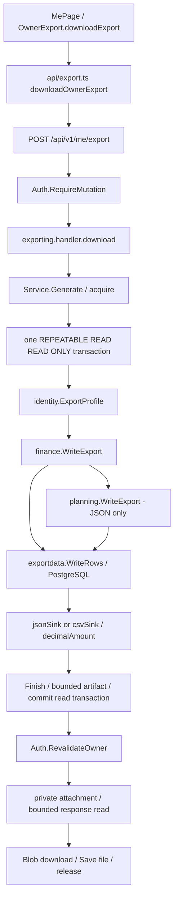

# Me and Owner Data Export — Approved V0.1 Design

**Status:** Accepted with ADR-017. Product Owner approved Me screenshots and actual synthetic JSON/CSV artifacts on 2026-10-20 and authorized Issue #32 commit, push and closure after final checks. Deployment remains separately gated.
**Date:** 2026-10-20
**Issue:** [#32 — Me / Owner Data Export](https://github.com/Faust217/LifeOS/issues/32), created after checking existing issues; local implementation authorized.
**Decision record:** [Accepted ADR-017](adr/ADR-017-owner-data-export.md).

**Final review adjustment:** The Product Owner approved the overall direction in principle and requested additional readable decimal CSV columns. The Product Owner subsequently accepted the revised design and ADR-017 and authorized local implementation.

## Scope and existing behavior

Reuse `apps/web/src/LifeApp.tsx` `MePage`, the current Google-backed LifeOS profile, and sign-out. The stored profile provides email, LifeOS ID and access label; do not invent a display name/photo or add Google scopes. Use the compact Sage Green heading/cards already approved in Money, Today and Plans.

Me becomes the primary timezone management location. The existing `MoneyPage.tsx` timezone presentation is extracted into `apps/web/src/TimeZoneSetting.tsx`; reuse `api/auth.ts` `updateTimeZone`, `PUT /api/v1/me/timezone`, `Auth.updateTimeZone`, and `repository.updateTimeZone`. Move the searchable editor to Me. Money Settings and incomplete-timezone guidance link to `/me#timezone`; Money still requires a confirmed preference before local input/display. Keep the existing browser-zone suggestion, server IANA validation, shell-wide preference update, DST gap/overlap rules and historical-regrouping explanation. Preserve recoverable drafts and focus on cancel/error. No separate timezone rule or migration is needed.

Me provides an **Export my data** section with **Download JSON** and **Download Finance CSV (ZIP)**. Explain: “This file contains private financial and Goal data. Store it somewhere safe. Deleted transactions are excluded.” JSON includes all implemented normal owner data; the CSV package covers Finance only. No language control, localization, profile editing, import, restore UI, new Planning feature or physical deletion is included. The preferences object permits future additions without implementing a language preference now.

## Exact JSON format: lifeos-export-v1

Download one UTF-8 JSON document, without a BOM, with this root shape:

```json
{
  "format": "lifeos-export-v1",
  "format_version": 1,
  "created_at": "2026-10-20T04:00:00Z",
  "owner": {
    "id": "00000000-0000-4000-8000-000000000001",
    "email": "owner@example.invalid",
    "created_at": "2026-10-09T04:00:00Z",
    "updated_at": "2026-10-20T03:00:00Z"
  },
  "preferences": { "time_zone": null },
  "finance": {
    "accounts": [],
    "categories": [],
    "events": [],
    "movements": [],
    "allocations": []
  },
  "planning": { "goals": [], "checklist_items": [] },
  "record_counts": {
    "accounts": 0,
    "categories": 0,
    "events": 0,
    "movements": 0,
    "allocations": 0,
    "goals": 0,
    "checklist_items": 0
  }
}
```

The example is synthetic and empty; the owner ID is illustrative. Root keys shown above are required. Each exported record implicitly belongs to `owner.id`; do not duplicate `owner_id` on every record. The single-owner envelope is not an authorization input.

Common types:

- `id` and relationship IDs: UUID strings, retaining existing values.
- Every `*_minor`: canonical signed base-10 int64 **string**, no leading `+`, decimal fraction, exponent or rounding; zero is `"0"`. Event/allocation amounts remain positive; movements and opening balances can be negative. Never pass through JavaScript `Number`.
- Currency: existing uppercase three-letter ISO 4217 code. Do not combine currencies or add FX conversion.
- Timestamps: RFC 3339 UTC strings ending in `Z`, preserving PostgreSQL precision with up to six fractional digits. Nullable timestamps are JSON `null`; empty collections are `[]`.
- `created_at` at the root: database transaction start time as the generation reference, not a write-completion watermark. All record reads share the snapshot acquired by the first owner/profile read.
- `preferences.time_zone`: saved validated IANA string, or `null` if never confirmed. Export is allowed with `null`; do not substitute a device zone. No unsupported preference or authentication field is synthesized.
- Strings retain stored Unicode/text, including notes and line breaks. JSON has no spreadsheet escaping.

Required record fields (and only the following initial v1 fields):

| Collection | Fields |
| --- | --- |
| `finance.accounts` | `id`, `name`, `account_type`, `currency`, `opening_balance_minor`, `archived_at`, `created_at`, `updated_at` |
| `finance.categories` | `id`, `name`, `kind`, `archived_at`, `created_at`, `updated_at` |
| `finance.events` | `id`, `kind`, `amount_minor`, `currency`, `occurred_at`, `note`, `status`, `voided_at`, `void_reason`, `created_at` |
| `finance.movements` | `id`, `event_id`, `account_id`, `amount_minor`, `currency`, `created_at` |
| `finance.allocations` | `id`, `event_id`, `category_id`, `kind`, `amount_minor`, `currency`, `created_at` |
| `planning.goals` | `id`, `title`, `completed_at`, `archived_at`, `created_at`, `updated_at` |
| `planning.checklist_items` | `id`, `goal_id`, `title`, `completed_at`, `created_at`, `updated_at` |

`owner` contains exactly the four fields in the example. Record names, titles, types, kinds and notes are strings. `account_type` uses the current `cash|bank|ewallet|savings|credit_card|other` values; event kind is `expense|income|transfer`; category/allocation kind is `expense|income`; event status is `posted|voided`. Only archive/completion/Void timestamps and `void_reason` are nullable. For posted events, `voided_at` and `void_reason` are null. For voided events, preserve the stored timestamp and audit string.

`void_reason` is stored **audit text**, which may be server-generated. The current schema does not record reliable author provenance: an explicit reason could equal the default string. Do not add a claimed user/system origin based only on string matching, replace the stored audit string with N/A, or invent a migration in this milestone. The UI may continue its existing N/A presentation.

Include every account/category, including archived and unused ones; every nondeleted posted/voided event and its linked movements/allocations; every Goal (active/completed/archived) and currently retained checklist item. Empty allocations mean Uncategorized. Removed checklist items have no retained row and cannot be reconstructed. Names are the current stored names, not historical name snapshots. Finance records have only the timestamps actually persisted; do not fabricate an event `updated_at`, opening-balance effective date, checklist position or historical balance.

Exclude events with `deleted_at IS NOT NULL`; movements/allocations must join the same owner's eligible event set. Do not include deleted record counts, IDs, notes or receipts. Exclude sessions, CSRF data, Google identifiers/tokens, invitations, access/admin flags, internal logs and operational records. JSON export is normal application portability, not a full database backup or an implemented import/restore format.

Ordering is deterministic: accounts/categories by `created_at ASC, id ASC`; events by `occurred_at DESC, id DESC`; movements/allocations by `event_id ASC, id ASC`; Goals by `created_at DESC, id DESC`; checklist items by `goal_id ASC, created_at ASC, id ASC`. Counts equal array lengths. Every relationship must resolve within this export. Reconstruct current balances using opening balance plus movements of **posted** eligible events; use a wide exact accumulator before checking int64 range. Voided movements are retained history and do not contribute; transfers are not spending. No derived balance/daily-total fields are included.

The export version is independent of `/api/v1` and database migration version 7. v1 readers must tolerate unknown optional keys. Additive optional data may extend v1; removing required fields or changing their type, meaning or visibility requires a new export version and explicit compatibility review. Preserve a documented v1 reader contract and golden fixtures as later modules grow; versioning does not authorize an importer.

## Exact Finance CSV package

One ZIP contains exactly `manifest.json`, `README.txt`, `accounts.csv`, `categories.csv`, `transactions.csv`, `movements.csv`, and `allocations.csv`. No JSON owner-data export is silently bundled; users choose JSON separately. ZIP entries use these fixed safe names and never user-supplied paths. Include archived/unused accounts and categories, so opening balances and linked names remain interpretable even without transactions.

The following lists are the exact CSV header order:

- `accounts.csv`: `account_id,name,account_type,currency,opening_balance_minor,opening_balance_decimal,archived_at_utc,created_at_utc,updated_at_utc`
- `categories.csv`: `category_id,name,kind,archived_at_utc,created_at_utc,updated_at_utc`
- `transactions.csv`: `event_id,kind,status,amount_minor,amount_decimal,currency,occurred_at_utc,occurred_at_local,time_zone,note,account_id,from_account_id,to_account_id,affects_balances,counts_as_spending,voided_at_utc,void_reason,created_at_utc`
- `movements.csv`: `movement_id,event_id,account_id,amount_minor,amount_decimal,currency,status,created_at_utc`
- `allocations.csv`: `allocation_id,event_id,category_id,kind,amount_minor,amount_decimal,currency,status,created_at_utc`

### Decimal amount columns and README examples

Keep every existing minor-unit column unchanged. `opening_balance_decimal` is derived only from the same row's `opening_balance_minor` and currency; each `amount_decimal` is derived only from that row's `amount_minor` and currency. These are readable representations, not independently stored facts or new JSON fields. Obtain the currency's **standard accounting decimal scale** from the existing pinned `golang.org/x/text/currency` metadata (`ParseISO`, then the scale returned by `currency.Standard.Rounding`). Read only the scale metadata: do not apply a rounding increment, call a float-based amount/rounding routine, or use `currency.Cash` rules. Do not assume every currency has two decimal places. An unsupported or unresolved scale fails the export with the existing `500 export_failed` behavior; do not silently fall back to two digits.

Format with integer/string operations only: retain the sign separately from the canonical minor-unit string, left-pad the unsigned digits to at least `scale + 1` digits, and insert an ASCII decimal point before the final `scale` digits. At scale zero, emit the integer with no decimal point. Emit exactly the currency's scale in fractional digits, including trailing zeros. Use ASCII `-` for negative balances/movements, no leading `+`, no grouping, currency symbol, exponent, locale-dependent separator, rounding or truncation. Zero is `0` at scale zero and, for example, `0.00` at scale two; never emit negative zero. String sign handling must support `-9223372036854775808` without overflowing an int64 absolute-value operation.

README must include this table of logical values **after removing the documented CSV text guard**:

| Currency / standard scale | Minor-unit text | Decimal text |
| --- | --- | --- |
| MYR / 2 | `1234` | `12.34` |
| MYR / 2 | `1` | `0.01` |
| MYR / 2 | `0` | `0.00` |
| MYR / 2 | `-1` | `-0.01` |
| JPY / 0 | `1234` | `1234` |
| KWD / 3 | `1234` | `1.234` |
| CLF / 4 | `12345` | `1.2345` |
| MYR / 2 | `9223372036854775807` | `92233720368547758.07` |
| MYR / 2 | `-9223372036854775808` | `-92233720368547758.08` |

Zero examples apply where the domain permits zero, such as an opening balance; expense/income/allocation amounts still obey their existing positive-amount invariant. For the MYR example, the actual CSV monetary cell pair is `"'1234","'12.34"`; a negative movement pair is `"'-1","'-0.01"`. Both columns are guarded text, not formulas. Import them as Text to preserve every digit; converting them to spreadsheet numeric cells can lose precision. JSON remains the authoritative unmodified source.

README must also show a MYR transfer with one transaction row (`100`, `1.00`), a source movement (`-100`, `-1.00`) and destination movement (`100`, `1.00`), and a single MYR expense with two allocations (`70`, `0.70`) and (`30`, `0.30`). These are logical unguarded pairs for explanation. Decimal columns add no rows, do not change kind/status flags and do not make transfers or voided records count as spending. Do not add or infer financial totals from readable columns.

Transactions have **one row per event**, including one row per transfer. For income/expense, `account_id` identifies its single account and both transfer IDs are empty. For transfers, `account_id` is empty; `from_account_id` is the negative movement's account and `to_account_id` is the positive movement's account. `amount_minor` is the original positive magnitude; signed account effects are in movements. Do not split a transfer into two transaction rows. `affects_balances` is `true` only for posted events; `counts_as_spending` is `true` only for posted expenses. The duplicated `status` in movement/allocation CSV rows makes their audit-only voided rows identifiable when opened alone; join by event ID for interpretation, and never treat transfers as expenses.

Each exact category split is one allocations row. Fully Uncategorized events have no allocation rows; transfers also have none. An event with explicit allocations must retain its exact allocation total; no synthetic Uncategorized allocation is added. `movements.csv` is necessary: it preserves stable movement IDs and exact signed account effects without making transaction rows depend on display conventions. Accounts/categories CSV files provide ID-to-name lookup; renames and archive state are current snapshot values.

All CSV dates ending `_utc` use the JSON UTC convention. `occurred_at_local` is RFC 3339 with a numeric offset for the saved owner zone, including DST; `time_zone` is the saved IANA identifier. When the preference is null, both cells are empty and UTC remains populated. Nullable cells are empty. No currency totals or running balances are exported.

Encoding and safety:

- UTF-8 with one BOM per CSV for common spreadsheet use, comma delimiter, CRLF record endings, fixed header, and a final CRLF. Quote every cell; double embedded double quotes. Retain commas and multiline text inside quoted cells. Use one focused, tested quote-all encoder that escapes each field before writing its surrounding quotes and checks every write; verify output with Go `encoding/csv` parsing. Do not concatenate raw text into rows. JSON remains the exact source for original text line-ending distinctions that spreadsheet/CSV readers may normalize.
- Prefix **every user-controlled text cell** (`name`, `note`, `void_reason`) with one ASCII apostrophe, even if already starting with an apostrophe. Prefix every `*_minor` and `*_decimal` cell with one apostrophe as well, to preserve exact digits as spreadsheet text and protect negative decimal values without executable formula wrappers. Apply the guard after deterministic decimal formatting and before CSV quote escaping; a negative value is encoded as `"'-0.01"`, not as a formula or a bare untrusted cell. Null cells stay empty. IDs, controlled enums, booleans, currencies and generated date/zone fields use validated server values. The first apostrophe is a documented CSV display guard; removing exactly one restores the original cell text. JSON remains unmodified and authoritative.
- Quote escaping and text guards must cover formula prefixes, leading controls/whitespace, full-width variants, quotes, separators and embedded newlines in fixtures. Do not emit formula wrappers such as `="..."`. Test initial opening in the supported spreadsheet application and record its version. CSV has no universal cross-application or save/reopen guarantee: warn in README that editing/resaving may remove guards, and import money columns as Text when needed. See [OWASP CSV Injection](https://community.owasp.org/attacks/CSV_Injection).

`manifest.json` is UTF-8 without BOM and contains exactly: `format: "lifeos-finance-csv-v1"`, `format_version: 1`, `created_at` (same generation reference), `owner_time_zone` (nullable), `record_counts` (accounts/categories/transactions/movements/allocations), `files` (the five CSV names in the order above), `csv_encoding: "UTF-8-BOM"`, `csv_text_guard: "apostrophe"`, `minor_units_encoding: "apostrophe-prefixed-decimal-string"`, and `soft_deleted_events: "excluded"`. It contains no email or owner ID. README explains joins, status flags, transfer handling, minor-unit and fixed-scale decimal columns with the examples above, guard removal, timezone/null behavior, the Finance-only scope, and that downloaded copies are outside LifeOS access/revocation controls. The manifest schema and authoritative JSON export schema are unchanged by this pre-acceptance CSV header adjustment; `csv_text_guard` applies to the new decimal columns too.

## Download contract and UX

Use one deliberate same-origin download endpoint:

`POST /api/v1/me/export` with `Content-Type: application/json`, same-origin session cookie, `Origin`, `X-CSRF-Token`, and exactly `{ "format": "json" }` or `{ "format": "finance_csv" }` (1 KiB request maximum). No owner, record-ID, pagination or filter inputs. Reject unknown fields/query parameters, malformed/extra JSON, and the existing owner-override header. Use `Auth.RequireMutation` for the existing full POST guard even though the export transaction is read-only. No database write, export job table, public URL, background queue, object storage or new dependency is introduced. Existing `GET /me` and `PUT /me/timezone` remain the profile/settings contracts.

Success is `200` with a completed, validated artifact:

- JSON: `Content-Type: application/json; charset=utf-8`, `Content-Disposition: attachment; filename="lifeos-export-v1-YYYYMMDDTHHMMSSZ.json"`.
- CSV ZIP: `Content-Type: application/zip`, `Content-Disposition: attachment; filename="lifeos-finance-csv-v1-YYYYMMDDTHHMMSSZ.zip"`.
- Both: exact `Content-Length`, `Cache-Control: private, no-store, max-age=0`, `Pragma: no-cache`, `Expires: 0`, `X-Content-Type-Options: nosniff`. No ETag, shared cache, redirects, user data in filenames, range/resume or CORS exposure. Apply no-store to errors too. Retain the existing request-ID header.

Known failure responses use the normal JSON error envelope, no attachment header and no partial success: `400 invalid_export_request` (including invalid format/unknown input), existing `400 owner_override`, `401 authentication_required`, `403 invalid_origin|invalid_csrf`, `429 export_busy` with `Retry-After: 5`, `422 export_limit_exceeded`, `503 export_timeout|export_unavailable|session_unavailable`, and `500 export_failed` for unexpected serialization/integrity failures. GET/HEAD and other unsupported methods return `405`; unsupported content type returns `415`. Never leak SQL, credentials, record content or internal paths in an error.

Use bounded in-memory artifact generation, streaming rows rather than loading every domain record into slices. Initial bounds: 64 MiB total uncompressed serialized data and 64 MiB final artifact, 120 seconds generation time, one active export per owner and two per API process (held until response finishes/cancels). Exceeding a bound fails the entire export explicitly; no silent truncation. The frontend also enforces the advertised 64 MiB response bound. This bounds the fetch/Blob path on mobile; it does not promise unlimited exports. Test a substantial synthetic dataset and cap boundaries. Larger capacity or a different streaming/download mechanism needs a measured follow-up design; do not add infrastructure preemptively. Server generation uses no disk artifact and the client adds no application-managed persistent cache. The user's saved download and browser/OS storage internals remain outside that guarantee.

Me offers the two format buttons with the privacy notice adjacent. The user action is the download confirmation; do not add repetitive modal prompts. Show pending/cancel/retry status with an accessible live region and disable duplicate clicks. Fetch with `cache: "no-store"`, validate status/type/length, read with an explicit byte cap, then create a Blob/object URL and an attachment link. Offer an explicit Save file link if browser download initiation is blocked; revoke the object URL when replaced, on cancel/navigation/sign-out, and after a bounded save opportunity (five minutes). Revocation releases the app's reference, not a guarantee of physical erasure. Report “Download ready/started”, not proof that a file was saved to disk. Do not cache bytes in localStorage, IndexedDB or a service worker. Errors keep the page and allow a fresh request; partial/aborted bytes never become a successful file. On 401, refresh the shell session and show sign-in. Retries generate a new snapshot, so they may contain later changes; no write idempotency key is needed. A CSV retry and JSON download are separate snapshots and need not have identical timestamps.

## Snapshot and module design

The coordinator opens **one `REPEATABLE READ READ ONLY` PostgreSQL transaction** and acquires its snapshot with the owner/profile/preferences read. All Finance and Planning export readers receive that same transaction and verified `identity.OwnerID`; do not call existing pool-backed list/history methods that would start independent reads/transactions. Domain modules own their SQL and dedicated export projections; a small `internal/exporting` coordinator composes explicit readers and never queries their tables itself. The current UI DTOs omit some persisted timestamps, so they are not a complete export source.

Within that snapshot, stream accounts/categories; eligible events; movements/allocations joined by **both owner and event ID** to nondeleted events; Goals/items. Keep cursors and ordering server-side without UI `LIMIT/OFFSET`, and close each row stream before using the same connection for another query. Validate counts, joins and the existing financial shape; abort on a missing relation or query/serialization error. Build/finish JSON or ZIP fully, check writer/ZIP close errors, and release the database transaction before sending bytes to a slow client. Concurrent writes appear wholly before or after the snapshot; an event deleted after the snapshot may still be in that export. Explain this capture-time behavior. See [PostgreSQL repeatable-read documentation](https://www.postgresql.org/docs/18/transaction-iso.html#XACT-REPEATABLE-READ).

Check session/active owner at entry through the existing guard, then revalidate the same authenticated session/owner immediately before releasing the artifact through an explicit Identity method (`internal/identity/export.go` `Auth.RevalidateOwner`). Fail closed if expired, revoked, disabled or unavailable; never switch owners. Set a separate 120-second response write deadline and honor request cancellation, so a stalled download cannot retain its memory/concurrency slot indefinitely. Bytes already delivered cannot be revoked. Logs keep only request ID, operation/format, result, duration and safe error code, not email, IDs, notes, file contents, cookies or tokens. No AI/MCP export tool is included.

No migration is introduced: the existing v7 schema stores the required data. Do not change opening-balance/backdated semantics, Money arithmetic, Goal lifecycle, or published migrations. Export describes the current approved model; it does not resolve the remaining Finance semantics or pass the Personal Data Ready backup/restore gate. No importer or recovery guarantee follows from this format.

## Actual function-level data flow



| Input → Function | Process → Output → Next function |
| --- | --- |
| Format click → `apps/web/src/OwnerExport.tsx` `OwnerExport.downloadExport` | Pending/cancel state → `apps/web/src/api/export.ts` `downloadOwnerExport`; prevent duplicate clicks and retain retry after errors. |
| Cookie/CSRF/format → `internal/identity/auth.go` `Auth.RequireMutation` | Validate Origin, session, CSRF and owner overrides → `internal/exporting/http.go` `handler.download`; unauthorized requests receive private errors without a file. |
| Verified owner/strict format → `internal/exporting/service.go` `Service.Generate` | `acquire` reserves owner/process capacity; open bounded read-only snapshot → module readers. Error/cancellation rolls back and releases capacity. |
| Snapshot → `internal/identity/export.go` `ExportProfile` | Read active owner/profile/timezone → `internal/finance/export.go` `WriteExport`; missing owner/invalid zone fails closed. |
| Same transaction/owner → Finance `WriteExport`, `internal/planning/export.go` `WriteExport` | Explicit complete projections → `internal/platform/exportdata/records.go` `WriteRows`; check retained ledger shape, omit deleted events/children, preserve archives and Void text. Planning is N/A for Finance-only CSV. |
| Query/owner → `WriteRows` | PostgreSQL rows in stable order → sink `Begin`, `Row`, `End`; timestamps become UTC microsecond strings, money stays integer text, row/query/write errors abort. |
| Record → `internal/exporting/json.go` `jsonSink.Row` or `internal/exporting/csv.go` `csvSink.Row` | Exact v1 fields or fixed guarded CSV headers; `decimalAmount` uses currency scale plus digit operations → `Finish`; writer/ZIP/cap failures return no artifact. |
| Completed buffer → `handler.download` / `internal/identity/export.go` `Auth.RevalidateOwner` | Commit read transaction, recheck same cookie's active owner/session → private fixed attachment with separate write deadline; `Artifact.Close` releases capacity after network completion/error. |
| Complete HTTP bytes → `downloadOwnerExport` / `OwnerExport.downloadExport` | Validate MIME/name/length and bounded stream → Blob plus automatic download/explicit Save file. Abort/truncation never creates a successful file; 401 refreshes shell auth. URLs expire after five minutes or release on replacement/unmount/cancel. |

Database writes are **N/A** for export: PostgreSQL enforces a read-only transaction. No new export repository owns another module's SQL: dedicated module projections use the caller's shared transaction. Timezone saving remains `apps/web/src/TimeZoneSetting.tsx` `save` → `api/auth.ts` `updateTimeZone` → `internal/identity/auth.go` `Auth.updateTimeZone` → `internal/identity/repository.go` `repository.updateTimeZone`; the shell updates the same preference used by Money and Today. Detailed errors, reading order and tests are in [the learning journal](../learning/journal/2026-10-20-me-owner-data-export.md).

## Verification and Product Owner acceptance

- [x] ADR-017 accepted and local implementation authorized; ADR-015 remains Proposed. Exact JSON and revised CSV field orders are retained.
- [x] Full Go suite: 112 passed tests/subtests, no actual test skipped; all seven integration DSNs pointed at distinct fresh disposable databases. `go vet` passed. Additional export-only run on another fresh database passed after adding HTTP 429/Retry-After and ZIP-cap assertions.
- [x] Frontend: 46 tests, TypeScript checks and production build passed. Windows sandbox Temp/SSR ENOENT failures were isolated by a successful full rerun outside the sandbox; no product workaround was added. Golden producer JSON Schema rejects secrets, numeric money and non-UTC timestamps; API tests cover byte limits/truncation/cancel/guard errors. OpenAPI lint/generated checks passed with only the two existing OAuth redirect warnings.
- [x] Existing migration chain v1–v7 and repeat-up verification passed on a fresh disposable target. No migration changed or was added; no personal database was accessed.
- [x] Real guarded Go/PostgreSQL tests cover all collections, stable relationships/counts, empty/other owner, archives, voided/deleted/Uncategorized/split/transfer records, integer boundaries, exact 0/2/3/4-scale decimals and guarded CSV parsing. A 10,029-event dataset produced a complete 4,988,425-byte JSON and approximately 629 KB ZIP without UI pagination.
- [x] Database snapshot settings were queried and a write was rejected. Deterministic concurrent account/Goal rename, timezone update and Finance Delete produced an all-old export; a fresh export saw the later changes. Session revocation before release returned 401 without an attachment. Expired/disabled/revoked/mismatched owners, Origin/CSRF, request overrides, privacy headers, slot release, scaled size/time bounds, injected failure and cancellation passed.
- [x] Windows Edge browser: native JSON/ZIP downloads, private profile, saved timezone with different device zone, first setup/search/reload, focus/Escape, Money links, navigation, no overflow at 320/390/1280px, errors/retry/cancel, sign-out and expired-session cleanup passed. A separate check blocked the automatic click and verified that a user gesture on Save file produced a valid native JSON download. Responsive sizes are desktop emulation, not physical phone tests. DST gap/overlap tests remain in the full frontend suite.
- [x] Synthetic sample ZIP was parsed with Go and Python CSV/ZIP readers; exact headers, BOM, guards, IDs, status and decimal-to-minor reconstruction checked. Actual Excel/LibreOffice initial-open and iOS/Android browser tests were **not run**; no cross-platform spreadsheet or mobile download guarantee is claimed. Editing/resaving CSV may remove text guards.
- [x] Codebase Map, Project State, issue and English learning journal document actual functions. `git diff --check` passed. Generated samples/screenshots/fixtures stay ignored under `.cache/issue32/`.
- [x] Product Owner approved the 320px/390px/desktop UI and independently reviewed actual synthetic JSON/CSV artifacts: structure/counts, matching IDs/relationships, transfers/splits, archives/Void, int64/currency scales and ZIP/CSV encoding/guards. Final delivery is authorized; the issue records the delivered commit and closure. Deployment and Personal Data Ready recovery/upgrade remain separate.

Final delivery checks repeated the full Go suite (112 passed tests/subtests, zero actual skipped tests) against seven additional fresh disposable databases, plus `go vet`, all 46 frontend tests, typecheck/build, contracts and diff checks. The last browser check found keyboard focus could scroll behind the fixed mobile navigation; a Me-only `scroll-margin-block-end` rule at the existing 800px mobile breakpoint corrected it without changing visual layout or navigation. At 320×568, 390×844 and 800×600, the full privacy notice was readable after scrolling, both export buttons passed unobscured hit checks and native touch downloads, and Tab focus stayed above the bar. No further cosmetic changes were made.

Tests do not establish unlimited export capacity, universal spreadsheet safety, a new live Google login check or measured peak RSS. Serialized raw/output caps are enforced; runtime/buffer overhead and browser Blob overhead also consume memory. A snapshot acquired before a concurrent deletion can legitimately include that event; previously downloaded copies cannot be revoked.


## Issue #33: accepted native v2 dated account support

Accepted [ADR-018](adr/ADR-018-opening-balance-effective-instant.md) adds v2 alongside the immutable v1 specification above. The Me UI now explicitly requests v2. `POST /api/v1/me/export` accepts `export_version: 1 | 2`; omission remains v1. An owner with any dated account (including archived accounts) receives HTTP 409 `export_version_incompatible` for v1, with no file. Legacy-only owners retain v1. Do not silently rebase amounts or omit pre-date events.

**JSON:** root `format="lifeos-export-v2"`, `format_version=2`; every v1 root/module/record field is retained. Each account additionally requires `opening_balance_basis`, `opening_balance_at`, `opening_balance_confirmed_at`. Basis is `legacy_all_movements` with both dates null, or `known_balance_before_instant` with both dates UTC. See `api/export/lifeos-export-v2.schema.json` and its independent synthetic golden. Events, movements, allocations, Goal relationships and exact money stay unchanged; internal balance revisions and conversion evidence are excluded. The original v1 schema/golden remain byte-for-byte unchanged.

**Finance CSV ZIP:** same seven filenames; manifest `format="lifeos-finance-csv-v2"`, `format_version=2`. Only the accounts header changes, in this exact order:

`account_id,name,account_type,currency,opening_balance_minor,opening_balance_decimal,opening_balance_basis,opening_balance_at_utc,opening_balance_confirmed_at_utc,archived_at_utc,created_at_utc,updated_at_utc`

All other CSV headers, apostrophe text/amount guards, BOM, CRLF, quote-all escaping, integer/string decimal conversion and privacy limits remain as v1. Legacy dates use empty cells. README explains both account formulas; `affects_balances` retains event-level posted eligibility, and consumers must additionally apply each account's date to each joined movement. It does not promise that both transfer legs contribute against different starting assertions. `counts_as_spending` includes posted pre-date expenses; dates are not spending filters. No running balance is exported.

**Reconstruction:** legacy opening + every posted visible movement; dated opening + posted visible movements whose event UTC occurrence is on/after that account's date. Before-date events remain exported and may count in spending. Void contributes zero; Soft Deleted events/children remain excluded. One transfer stays one event. The same read-only repeatable-read snapshot, bounded generation, guarded Origin/CSRF/owner access, session revalidation and private no-store response cover both versions. A concurrent conversion cannot mix old opening values with new dates in one artifact. No import/restore capability is added.

Previously downloaded v1 artifacts retain their original meaning. Later Edit revision support needs a separate version review. Physical iOS/Android and Excel/LibreOffice remain unverified; no new platform guarantee is claimed. Local #33 samples and screenshots are ignored review artifacts, not personal data.

### Original v1 review references

- Accepted [ADR-009](adr/ADR-009-import-export-bluecoins.md), [ADR-013](adr/ADR-013-life-first-multi-user-rebaseline.md), [ADR-014](adr/ADR-014-google-identity-invitations-owner-isolation.md), [ADR-016](adr/ADR-016-financial-event-soft-delete.md) and [V0.1 Scope](V0.1_SCOPE.md).
- [ADR-015](adr/ADR-015-personal-import-boundary.md) is Proposed and unrelated to approving Export implementation.
- [Go encoding/csv](https://pkg.go.dev/encoding/csv), [OWASP CSV Injection](https://community.owasp.org/attacks/CSV_Injection), and [PostgreSQL transaction isolation](https://www.postgresql.org/docs/18/transaction-iso.html).

## Atomic Edit compatibility (ADR-020)

Issue #35 retains the exact JSON/CSV v1/v2 schemas and golden fixtures. Each artifact is a snapshot of current visible events and current movements/allocations; editing a posted event keeps its event ID and changes that current state. Existing relationship IDs stay stable; changed relationships have new current child IDs. Internal revision snapshots, event concurrency tokens and request markers are excluded. Visible Voided records retain their stored text; Soft Deleted events and dependents stay excluded. The existing read-only repeatable-read export transaction prevents mixing pre-edit headers with post-edit children. No audit export or export v3 is introduced. ADR-018's restriction on exporting anchored accounts as v1 still applies.
