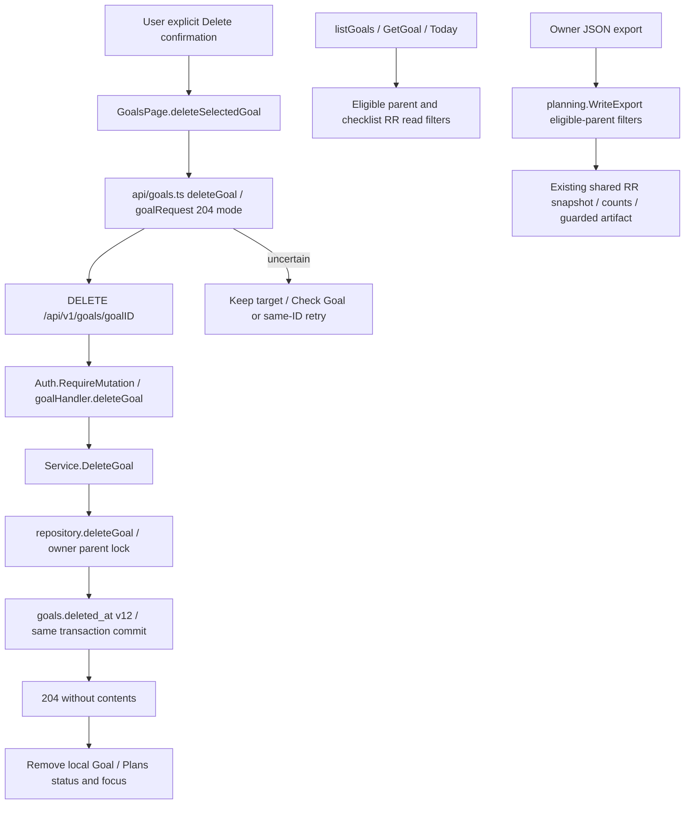

# Issue #38 — Safe Goal Delete

**Status:** Accepted under ADR-021; implemented and final regressions passed. The Product Owner manually verified successful Goal deletion and approved final delivery on 2026-11-04. Commit/push/closure are authorized after checks; deployment and personal-data operations remain unauthorized.

**Baseline:** Finance/Planning schema v11, commit `98ec25af204d55c8928d7bcb465a0e1dff464445` (Issue #36 delivered).

**Issue:** [#38](https://github.com/Faust217/LifeOS/issues/38). **Accepted decision:** [ADR-021](adr/ADR-021-goal-soft-delete.md), including the explicit export compatibility exception below. ADR-015 remains Proposed. Existing accepted ADR files remain unchanged.

## 1. v11 findings reviewed before implementation

- `internal/planning/service.go` / `repository.go`: Goals are independent of Finance. A Goal has completion/archive timestamps but no deletion marker. `listGoals` reads parents and children in one read-only REPEATABLE READ transaction. `GetGoal` reuses this query.
- Checklist mutations use `withEditableGoal` -> `lockGoal` (parent `FOR UPDATE`) before child writes. Completion uses the same parent lock. Rename/archive/restore use single parent UPDATE statements, which already take row locks. All bind both owner and record IDs.
- Migration `000005_goals` has `(owner_id, goal_id)` checklist references with `ON DELETE RESTRICT`. No current Finance or other module references a Goal. Earlier checklist Remove physically removes that individual item; this proposal neither reconstructs those old items nor changes that workflow.
- `http.go` registers shared `Auth.RequireRead` / `Auth.RequireMutation` guards. The latter repeats session, Origin, CSRF and owner-override checks. Goal state conflicts and safe not-found errors already exist.
- `GoalsPage.tsx` reads `listGoals` for both list and detail presentation; detail selection is local. `GoalCard` has separate editing drafts. Its existing `mutate` expects a returned Goal, so it must **not** receive a successful empty Delete response.
- `TodayPage.refresh` also calls `listGoals`; `activeGoalsOnly` then excludes completed/archived Goals. No new Today endpoint/client deletion rule is needed.
- `planning.WriteExport` currently exports every retained Goal and item. Both JSON versions call it inside the export coordinator's single read-only REPEATABLE READ snapshot. Finance CSV skips Planning entirely.
- `api/goals.ts` currently parses JSON for every successful operation. A new 204 Delete needs explicit no-content handling without changing the other operations' response expectations.

## 2. Minimal domain and visibility rules

Add one nullable `goals.deleted_at` timestamp. `NULL` means normally visible; non-null means deleted. Active, completed, archived and completed+archived Goals are all deletable, including a Goal with no items. Archive/Restore and completion stay distinct.

First Delete changes only the owned parent marker and `updated_at`, using one server timestamp. Preserve the Goal ID/title, completion/archive timestamps and **all checklist rows then present**, their IDs, content, timestamps and owner/parent relationships. Do not touch Finance tables, financial request markers, account balances or owner History revisions. Do not fabricate a completion, archive, audit snapshot or deletion receipt.

Ordinary Plans lists (including Archived), Goal details and normal owner JSON exports exclude deleted parents and their children. Existing completion/archive filtering still applies to visible Goals. No `include_deleted`, Trash, Undo/undelete or internal-history API is added. An otherwise valid direct detail/mutation request against a deleted parent returns the same 404 as an unknown/foreign Goal. The one explicit exception is repeat **Delete of the same owned retained Goal**, which returns idempotent 204.

Reads that acquired an earlier snapshot may finish with the pre-delete Goal/checklist. Fresh snapshots after commit exclude them. This is not instantaneous revocation of another tab's already rendered contents or a previously downloaded file. Today refetches on normal navigation/refresh; no cross-tab bus/polling/cache infrastructure is added.

## 3. Exact implemented API

`DELETE /api/v1/goals/{goalID}`

- Same-origin authenticated session; normal `Origin` and `X-CSRF-Token` protections through `Auth.RequireMutation` on **every** request/retry.
- No query parameters, no request body (reuse `validQuery` / `emptyGoalBody`), no client owner field. Existing UUID syntax validation applies; unknown query/body/owner overrides are rejected. No Content-Type is required for an empty body.
- No financial `Idempotency-Key`, `If-Match`, new Goal revision or receipt. The immutable target Goal ID and terminal persisted marker make this command naturally retryable. This does not change any Finance API/key/precondition contract.
- First owned Delete: **204 No Content**, after commit. Repeated owned Delete: identical 204, with the original `deleted_at` and `updated_at` unchanged. There is no Goal DTO, marker, checklist content or provenance acknowledgement in the response.
- Unknown or foreign valid ID: **404** `{ "error": { "code": "not_found", "message": "Goal record not found" } }`, identical to an otherwise valid deleted-Goal GET/mutation. A retry's 204 describes the retained desired state, not proof of which attempt committed.
- All results remain `Cache-Control: no-store`, including shared guard denials. Do not log titles, checklist text, request bodies or raw SQL errors.

| Status / code | Contract |
| --- | --- |
| 204 / empty | First Delete or repeat owned Delete; never parse JSON |
| 400 / `invalid_input` | Malformed Goal ID, nonempty body or disallowed query; use existing no-body error behavior |
| 400 / `owner_override` | Existing guard rejects owner selectors |
| 401 / `authentication_required` | Missing, expired, revoked or disabled-owner session |
| 403 / `invalid_origin` or `invalid_csrf` | Existing mutation guard denies request |
| 404 / `not_found` | Unknown/foreign target; or a valid non-Delete operation on a deleted parent |
| 500 / `internal_error` | Database/commit/deadline/lock failure; neutral existing Goal error, never claim a mutation did not commit |
| 503 / `session_unavailable` | Shared session validation unavailable |

No special 409 is needed for Delete: completed/archived states are eligible. Existing 409 `conflict` still applies to prohibited mutations of **visible** completed/archived Goals. Structural/authentication errors can precede target lookup; a malformed request is not promised a 404 merely because its ID happens to be deleted.

OpenAPI adds this operation to the existing Goal path, with an empty 204 response and the error contracts above. Generate TypeScript normally. Existing Goal DTOs do not expose `deleted_at`; other Goal operation response schemas remain unchanged.

## 4. Atomicity and concurrency

**`repository.deleteGoal`:** use one READ COMMITTED transaction with a 10-second context, 2-second lock timeout and 8-second statement timeout. Lock exactly `(owner_id, id)` with `SELECT deleted_at ... FOR UPDATE`, intentionally including an already-deleted owned row. Missing/foreign -> `ErrNotFound`. If already marked, commit without any UPDATE. Otherwise set marker/updated timestamp once and commit. Roll back failures/cancellation using a short cleanup context independent of cancelled request context. A client response loss or commit error remains an uncertain outcome; retrying the same Goal ID is safe.

**Existing mutation protections to extend:**

- `lockGoal`: add `deleted_at IS NULL` before `FOR UPDATE`; checklist writes and completion then fail 404 before inspecting/modifying children.
- `renameGoal`, `archiveGoal`, `restoreGoal`: add `deleted_at IS NULL` to their owner-scoped UPDATE predicates. Their implicit parent row locks serialize with Delete and PostgreSQL rechecks the predicate after a wait. No need to convert all these single statements into a new generic transaction framework.
- No new lock order: parent before existing child writes; Delete takes only the parent lock. No Finance advisory lock/history bump, global owner mutex or infrastructure.

| Competing operation | First operation commits | Required outcome |
| --- | --- | --- |
| Delete / Delete | Either Delete | Both 204; one marker/timestamp transition, no child writes |
| Add/rename/check/uncheck/remove item / Delete | Checklist mutation first | Existing valid mutation may commit; Delete then retains the current remaining checklist and hides it |
| Delete / checklist mutation | Delete first | Mutation waits/rechecks parent, then 404; no child write |
| Complete/reopen/archive/restore/rename / Delete | Other mutation first | Preserve its committed state internally, then delete the same Goal |
| Delete / any ordinary Goal mutation | Delete first | 404; cannot reopen/restore a deleted Goal |
| List/detail/export / Delete | Read snapshot first | Coherent old parent+children allowed; fresh read excludes both |

Confirmation targets the same Goal ID's latest committed checklist, not a frozen checklist revision. Delete is terminal, so a checklist change that wins the lock first does not cancel a later confirmed Delete. This trade-off is explicit: no optimistic Goal revision/extra confirmation is proposed.

Existing services often commit a mutation and then call `GetGoal` separately for the response. If Delete wins between those steps, that mutation may return 404 despite its earlier successful commit. Preserve this safe terminal not-found behavior; do not describe it as proof of rollback or introduce a broad response-snapshot refactor. No already completed response/file is revoked.

## 5. Read and export changes; compatibility approval

**Normal Planning:** `listGoals` filters `goals.deleted_at IS NULL` before ordering. Its child query joins `(owner_id, goal_id)` to the same eligible parents in the existing RR snapshot, rather than loading deleted children and merely dropping them in React. `GetGoal` naturally becomes not-found. Every checklist route must pass the filtered parent lock; individual child IDs never bypass it. Reuse `listGoals` for Plans and Today; do not add a client-only deleted flag or Finance changes.

**JSON v1/v2:** `planning.WriteExport` filters eligible parent Goals; checklist export joins the same owner's eligible Goal set in the caller's existing RR transaction. Keep active/completed/archived visible Goal records, exact field order/types, UTC times, stable IDs, array ordering, counts and resolvable relationships. Export neither deleted parents nor their child content/IDs/counts/marker. No audit/Trash export is added. Concurrent Delete can yield the complete old set if the snapshot predates it, or no parent/children if later; never orphaned children.

**Finance CSV v1/v2:** no Goals/checklists exist in these ZIPs and `exporting.Service.Generate` skips `planning.WriteExport` for CSV. No CSV/manifest/column or money change. ADR-018's existing v1 eligibility restriction for anchored accounts remains.

**Accepted compatibility decision:** ADR-021 explicitly supersedes ADR-017's visibility/version rule only for the newly introduced deleted-Goal state. Normal JSON v1/v2 excludes those parents and children without a version bump. Existing schemas, field meanings/order, goldens and visible active/completed/archived Goals remain unchanged. ADR-017's historical file is untouched; all other versioning rules still apply. This grants no permission for future unrelated unversioned changes. No v3 is introduced.

Normal owner JSON is not a complete database backup. Retained internal rows, old backups and earlier exports can contain deleted Goals; restoring an older backup may make them visible again. The existing Personal Data Ready restore/reconciliation gate remains mandatory.

## 6. Implemented v12 migration and future activation

- Forward migration `000012_goal_soft_delete.up.sql` adds nullable `deleted_at timestamptz` to `goals`. No default/non-null backfill, new table, FK change, child marker, index or ledger migration. Existing rows remain visible; never infer deletion from archive/completion.
- Keep existing owner/date and checklist-parent indexes initially; Goal volumes are personal-scale. Use eligible-parent joins and add no index without evidence of need.
- Down must lock the Goal table (bounded lock timeout), refuse if any deleted marker exists, and only then remove the column. Otherwise a down would resurrect hidden Goals. This is not a production rollback strategy; forward correction is preferred after use.
- Upgrade tests use populated v11 data, preserve every parent/child/Finance/History/audit/key fact, and exercise repeated up and guarded down. `migrations.CurrentVersion` is now 12; readiness rejects older schemas. Published migrations v1-v11 remain untouched.
- **Coordinated activation is mandatory:** stop/drain old API/Planning readers/writers and export generators before activating v12/new API/UI or enabling Delete. Old binaries do not filter the marker. v11's Finance writer fence does **not** protect Goals; readiness alone does not stop an already-running old reader/writer. This minimal proposal adds no separate Planning fence/mixed-version protocol and makes no rolling-compatibility promise. Mixed-version operation would need separate design.

v12 was applied only to newly created disposable databases during local verification. No personal or production database was accessed.

## 7. Implemented compact UI and client states

Expose one subordinate **Delete Goal** action in `GoalCard` detail for active, completed and archived Goals. Keep current cards/status/archive/restore/checklist UX, Sage Green identity and bottom navigation. No More menu, Trash page or new UI library.

Reuse the existing inline confirmation pattern, with a labelled group and concise text:

> Delete “{Goal title}” and its checklist from LifeOS? You cannot undo this in the app. Data may remain in internal storage, backups or earlier exports.

Buttons: **Keep Goal** (initial focus) and destructive **Delete Goal**. Escape/Keep before sending closes the confirmation and returns focus to its trigger. This is an inline group, not a modal: no false dialog role/focus trap/background scroll lock. Preserve existing rename/item drafts when opening/cancelling or encountering recoverable errors. Disable competing mutations while confirming/sending/reconciling this target, without clearing their inputs.

Use a small Goal-only in-memory attempt in `GoalsPage`, separate from `View`/refresh and from Finance recovery: `{ targetGoalID, phase, error }`, scoped to the authenticated page instance. The target is frozen while unresolved. Do not route 204 through `mutate`, which upserts a Goal DTO. Dedicated `deleteSelectedGoal` handles it.

| State | UI and transition |
| --- | --- |
| `closed` | Delete Goal opens `confirm`; never sends from one accidental tap |
| `confirm` | Keep/Escape retains Goal/drafts; explicit Delete enters `sending` |
| `sending` | One in-flight gate, disabled competing controls, Deleting…; no false promise that Cancel can undo the server operation |
| `error` | Definitive pre-operation 4xx: retain confirmation/drafts, show accessible error; Keep or appropriate retry after protection repair |
| `uncertain` | Network failure, client timeout, unexpected 2xx or 5xx: “The delete may have completed. Check this Goal or retry safely.” Keep the exact target; offer Check Goal / Retry deletion of that same ID |
| `done` / `unavailable` | 204 -> remove locally, announce deletion and return to Plans. Safe 404 -> generic no-longer-available state, not proof that this particular request deleted it |

- Transport: `deleteGoal` calls `goalRequest<void>` with explicit expected-no-content behavior. Accept exactly 204 without parsing JSON. Existing Goal-returning calls keep their JSON requirements; unexpected 2xx is uncertain, not accepted as deletion success. Apply a Delete-only 15-second AbortController deadline; abort does not prove rollback.
- Check Goal is an authenticated GET. 200 means visible **at that read's snapshot**, not proof that the old Delete cannot commit later; keep unresolved state and competing edits blocked until same-target retry settles it or the user leaves. 404 means unavailable; 401 invokes session recovery; 403/503 remain safe errors. A later retry failing authentication does not disprove an earlier uncertain commit.
- A refresh never clears an unresolved attempt or treats it as acknowledged. Navigating away/reload/session expiry may lose this in-memory UI context; do not promise durable command recovery. The persisted marker and fixed Goal ID still make a later same-target Delete safe, without keys/storage/receipts. Auth-owner change discards the old page/attempt; never auto-retry under another session/owner.
- On 204, remove the Goal from local data before any follow-up read; a failed list refresh must not put it back. Use the app's existing full-navigation model to replace the detail URL with `/plans#goal-deleted`. Consume/clear only that generic fragment in Plans, show `Goal deleted.` as a status and focus the Plans heading/status after mount. No private Goal title/ID or server data in the fragment/storage. If navigation fails, keep the success state with a Return to Goals link. Generic not-found recovery uses a no-longer-available notice, not the success fragment.
- Today/Plans subsequently obtain filtered server data. Do not promise immediate synchronization of other open tabs or touch pending financial commands.
- At 320px/390px/desktop: long titles wrap; controls stack/wrap with at least 44px targets; retain readable type/contrast and bottom-nav scroll/focus clearance. Delete stays secondary. Test keyboard, Escape, Tab order, focus restoration, screen-reader status/errors, scroll and mobile keyboard reachability. Rendered browser/physical-mobile checks remain unverified because the browser access host/native pipe is unavailable.

## 8. Actual function-level flow

These are actual implementation names. The English [function-level journal](../learning/journal/2026-11-04-safe-goal-delete.md) records inputs, errors, tests and verification limits.

| Input -> function/path | Process -> output -> next |
| --- | --- |
| Confirmation -> `apps/web/src/GoalsPage.tsx` `deleteSelectedGoal` | Freeze target; one in-flight attempt; retain drafts -> `api/goals.ts` `deleteGoal` |
| Target/CSRF -> `goalRequest` **204 mode** | Empty guarded DELETE; bounded client wait -> `internal/planning/http.go` `RegisterRoutes` / `goalHandler.deleteGoal` |
| Request -> `internal/identity/auth.go` `Auth.RequireMutation` **existing** | Session/Origin/CSRF/owner-override checks -> handler receives only server OwnerID |
| Valid owner/ID -> `internal/planning/service.go` `Service.DeleteGoal` | Owner/UUID validation -> `repository.deleteGoal` |
| Owner/ID -> `internal/planning/repository.go` `deleteGoal` | Parent lock, marker once or owned no-op, commit/rollback -> 204 or neutral error |
| 204 -> `GoalsPage.deleteSelectedGoal` | Remove local record; generic Plans success route/focus; never upsert undefined -> filtered list |
| List/detail -> existing `ListGoals` / `GetGoal` / `repository.listGoals` **filters** | One RR visible parent/child set -> Plans and `TodayPage.refresh` / `activeGoalsOnly` |
| JSON export -> existing `internal/exporting/service.go` `Service.Generate` / `planning.WriteExport` **filters** | Existing common RR and final session revalidation; exclude hidden parent/children -> unchanged JSON shapes |
| Finance CSV/business writes | **N/A:** Planning is not in CSV; Goal deletion has no Finance side effect or History revision increment |

## 9. Acceptance gates

1. Fresh disposable PostgreSQL only: populated v11->v12 upgrade, full v1-v12 chain, repeat-up, null-preserving data digests, no-marker down/re-up, marked-row down refusal and lock-wait/rollback protection. Never delete old test DBs.
2. Delete empty/active/completed/archived/completed+archived Goals; preserve parent ID/state and every current checklist row/relationship; first marker and updated timestamp stable on duplicate/concurrent retry. Other owner/Goal data unchanged.
3. List/detail/Today exclusion, generic direct-link not-found and **every** Goal/checklist mutation rejected after deletion, including Rename/Archive/Restore/Complete/Reopen/Add/Rename/Toggle/Remove step. Validate owner/query/body/auth behavior before record lookup as specified.
4. Deterministic concurrency barriers for both lock orders of Delete vs each checklist action, completion/reopen, rename, archive/restore; duplicate Deletes; transaction cancellation, lock/statement timeout, injected update/commit failure and response loss. No child mutation after committed deletion, no undelete, no partial marker. Account for mutation-follow-up-GET race honestly.
5. Real guarded API: sessions/expired/revoked/disabled users, wrong/missing Origin/CSRF, cross-owner and missing IDs, empty 204, no body/query/owner bypass, repeat after restart/lost reply, no sensitive error/log contents. No client-supplied ownership or financial idempotency path.
6. JSON v1 and v2: old schemas/goldens unchanged, visible archived/completed Goals still included, deleted Goal and all its child IDs/content absent, counts/relationships exact, empty Planning export and cross-owner isolation. Hold snapshots across concurrent Delete to prove whole old or whole new parent/checklist set. Session revalidation/bounds/cancel/download behavior unchanged. Finance CSV v1/v2 remains Finance-only and passes all existing precision/transfer/Void/Soft Delete cases; no new v3.
7. Freeze Finance balances, spending, event/movement/allocation/audit/key data and History epoch/revision before Goal Delete; assert unchanged afterward and that an existing same-owner History continuation remains valid. Existing Goals/Finance/export regressions still pass.
8. Frontend: explicit confirmation in all Goal states, cancellation/draft preservation, double-click gate, no JSON parse for 204, unexpected success/network/timeout handling, same-target retry, GET-200 uncertainty retained, safe 404, session-owner change, confirmed-delete/list-refresh failure and success focus/navigation. Do not clear or replay Finance pending state.
9. Real preview at 320px/390px/desktop with long Goal/step titles, empty states, bottom navigation, keyboard/touch/focus/scroll/error recovery. Record actually tested platforms and any blocked browser/physical-mobile checks; never label DOM tests as rendered passes.
10. Full Go tests/vet, frontend tests/typecheck/build, OpenAPI lint/generated checks, migration/export/diff checks. Update Codebase Map, Project State and an English implementation journal with actual function names/Mermaid and evidence. Final local review precedes separate commit/push/closure authorization.

## 10. Decisions and boundaries

The Product Owner accepted the owner-scoped marker/parent-lock/204-retry design and ADR-021's narrowly stated export visibility exception. No further domain alternative is pending. No general Trash, hard cascade, Goal revision/audit system, financial idempotency for Goals, new service/cache/queue, Finance modification or extra export format is included.

Backups/old exports may retain a Goal; restoring an old backup can reintroduce it. Preserve this fact in the general Personal Data Ready restore/reconciliation gate. No separate deletion inventory, retention daemon, recovery UI or Backup/Restore implementation is authorized.

Implementation and final automated verification are complete. The Product Owner manually tested successful Goal deletion and approved final delivery on 2026-11-04. The commit SHA and closure result are recorded in Issue #38 after remote synchronization. No deployment or personal-data operation is authorized.

## 11. Final verification and Product Owner acceptance (2026-11-04)

- Full Go suite: **217 passed tests/subtests**, one intentional opt-in History benchmark skip; **go vet passed**. Twelve fresh PostgreSQL 18.6 databases were retained, prefix `lifeos_i38_full_20261104_080138_*_test`.
- New Goal integration tests cover all five lifecycle variants, complete deleted-parent mutation rejection, owner/session/Origin/CSRF denials, stable duplicate timestamps, cancellation, injected UPDATE/COMMIT rollback, parent-lock timeout and **22 deterministic parent-lock race cases** (11 operations in both orders).
- Populated v11→v12 and no-marker down/re-up pass. Marked down refuses without losing markers. Full migration chain/repeat-up/smoke down pass on retained `lifeos_i38_chain_20261104_080140_test`.
- Both JSON versions prove complete old snapshot vs fresh excluded Goal+children during concurrent deletion; visible archived/completed records and exact relationships remain. Finance CSV data is unchanged. Finance table digests, account balance and an existing History continuation remain unchanged across Goal deletion.
- A separate real HTTP preview check covered active/completed/archived deletion, repeated empty 204, GET 404, list/export exclusion, committed-but-dropped reply and same-ID retry. Restarting only the task-owned Go API and retrying again returned 204 with original deletion/update timestamps unchanged.
- All 112 frontend tests, typecheck/build and OpenAPI/generated checks pass (two existing OAuth warnings). Unit/SSR/state tests are not evidence of rendered mobile focus/scrolling.
- Synthetic production-bundle preview: `http://127.0.0.1:5207/__test_login_owner`; width review wrappers: `/__review/320`, `/__review/390`, `/__review/1280` after synthetic login. Separate visible review Goals remain active, completed and archived.
- **Product Owner manual check:** successful Goal deletion was tested and approved. This is functional acceptance, not a claim of full responsive/accessibility coverage.
- **Unverified:** full rendered 320px/390px/desktop checks, automated screenshots, interactive keyboard/focus/draft/scroll behavior and physical mobile. Normal browser inventory failed with `The browser access host is unavailable` and native pipe error 2. No browser security restriction was bypassed.
