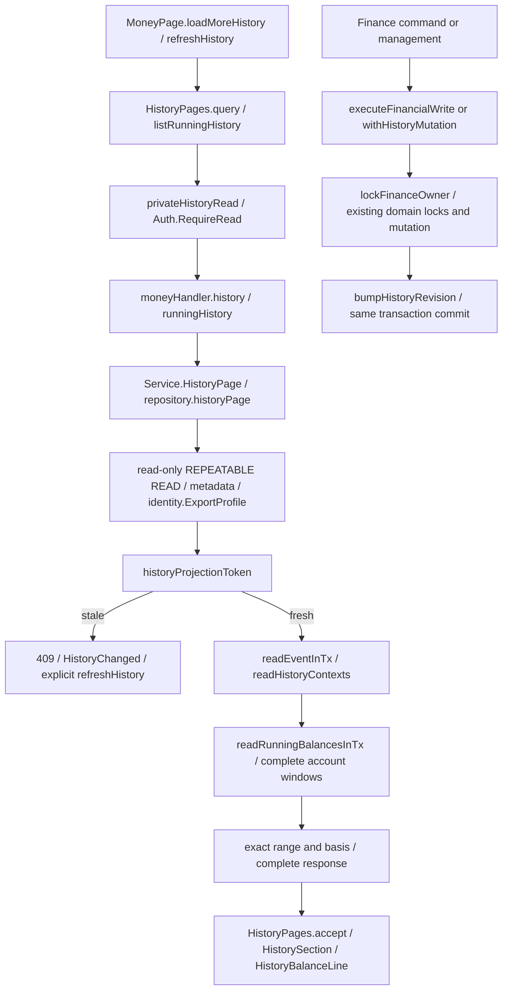

# Issue #36 — Historical Account Balances and Stable History Pages

**Status:** Design and implementation accepted. The Product Owner passed manual 390px/continuous-History review and authorized final verification, commit, push and closure on 2026-11-04. Final checks passed; The delivery SHA and closure will be recorded in Issue #36 after commit, push and remote verification. Personal-data operations and deployment remain unauthorized.

**Date:** 2026-11-02

**Baseline:** v10 / Issue #35 commit `bfd75b4d6b194277a1f861b6fd8a1922b0c64aeb`.

**Issue:** [#36 Historical Per-Account Running Balances](https://github.com/Faust217/LifeOS/issues/36).

## 1. Scope and existing decisions

Add server-derived balance-after information to compact Money History and detect changes between pages. Preserve one current FinancialEvent and its current children, complete allocations, per-account currencies/anchors, archived references, owner isolation, Edit, confirmed Soft Delete, idempotent recovery and normal export v1/v2. **Do not restore an ordinary Void action or add a More menu.** Historical Voided records remain visible, labelled and non-effective. No charts, search/filter feature, daily totals, stored balance cache, audit viewer, export v3, new infrastructure or unrelated UI work.

Accepted ADR-018 already defines the historical formula, equal-time order, pre-anchor reconstruction caveat and legacy anchor requirement. ADR-020 defines current-only calculations and coherent per-response reads; ADR-016 and ADR-019 retain deletion/replay semantics. This implementation applies those decisions. **No new domain ADR is required:** the owner counter/epoch is operational read-consistency metadata, not a new financial fact. A legacy dated number without confirmation, inclusion of prior audit states, or a changed anchor formula would require separate domain/ADR approval; none is proposed. ADR-015 stays Proposed and existing accepted ADR files remain unchanged.

## 2. Reviewed v10 baseline (before this implementation)

- `internal/finance/repository.go` `balanceSQL` calculates current recorded balances from posted, nondeleted current movements, independently applying each account's nullable `opening_balance_at`.
- `repository.history` already uses one read-only REPEATABLE READ transaction for event headers and all current children. It orders `(occurred_at DESC, id DESC)` and uses limit/offset. It has no owner-wide history token or derived historical positions.
- `internal/finance/edit.go` atomically replaces current ledger values, bumps event/account revisions and captures immutable audit snapshots. Audit rows are not a second effective ledger.
- `executeFinancialWrite` in `idempotency.go` owner-serializes keyed writes; committed replay precedes current-state checks. Account/category archive/restore and category management do not all participate in that owner serialization today.
- `MoneyPage.loadMoney` separately loads accounts, categories, history and current balances. Consequently #36 must not use those independent responses to label a supposedly single-snapshot history projection. Today can retain its small existing history read.
- Existing indexes cover owner/date/id History, owner/account/event movements and owner/event allocations. No new ledger index is justified before measuring the proposed query.

## 3. Exact financial calculation

For one owner/account/currency, define effective movements as current `account_movements` joined to current `financial_events` where `status='posted' AND deleted_at IS NULL`. Never join allocations into this sum; a split must not multiply an account effect. Archived accounts/categories are retained, not filtered out. Include eligible future-dated posted records under ADR-018; there is no new wall-clock cutoff.

Use ascending key `K(e) = (occurred_at UTC at stored microsecond precision, event_id in PostgreSQL UUID order)`. Display its exact reverse. UUID order is a deterministic tie-breaker, not evidence of actual same-instant bank sequence. The virtual opening assertion precedes **all** events at its exact instant. Movement IDs, creation time, note, device time and category order do not break event ties.

For anchored account opening amount `O` and instant `A`:

`P(e) = sum(all effective account movements with K <= K(e))`

`Q(A) = sum(all effective account movements with occurred_at < A)`

`balance_after(e) = O + P(e) - Q(A)`

Both sums use the **complete relevant account ledger**, including movements on other History pages. For events at/after A this equals O plus the prefix starting at A. For pre-anchor events it reconstructs backwards from the owner's known balance; it does not simply add old expenses to O. Never claim it verifies a bank balance or that recorded history is complete. Edits/backdated entries recalculate the current reconstructed timeline, not an "as originally entered" audit timeline.

Use PostgreSQL `numeric` / Go exact integer arithmetic throughout, then range-check the final projected value against signed int64. Preserve decimal-string minor units and ISO currency. No float, rounding, clamp, cross-currency total or running sum over the requested page.

### Availability rules

| Record/account | Numeric balance-after | Basis / unavailable reason |
| --- | --- | --- |
| Posted, anchored, at/after A | Exact int64 string if representable | `anchored` / null |
| Posted, anchored, before A | Exact int64 string if representable | `reconstructed_pre_anchor` / null |
| Posted, legacy (`A=null`) | null; retain existing current-balance formula elsewhere | `legacy_unconfirmed` / `anchor_required` |
| Voided, any account | null; retained movements do not enter any prefix | Account/time-derived basis / `voided` |
| Posted anchored projection outside int64 | null; other rows still work | Account/time-derived basis / `amount_out_of_range` |
| Soft Deleted | No row, no movement contribution | N/A |

Reason precedence is Voided, then legacy, then range. A non-null value requires a null unavailable reason; a null value requires one of the specified reasons. Historical overflow does not invalidate an otherwise valid existing event/current balance or change write validation. Show a concise unavailable label instead of failing an entire History page. Genuine query/consistency failures still fail the complete request, never return a partial ledger.

For a Transfer, each distinct account has exactly one movement, so the event's common ordering key defines both after-positions. Display negative/source first, then positive/destination, independently using each account's basis and currency. One leg may have a number while the other requires confirmation or carries a reconstruction label. Do not split the Transfer into two FinancialEvents or spending rows.

## 4. API: opt into the existing History route

Keep `GET /api/v1/events?limit=&offset=` and its current `MoneyHistoryResponse` unchanged for Today/compatibility. New Money History opts into:

`GET /api/v1/events?view=running_balances&limit=25`

`GET /api/v1/events?view=running_balances&limit=25&history_revision=<H>&cursor=<C>`

Optional API first-batch revalidation (ordinary UI has no Previous/Next):

`GET /api/v1/events?view=running_balances&limit=25&history_revision=<H>`

### Request grammar

- New mode permits only `view`, `limit`, `history_revision`, `cursor`, once each. `view` is exactly `running_balances`; offset is forbidden in this mode. Existing mode still accepts only its existing limit/offset grammar. GET bodies/owner overrides/unknown or duplicate parameters are rejected under the existing read guard/query validation pattern.
- New-mode limit is an integer 1–100, default 10. Money explicitly requests 25 events per batch; the API default remains 10 and its cap remains 100.
- `history_revision` is exactly 64 lowercase hexadecimal characters, an equality token, not a numeric counter or authorization credential.
- A cursor requires `history_revision`. Decode canonical unpadded base64url, at most 384 characters, to an exact five-element JSON array: `[1, H, limit, occurred_at_utc, event_id]`. The UTC instant is canonical six-digit microseconds ending Z; event ID is lowercase canonical UUID. Reject unknown versions, extra elements, noncanonical values or mismatch with the request H/limit. Cursor bytes are private navigation metadata and are not logged.
- Cursors are not signed and grant no permission. They are validated boundaries only; every query still binds the owner from the session. The owner/timezone-bound H check rejects a cursor copied from another owner. Changing a valid cursor boundary can only navigate within the request owner's same current projection; it cannot select a different owner or bypass freshness.

### Complete 200 response shape

Actual OpenAPI DTOs: `MoneyRunningHistoryResponse`, `MoneyRunningHistoryEvent`, `MoneyHistoryPosition`, `MoneyHistoryAccount`, `MoneyHistoryCategory`. The projection is separate from the unchanged closed MoneyEvent/export schemas.

| Field | Exact meaning/type |
| --- | --- |
| `projection` | Constant `lifeos-running-history-v1`; unrelated to export format version |
| `history_revision` | H for this owner/projection snapshot |
| `time_zone` | Saved validated IANA string, or null if not confirmed |
| `limit` | Applied integer limit |
| `has_more` | Boolean, based on one server-side lookahead event |
| `next_cursor` | Cursor based on the last **returned** event, or null; non-null exactly when has_more |
| `items` | Complete current MoneyEvent fields, plus required `account_balances` array |
| `accounts` | Page-referenced account contexts, including archived accounts |
| `categories` | Page-referenced complete allocation category contexts, including archived categories |

Existing MoneyEvent fields remain `event_revision`, `id`, `kind`, `amount_minor`, `currency`, `occurred_at`, `note`, `status`, optional `voided_at`/`void_reason`, complete `movements` and complete `allocations`. Their current values and types do not change. Full-event GET and export DTOs do not acquire derived History fields. Do not extend a closed `additionalProperties:false` schema through an incompatible allOf; define the separate exact projection schema and generate types.

Each `account_balances` element has exactly these required fields:

- `movement_id`, `account_id`: UUID strings identifying that event's current movement/account.
- `currency`: that account/movement/event's ISO code.
- `balance_after_minor`: canonical signed int64 decimal string, or null. No leading plus/zeroes or negative zero.
- `basis`: `anchored`, `reconstructed_pre_anchor`, or `legacy_unconfirmed`.
- `unavailable_reason`: null, `voided`, `anchor_required`, or `amount_out_of_range` under the rules above.

There is exactly one position per current movement, including null positions for Voided rows, and no duplicate account in an event. Transfer positions are source then destination; the underlying movement/allocation arrays retain their existing identities and full contents. Context arrays sort by UUID for deterministic output:

- Account context: `id`, `name`, `currency`, nullable `archived_at`, `balance_basis` (`legacy_all_movements` or `known_balance_before_instant`), nullable UTC `opening_balance_at`.
- Category context: `id`, `name`, `kind`, nullable `archived_at`.

No current account-card balance, daily total, total result count, audit snapshot, key marker or auth/profile secret is added. Empty arrays and null next_cursor are explicit. A page with unconfirmed timezone may still return UTC facts; the UI shows the existing Me timezone setup and does not invent device-local grouping or enable date entry.

### Errors / response privacy

Use the existing `{ "error": { "code", "message" } }` envelope. All new-mode successes and failures are `Cache-Control: private, no-store`, with normal safe JSON/nosniff handling; assemble the complete response before writing 200. Apply private headers at response-write time around the existing read guard, including its early denials; setting them only after RequireRead would miss authentication errors. This wrapper does not weaken or replace the guard.

| Status/code | Behavior |
| --- | --- |
| 400 `invalid_input` | Bad mode/limit/parameter combination, duplicates or prohibited GET body |
| 400 `owner_override` | Existing authentication guard rejects client owner selectors; no query scope from client IDs |
| 400 `invalid_history_cursor` | Malformed/unsupported cursor or cursor/request H/limit mismatch |
| 401 `authentication_required` | Missing/expired/revoked session; every request repeats RequireRead |
| 409 `history_changed` | Well-formed expected H differs from the current snapshot, including foreign-owner H or changed timezone; return no page/current token/record existence detail |
| 503 `session_unavailable` | Existing authentication/session storage failure; retain the shared guard contract |
| 503 `history_unavailable` | Bounded query timeout, missing required metadata/inconsistent references or temporary Finance storage failure; no partial page; Retry-After 2 |
| 500 `internal_error` | Unexpected internal failure; private neutral message, no SQL/data |

No extra Origin/CSRF header is required for a read-only GET; all retained financial mutation protections remain mandatory. Per-row historical numeric overflow uses null/reason, not a page-level 422. At exhausted history counter capacity, a new write fails 503 `history_revision_exhausted` atomically; existing-key replay still succeeds. The error enum and generated TypeScript contracts include these codes.

## 5. One snapshot, revision token and keyset paging

### One response

Begin one read-only REPEATABLE READ transaction with a 5-second request deadline and transaction-local 4-second statement timeout. Read owner metadata and timezone within that snapshot before validating H; do not validate with one pool query then calculate under another snapshot. Read owner timezone through the existing `identity.ExportProfile(ctx, tx, owner)` interface, already used by opening-balance validation; use only its timezone and expose no other profile fields. Finance does not add ad hoc access to identity tables.

Select visible event headers descending with optional strict boundary `(occurred_at,id) < (cursor_time,cursor_id)`, limit+1. The extra row only establishes has_more and is not the next cursor boundary. Fetch page current movements/allocations and referenced account/category contexts from the same transaction. Identify relevant anchored accounts, then calculate their complete effective ledgers using an explicit row-prefix window:

`SUM(amount_minor::numeric) OVER (PARTITION BY account_id ORDER BY occurred_at, event_id ROWS BETWEEN UNBOUNDED PRECEDING AND CURRENT ROW)`

Calculate Q(A) over each full account partition, not a prefix/page. Only **after** the complete-account window calculation select balances for returned event IDs. A window/subquery projection boundary must keep event-ID/page filters outside the window input. Selecting page headers first to identify relevant accounts is safe; restricting the financial window to page events is not. Child/context reads and the final join must not multiply movements by split allocations. No request joins audit snapshots.

A concurrent Edit/Void/Delete commits all current state and metadata together, so a page sees one coherent old or new state. A commit after the page snapshot may make the response immediately older, but it cannot mix revisions; the next request detects the change. Do not hold a database transaction open while the user reads a page.

### Token definition

H is lowercase SHA-256 of UTF-8 Go `encoding/json.Marshal` of the ordered array:

`["lifeos-finance-history-v1", canonical_session_owner_uuid, epoch_uuid_or_null, revision_decimal_string, saved_time_zone_or_null]`

The counter is internal and the token is not a secret, signature, write precondition or replacement for event_revision/Idempotency-Key. Including owner and saved timezone makes foreign-owner reuse fail and makes timezone regrouping invalidate continuation without identity writes modifying Finance tables. Epoch prevents counter reuse during a controlled rebuild from accidentally validating old pages. Timezone changes never rewrite UTC event instants or amounts.

### Across requests and UI recovery

Keep H, the next opaque cursor and accumulated complete events/contexts in `HistoryPages`. First use requests 25 rows. `HistorySection` observes a 400px approach-to-end sentinel and appends one bounded batch at a time. There is always an accessible Load more button; failures stop automatic loading and offer Retry loading and Refresh history. Without IntersectionObserver, manual loading still works. End-of-history and loading counts are explicit. Manual loading focuses the first added record; automatic loading never steals focus. One in-flight read gate prevents duplicate requests. A duplicate ID, non-advancing cursor or mismatched revision/timezone is rejected before any append; failures leave the old cursor retryable. Same-date headers are computed over the combined ordered collection, not separately per batch. No daily totals or page-number UI, no server cursor state/cache and no fetch-all upfront.

On 409, stop appending and replace stale rows with History changed and explicit Refresh. Build a fresh stream separately without H; publish only the complete rebuilt prefix, never a mixture of old/new versions. Open Edit drafts, split values and frozen uncertain commands remain outside History read state. A read refresh never clears or resolves a financial command. Actual write conflicts retain the existing event-revision/draft recovery.

Overview and Transactions remain mounted under hidden wrappers: switching views does not refetch, clear loaded records or collapse their expanded details. Save each panel's window scroll position and restore it on the next animation frame. Automatic loading pauses when History is hidden, a modal is open, a write is protected, a read is running or an append failed.

After successful Edit/Delete or explicit Refresh, capture the affected/first-visible record's stable ID, nearby IDs and viewport offset. Reload up to the previous visited batch count, bounded to 8 batches (200 records), under one fresh H. No old revision remains in the new collection. Restore the record or an adjacent surviving record and focus without a second scroll jump. An edited date is compared with the saved UTC instant: explicitly announce its new position or nearest surviving neighbor. If the prior location is outside the bounded refreshed prefix, focus Transactions and explain that history restarted at the latest records and Load more continues. This bound avoids scanning a very large history merely to find an edited record. The next append continues the new stream. Existing sheet scroll locking/focus cleanup and frozen command/key bytes are unchanged.

The successful page's time_zone is its grouping context. Synchronize the shared owner preference using the existing shell timezone callback when safe. Do not re-interpret a date/time draft when a response reveals a different zone: retain that draft's visibly identified entry zone/resolved UTC and require explicit date review/reopening before adopting another zone. An already frozen command's bytes/key/If-Match never change. First-use null remains an existing Me setup path. Tests must cover timezone-only changes, different device zones, DST and a draft open during regrouping.

## 6. Minimal v11 metadata and write coverage

v10 has no reliable owner-wide revision. Neither max(event_revision), account balance_revision, timestamps, request-key counts nor an approximate count can safely detect all returned-fact changes. The implementation adds **one forward v11**, with one Finance-owned table:

| Column | Constraint |
| --- | --- |
| `owner_id` | UUID primary key, FK to lifeos_users, ON DELETE RESTRICT |
| `epoch` | Non-null random UUID generated once for this owner metadata stream |
| `revision` | Non-null bigint, default 0, CHECK revision >= 0 |

Table name: `finance_history_revisions`. No balances, payloads, receipt, timestamps, expiry policy, background service or cached pages are stored. Backfill one epoch/revision-0 row for each distinct owner represented in Finance accounts/categories/events, in the same migration transaction. This is an observed baseline, not a historical change count; do not touch ledger rows, account/event revisions, audit evidence or idempotency markers. Future owners get a row lazily in their first committed Finance mutation. An entirely empty owner can read with `(epoch=null, revision=0)` without a write; an owner with Finance records but missing required metadata fails closed.

Every effective Finance mutation atomically advances the counter **once**, including pre-anchor changes that leave current balance unchanged. Helper `bumpHistoryRevision` is called at the end of the existing repository mutation inside its current transaction, before commit. A failure rolls back ledger, audit, request marker and counter together. Shared helper `lockFinanceOwner` extracts the **unchanged** ADR-019 owner lock key/namespace. All non-keyed Finance management transactions must acquire it before their existing name/row locks; archive/restore single-statement writes become short explicit transactions. No public API semantics or new idempotency requirement is added for categories.

| Operation | Advance? |
| --- | --- |
| Account creation; opening confirmation; event/Transfer creation; Edit; first Void; first Soft Delete | Yes, once per committed command, not per leg/child |
| Category create/rename/archive/restore; account archive/restore | Yes, once for actual changes. A same-name rename is a true no-op, including no updated_at write, and does not advance the revision |
| Matching committed-key replay; new-key already-deleted no-op; validation/conflict failure; transaction rollback | No |
| Read/export/preview, marker-only operation, Goal change | No |
| Saved timezone update | No Finance counter change; included snapshot timezone changes H |

Lock order for every Finance writer: owner advisory lock → existing key/name/event/account/category locks in their established order → metadata insert/increment → commit. The common owner lock serializes metadata updates as well as domain work; no trigger obtains it after a domain lock. Retain ADR-019 admission/deadline/capacity bounds. Newly wrapped non-keyed management transactions also use bounded 10-second contexts, 2-second lock and 8-second statement timeouts. Historical read transactions take no writer locks. New counter overflow must never wrap or reset: fail the complete new write with the operational 503 above; no new marker/effect, while committed replay and reads continue.

Minimal v11 adds the metadata table/PK/FK and the database compatibility fence required to prevent old writers bypassing revisions; defer any additional ledger index until EXPLAIN/benchmarks demonstrate a need. Populated v10→v11 tests must preserve all current children, anchors, revisions, Voided/deleted records, snapshots and retained v1/v2 keys. Upgrade fixtures use truthful v10 SQL/prior-format setup, not a new v11 writer against an old schema. Stop/drain all v10 writer processes before a separately approved v11 upgrade, then activate the v11 writer/client and readiness version; readiness alone does not prevent an old process from mutating through an already-open connection. A v10 binary must not write to a v11 installation and bypass the token update path. Published migrations v1–v10 stay unchanged. Before taking the owner baseline, v11 obtains SHARE ROW EXCLUSIVE locks on the eight existing Finance write tables. Both upgrade and rollback use a 5-second lock timeout. Statement-level INSERT/UPDATE/DELETE/TRUNCATE fences cover those eight tables plus finance_history_revisions; an unmarked writer fails with SQLSTATE 55000, including an old prepared connection. lockFinanceOwner sets transaction-local lifeos.finance_writer_version=11 before DML. This is a compatibility guard, not authorization against a database operator, and does not replace application-owned counter increments. Down locks the same tables before checking for active counters. The v11 down refuses once any counter is nonzero; empty/baseline-only metadata rollback requires a coordinated client cutover and loses no ledger data. Re-up creates fresh epochs, invalidating prior cursors.

Keep metadata with normal database backups. Restoring an older snapshot can otherwise repeat an older counter/token; under the existing separately approved Personal Data Ready restore procedure rotate history epochs before reopening History/writes and restart client paging. No restore is performed here and a token is not proof against privileged SQL or an unreconciled backup restore. This adds no separate deletion inventory/retention service. The new operational table is excluded from normal JSON/CSV v1/v2, which remain byte/schema-compatible current-state exports; no audit export/v3.

## 7. Compact Money UI

- Keep the approved title, signed amount/currency, date groups, local time, complete expandable details and Sage Green colors. Add a secondary account line, e.g. `Everyday bank · after MYR 920.00`.
- Pre-anchor Option B: collapsed rows show only `Everyday bank ? Before balance date`, never the reconstructed number (including out-of-range positions). Expanded `ReconstructedDetails` shows representable reconstruction, explicitly Not bank verified, with the relevant confirmed date/time and a short backwards-calculation explanation. One optional About balance dates disclosure gives shared context. Backend numeric reconstruction remains unchanged.
- Legacy: `Everyday bank · confirm a balance date`, with an accessible existing Overview/conversion link. Never show the current card balance as the old transaction's balance.
- Voided: keep the muted/struck transaction amount and Voided/reason details; show no numeric after-balance. Delete remains available with confirmation; Edit remains unavailable. No ordinary Void control or More menu.
- Transfers: one parent title/amount, two compact source/destination balance lines. At 320px allow account names and amount/balance lines to wrap; do not shrink fonts or truncate meaningful money. At 390px/desktop use available width without forcing two dense columns.
- Minimum 44px targets, existing modal scroll/focus restoration and fixed bottom navigation clearance. Test long Unicode names, int64 representations, 200% zoom, keyboard focus and screen-reader labels. Native automated rendered layout, physical mobile, zoom and screen-reader checks remain unverified; the separate Product Owner manual 390px review passed on 2026-11-04.
- Continuous History uses 25-row batches, automatic append and manual Load more/Retry. No Previous/Next, page numbers, inferred total page count or daily totals. View switches preserve the loaded collection and per-panel scroll.

## 8. Concrete synthetic MYR examples

1. **Mixed accounts / edit across pages:** Bank anchor MYR 1,000 and Cash anchor 200 immediately before 1 October. 2 October Bank expense 50 → Bank after 950; 3 October Bank→Cash Transfer 100 → Bank after 850 / Cash after 300. Edit the expense to 80: its after-position becomes 920 and the Transfer's Bank after-position 820, Cash still 300, even if the two events are on separate pages. Void through the retained API or Delete the expense: the Transfer becomes Bank 900 / Cash 300; Void row remains non-effective, Delete row disappears. Each change invalidates continuation; replay does not.
2. **Reconstructing before the anchor:** Bank anchor MYR 1,000 before all events on 10 October; expenses −30 on 8 October and −20 on 9 October. The reconstructed after-values are 1,020 on 8 October and 1,000 on 9 October. Add a −10 expense on 7 October: current balance remains 1,000; its reconstructed after-position is 1,050. Editing the 9 October expense from 20 to 25 raises the 8 October reconstruction to 1,025, while the 9 October after-position and anchored current position stay 1,000. These are not verified bank balances.
3. **Independent Transfer anchors:** Cash 100 before 10 October; Savings 200 before 20 October. Transfer 50 on 15 October → Cash after 50, Savings reconstructed after 200 (with no other entries), current Cash 50 / Savings 200. Move it to 21 October → Cash after/current 50, Savings after/current 250. Same event, two movements. If Savings is still legacy, show its confirmation link instead of a historical number; its existing current formula remains unchanged.
4. **Equal instants / overflow:** With opening 100, an expense 10 and income 5 at the anchor instant have UUIDs ending 001 then 002: ascending after-values 90 then 95, displayed newest-first 002 then 001. At int64 max, first record a later-dated expense −1, then backdate an income +1 before it. Each write leaves a representable current balance, but the earlier income's historical after-position exceeds int64; return null/amount_out_of_range only for that position, not a wrapped number or a rejected existing transaction.

## 9. Performance assumptions and acceptance gates

Personal app target: 25 events/UI batch (API default 10, cap 100; existing performance baseline uses 10-row requests), ordinary owners up to roughly 10,000 events and a 100,000-event synthetic upper benchmark with mixed accounts, Transfers and splits. These are benchmark sizes, not a row cap for sums or a guarantee that ADR-019 allows unlimited new keys. Only page-relevant anchored account partitions need scanning; window input remains complete for those accounts. Existing indexes and PostgreSQL snapshot/window execution come first. No Redis, queue, worker, materialized balance table or cross-request snapshot cache.

Provisional measurement budgets on a documented local PostgreSQL 18/container setup: warmed p95 at most 500ms for a 10k-event/10-row page and 2s for 100k events. Record CPU/memory/container resources, cold/warm timings and EXPLAIN (ANALYZE, BUFFERS); do not claim these targets passed during design. If measurements miss, improve the exact query/index with evidence before adding infrastructure. Deadline/cancellation returns an error, never a truncated prefix presented as a balance.

Acceptance gates (actual execution and limitations recorded below):

- Independent exact reference against complete owner/account data, randomized multi-page data, equal UTC microseconds/UUID ties, exact anchor equality, future-dated posted records, negative/credit-card positions and 0/2/3/4-decimal currencies. No allocation-join multiplication.
- All MYR examples; mixed legacy/anchored Transfer legs; pre-anchor reconstructed labels; out-of-range historical positions with valid current balances; no bank-verified flag.
- Full splits/Uncategorized and archived names, one-event/two-movement Transfers, voided rows without numeric positions, deleted rows excluded before page selection and every financial sum. Audit-only snapshots excluded.
- Freeze a read after metadata/headers while Edit/Void/Delete/anchor/category changes commit: one coherent old response. Next request must fail stale; different-owner writes must not invalidate it. Same-owner pre-anchor changes must invalidate it even if current balances do not change.
- Table-driven coverage of every mutation above: exactly-once counter advance on actual changes; zero on replay/no-op/failure; injected counter failure/overflow rolls back domain/audit/key; owner/name/row lock races and timeouts do not deadlock or bypass authorization.
- Cursor byte goldens/strict parsing, unsupported versions, duplicates, mismatch, forged/cross-owner reuse, equal-time and same-local-date boundaries, continuous same-H batches, duplicate rejection, manual retry/end states and empty history. Never concatenate pages with different H.
- Saved-zone-only changes invalidate continuation, DST gaps/overlaps preserve UTC semantics, and a zone change does not reinterpret an Edit/date draft or frozen pending command. Unknown timezone uses Me setup, never device fallback.
- Real guarded API owner/session/CSRF/Origin regressions; no sensitive request/cursor contents in logs; private errors and cache headers; cancellation/deadline and metadata inconsistency fail closed.
- Full Go/vet, frontend/typecheck/build, OpenAPI/generated contracts, unchanged export v1/v2 goldens and concurrent export regression, fresh v11 chain/populated-v10 upgrade/down guards, diff checks. No personal DB or deletion of prior disposable databases.
- Real browser 320/390/desktop, long names/numbers, overflow/zoom/focus/touch, Edit/Delete confirmation/recovery, modal cancellation and bottom-nav clearance, loading/error/retry/empty/expired-session. Report actual platforms and unavailable checks accurately. Product Owner visual approval before delivery.

## 10. Actual function-level implementation

See [Codebase Map](CODEBASE_MAP.md) and the [English journal](../learning/journal/2026-11-02-historical-account-balances.md) for exact inputs, errors and tests.

- Browser: apps/web/src/MoneyPage.tsx loadMoney/loadMoreHistory/refreshHistory own reads only. HistoryPages.query/accept bind and merge 25-row continuations; historyPosition.ts captureHistoryLocation/restoreHistoryLocation restore stable record context. switchPanel preserves mounted views and scroll. HistoryBalanceLine hides pre-anchor numbers; ReconstructedDetails labels them in expanded details. PendingFinancialWrites and Edit/entry/account drafts have independent lifetimes and pinned entry zones.
- API: apps/web/src/api/money.ts listRunningHistory uses a same-origin no-store GET with no owner field. internal/finance/history_http.go moneyHandler.runningHistory validates query shape, calls Service.HistoryPage, maps complete event/position DTOs and sends one response. privateHistoryRead reapplies privacy headers even for guard errors.
- Application/repository: internal/finance/history_page.go HistoryPage validates cursors/deadlines; repository.historyPage owns the RR transaction. historyProjectionToken binds owner/epoch/counter/timezone. readEventInTx (event_read.go), readHistoryContexts and readRunningBalancesInTx return current children, same-snapshot labels and complete-account exact values. Range failures are per-position nulls; inconsistent references/storage errors fail the response.
- Writer: internal/finance/history_write.go lockFinanceOwner preserves the ADR-019 advisory namespace, sets the v11 compatibility marker and is shared by executeFinancialWrite and withHistoryMutation. repository.go, edit.go and opening_balance.go call bumpHistoryRevision once after real mutation/audit work. Replay and actual no-ops do not advance it; any failure rolls everything back. Published fingerprints and export schemas are unchanged.
- History business writes: **N/A**, the projection GET is read-only. Only authorized disposable migrations/fixtures were executed. Personal-data operations, deployment, commit/push and closure were not performed.

## 11. Local verification evidence and final acceptance

- Option B final full Go/vet and all Finance/Goals/export integration suites passed: 185 tests/subtests on eleven new disposable databases. All 103 frontend tests passed. The optional performance test is run separately; its normal-suite skip is intentional. A focused reference checks 102 varied events over many 7-row keyset pages against an independent forward/backward big-integer calculation, with edits, splits, mixed currencies, legacy accounts, archived references, Void/Delete and another owner's writes.
- Populated v10 -> v11 preserves current ledger, audit and key digests, includes an old in-flight writer in the baseline, fences an old prepared connection, permits baseline-only down/re-up with fresh epochs and refuses populated down. Exact-time, counter rollback/overflow, replay-at-exhaustion and coherent Edit/Void/Delete snapshots pass.
- Frontend tests, TypeScript/build, OpenAPI lint/generated checks and v1-v11 chain/no-op/smoke checks pass. Lint retains only the two established OAuth redirect warnings. Published migrations v1-v10, accepted ADRs and export v1/v2 schemas/goldens are unchanged.
- Synthetic real guarded preview: http://127.0.0.1:5205/__test_login_owner then /money. Bank 1,000/Cash 200; expense 50 -> Bank 950; Transfer 100 -> Bank 850/Cash 300. Edit expense to 80 -> 920 then 820/300; stable event identity, one Transfer/two movements, old-page 409 and cross-owner/anonymous/Origin denials verified through the actual HTTP API.
- PostgreSQL 18.6, dedicated 2-CPU/2-GiB container, shared_buffers 128MB/work_mem 4MB. Each size has 3 PostgreSQL-restart first requests and 30 warm guarded HTTP requests. Final 10k warm median/p95: 36.937/42.348ms; first requests: 91.413/64.549/63.138ms. Final 100k median/p95: 178.105/208.169ms; first requests: 301.324/327.014/339.992ms. These are shared-buffer-cold, not controlled cold-disk or production load measurements.
- EXPLAIN: all complete account rows pass windows before event selection; no audit/allocation multiplication. An earlier same-workload comparison before adding split rows removed forced CTE materialization and reduced 100k warm p95 from 248.702 to 203.235ms and temp writes from 4,090 to 3,140 blocks. Final window-query execution 19.304ms/275.370ms for 10k/100k. The 100k sort spills ~8.2MiB at default work_mem; final query temp read/write is 3,791/3,140 8-KiB blocks. Combined 110k-event database including snapshots/indexes is 233,248,447 bytes. Existing indexes suffice; no cache/index/infrastructure was added.
- **Browser limitation:** browser access host and native pipe are unavailable. No new rendered 320px/390px/desktop screenshots, overflow/focus/touch/zoom assertions or physical mobile checks are claimed. DOM-interface scroll-lock tests and server-rendered row/accessibility regressions pass but do not replace browser verification. This describes the earlier automation limitation; Product Owner manual 390px acceptance and delivery authorization are recorded below. Synthetic preview and ignored artifacts remain local. Personal Data Ready restore/epoch/stale-retry safety remains open.

### Option B exact example and refinement evidence (2026-11-02)

Read-only inspection was restricted to the known synthetic `lifeos_i36_preview_20261102_test`. Account `8ef1cdb3-97d0-490e-9a18-ac2874904c2e` has a MYR 100,000-minor-unit assertion at `2026-10-30T00:00:00Z` (08:00 Kuala Lumpur). Event `4cb3a2ef-a39b-489c-a2bd-547155f955d6` occurs at `2026-10-29T16:00:00Z` (00:00 Kuala Lumpur). Immutable revision 4 is 40,000 minor units and revision 5 is 80,000; the event ID/date are unchanged. At each checkpoint the seven subsequent pre-anchor expenses total 728 minor units. Reconstructed **after** = 100,000 - (-728) = 100,728 (MYR 1,007.28) in both snapshots. Reconstructed **before** is 140,728 -> 180,728. The edited movement appears in both prefix and pre-anchor sum and cancels from its own after-position. This is expected ADR-018 arithmetic, not evidence of a calculation defect. Later synthetic edits are retained; the current preview is not claimed to still show that old checkpoint's number.

`history_optionb_test.go` verifyHistoryOptionB reproduces that exact 400 -> 800 scenario on a fresh isolated owner, then traverses 73 events with 25-row continuations. Anchored current stays 93,500 minor units. A new later post-anchor expense leaves the earlier post-anchor after-position 99,900 unchanged; editing the earlier expense 100 -> 300 changes it to 99,700 and the later event to 93,100. Deleting an older loaded event excludes its ID and adds its effect back once; moving an older event to a later date reorders the same identity without duplicates. Old continuation returns history_changed. Existing reference/integration tests cover tied timestamps, independent Transfer anchors, archived splits, currencies, Void/Delete and snapshot consistency.

Important distinction: a later **post-anchor** event does not alter an earlier after-position. Adding/changing an event between an earlier pre-anchor event and its later known balance can correctly change that earlier reconstruction; claiming otherwise would contradict ADR-018. No formula was changed. Actual browser refresh behavior cannot be certified while the browser host is unavailable.

Final run: 185 Go tests/subtests + vet on eleven new `lifeos_i36_full_20261102_063954_*_test` databases (one intentional optional benchmark skip); 103 frontend tests, typecheck/build and contracts passed. Migration chain/no-op/smoke passed on `lifeos_i36_chain_20261102_064055_test`. Read-only guarded preview smoke loaded 25 + 4 events (29 unique, same H); Today retained its 5-row old route. Fresh production bundle is served, not a stale build. Existing benchmark numbers above are retained **10-row** baseline measurements, not new 25-row cold/warm measurements. Browser inventory again reports browser access host unavailable and missing native pipe; no rendered screenshots/mobile/scroll/overflow assertions are claimed. SSR and DOM-interface tests cover labels, date-group merging, loading/retry/end, neighbor recovery, hidden records and existing modal lifecycle; they are not browser tests.

## 12. Final Product Owner approval and delivery verification

On 2026-11-04 the Product Owner manually reviewed the updated 390px Money Transactions screenshot and tested continuous History, then explicitly approved final delivery. This is a passed Product Owner manual 390px review, not automated browser evidence. 320px, physical mobile, desktop rendered regressions, full native browser automation, mobile keyboard/zoom and screen-reader checks remain unverified for the final UI. No new screenshot or native-browser pass is claimed.

Final delivery checks on 2026-11-04 passed: 185 Go tests/subtests and go vet on eleven new lifeos_i36_full_20261104_063033_*_test databases; 103 frontend tests; TypeScript typecheck and production build; OpenAPI lint and generated-contract checks; v1-v11 chain/repeated-up/smoke verification on lifeos_i36_chain_20261104_063057_test; git diff --check. One opt-in performance test is intentionally skipped in the ordinary suite; its separately completed 2026-11-02 measurements are retained, not rerun or relabelled as 25-row UI benchmarks. Lint has only the two established OAuth redirect warnings.

Published migrations v1-v10, accepted ADRs and export v1/v2 schemas/golden fixtures are unchanged; ADR-015 remains Proposed. Populated v10-v11 preservation, old in-flight/prepared-writer fencing, owner history revision increments/no-ops/replays/rollback, coherent concurrent reads and export compatibility passed in the full integration suites. Only disposable data was used and all test databases/ignored artifacts were retained. No personal database operations or deployment occurred. Personal Data Ready still requires separately approved restore/reconciliation, safe upgrades and secure persistent operation. Issue #37, Goal Delete and Backup/Restore implementation have not started; wait for separate authorization.

The final implementation remains the documented function chain above: User approach-to-end/Load more -> MoneyPage.loadMoreHistory -> HistoryPages.query/listRunningHistory -> privateHistoryRead/Auth.RequireRead -> moneyHandler.runningHistory -> Service.HistoryPage/repository.historyPage -> one read-only RR snapshot and complete-account windows -> HistoryPages.accept -> HistorySection/HistoryBalanceLine/ReconstructedDetails. Refresh uses captureHistoryLocation/loadMoney/restoreHistoryLocation without changing drafts or frozen commands. No business write is performed by History reads.

## Technical references

The current v10 source/accepted ADRs are the domain authority. PostgreSQL's documented [REPEATABLE READ behavior](https://www.postgresql.org/docs/18/transaction-iso.html) supports the per-request snapshot choice; its [window aggregate/frame rules](https://www.postgresql.org/docs/18/functions-window.html) support the explicit ROWS prefix and separate full-partition pre-anchor sum. These references justify the query mechanics, not new Finance semantics or a claim of bank-verified history.
