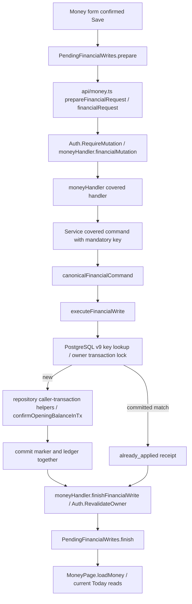

# ADR-019: Owner-scoped Financial Write Idempotency

**Status:** Accepted — Product Owner approved ADR-019 and authorized Issue #34 implementation on 2026-10-26, with the capacity-warning and frozen-recovery additions below. The Product Owner approved the final recovery UX and authorized verification, commit, push and closure; deployment remains a separate gate.

**Date:** 2026-10-23

**Issue:** [#34 — Owner-scoped Financial Write Idempotency](https://github.com/Faust217/LifeOS/issues/34).

## Context and retained decisions

Issue #33 was delivered at `09d365563dc4cc08c3ae11b5a162a78c727af86a`. Finance writes currently commit their own repository transactions. An HTTP response can be lost after commit, so a second Save may create another event or account. Opening-balance confirmation is revision-guarded and one-way; retrying a successful confirmation currently encounters changed account state rather than confirming the original outcome.

Retain ADR-003 exact money/forward migrations, ADR-004 ledger relationships, ADR-014 session-derived owner isolation, ADR-016 Void/Soft Delete, ADR-017 versioned exports, and ADR-018 per-account balance eligibility/revisions. Do not change their accepted texts. ADR-015 remains Proposed. Edit and running balances remain Issues #35/#36; neither is implemented by this decision.

## Decision

Use one PostgreSQL table of minimal committed-success markers, an owner-scoped transaction advisory lock, and the existing ledger transaction. No Redis, queue, worker, durable in-progress job, response-body cache, or new recovery endpoint is needed. This is at-most-once financial application for a retained owner/key, with a reliable committed-success acknowledgement; it is not an unconditional exactly-once delivery promise across arbitrary backup restores.

### Product Owner acceptance additions (2026-10-26)

- Keep the 100,000 successful-key Alpha limit with no expiry or eviction. Emit privacy-safe structured capacity warnings from 90% through the hard limit, excluding owner/key/resource IDs and financial content. Document a reviewed operational increase before blocking new writes; no dashboard, worker or new infrastructure. Test both real thresholds and replay at capacity.
- Never overwrite an unresolved tab command with a new Save. Bind recovery to the exact payload, operation, target and key, including an integrity check before retry. Unavailable/full/corrupted storage blocks new requests with clear recovery guidance; a lost key cannot be recovered. Explicit acknowledgement is required before discarding unresolved recovery state. Ordinary successful Save adds no confirmation dialog.

### 1. Covered operations and request keys

All paths below are relative to `/api/v1` and retain their POST method:

| Path | Operation identifier | First committed response |
| --- | --- | --- |
| `/accounts` | `account.create` | 201, existing Account DTO |
| `/events` | `event.create` | 201, existing Event DTO; income or expense |
| `/transfers` | `transfer.create` | 201, existing Event DTO; one event/two movements |
| `/accounts/{accountID}/opening-balance/confirm` | `opening_balance.confirm` | 200, existing Account DTO |
| `/events/{eventID}/void` | `event.void` | 204, empty body |
| `/events/{eventID}/delete` | `event.delete` | 204, empty body |

Require exactly one `Idempotency-Key` header value: a canonical lowercase UUIDv4, 36 ASCII characters, version nibble `4`, variant nibble `8`, `9`, `a`, or `b`. Reject missing, blank, malformed, duplicated, or comma-list values. Validate the parsed HTTP value; transport-normalized surrounding whitespace is not a second spelling of a key. Keys are opaque and unrelated to financial IDs or authentication.

The browser generates a fresh key with `crypto.randomUUID()` or an equivalent cryptographic `getRandomValues` implementation when the user confirms a new logical Save. Never use a clock, `Math.random`, payload hash, or a new key for an uncertain retry. Two deliberate identical purchases use different keys. Scope uniqueness to `(authenticated owner_id, request_key)` across all six operations, not per endpoint or session. Another owner may use the same key independently.

The same requirement applies at the covered application-service entry points, including future non-browser clients. No optional unprotected service or HTTP fallback is provided. Read-only preview, account/category archive/restore, category editing, Goals, timezone, and export are outside #34. Future Edit must join this mechanism under #35's separate accepted contract.

### 2. Canonical fingerprint v1

Hash a fixed-order JSON array using SHA-256:

`["lifeos-finance-command-v1", owner_uuid, operation, target_uuid_or_null, parameters]`

Canonical bytes are UTF-8 from Go `encoding/json.Marshal` of arrays/scalars only, with its standard string/HTML escaping and no trailing newline. Do not hash an unordered map, HTTP bytes, authorization headers, or display labels. Commit golden byte/digest fixtures so subsequent encoders cannot silently redefine v1.

| Operation | Exact parameters array order |
| --- | --- |
| `account.create` | `[name, type, currency, opening_balance_minor, opening_balance_at]` |
| `event.create` | `[kind, account_id, amount_minor, currency, occurred_at, note, allocations]` |
| `transfer.create` | `[from_account_id, to_account_id, amount_minor, currency, occurred_at, note]` |
| `opening_balance.confirm` | `[opening_balance_at, opening_balance_minor, balance_revision, acknowledge_change]` |
| `event.void` | `[reason_mode, explicit_reason_or_null]` |
| `event.delete` | `[]` |

Canonicalization must match the existing effective input semantics:

- Lowercase valid UUID values. Keep ISO currency uppercase and validate against the existing currency rules; do not invent FX conversion.
- Encode money and nonnegative expected revisions as canonical base-10 strings after exact int64 parsing. Normalize accepted `-0` to `0`; retain existing rejection of plus signs, leading zeroes, invalid values and overflow. No floats or rounding.
- Convert accepted instants to UTC, truncate to PostgreSQL microseconds as existing Finance does, and format exactly `YYYY-MM-DDTHH:mm:ss.ffffffZ`. Equivalent offset spellings have the same meaning. Freeze the resolved UTC value in the browser; retries never recalculate now, timezone conversion, or DST selection.
- Trim account name with the existing Go `strings.TrimSpace` rule. Preserve decoded note text exactly, including spaces and newlines. Do not apply Unicode normalization, case folding, or generic trimming.
- Encode allocations as `[category_uuid, amount_minor]` pairs sorted by canonical category UUID. Reject duplicate categories and invalid/excess/incomplete explicit totals. An empty array means Uncategorized. Do not omit or collapse a split. Preserve the existing requirement for an explicit allocations array on income/expense requests.
- For Void, omitted/empty/whitespace-only reason maps to `["generated", null]`; a nonblank reason maps to `["explicit", trimmed_reason]`. The stored server audit default remains unchanged. This fingerprint distinction adds no new Void metadata or claim about audit-text provenance. The request still requires its existing JSON object; Delete still requires an empty body.
- Include operation, target, revision and acknowledgement even when a particular value does not change the resulting amount. No owner IDs from request bodies, current balances, category names, generated resource IDs, session/CSRF tokens, or server-generated audit text enter the fingerprint.

Maintain the 16 KiB request-body limit. For these six paths reject duplicate JSON member names, unknown fields, trailing documents and invalid UTF-8; do not let ambiguous JSON decide which financial intent wins. Required fields, types, stateless value validation and canonicalization precede execution. Mutable-state checks (ownership of targets, archive/status, saved timezone, opening date versus current server time, balance revision and computed acknowledgement requirement) run only for a new command, after the committed-key lookup.

Store a fingerprint version. Retain the v1 decoder/normalizer for retained keys if a later contract evolves; existing keys must be compared using their stored version before any new state-dependent preconditions. An unsupported stored version fails closed with 503 rather than treating the key as unused. A structurally invalid request is never a replay. Changes to fingerprint meaning require explicit version/compatibility review.

### 3. Stored outcome and replay contract

Do not retain original DTOs, request bodies, target/result IDs, amounts, notes or audit reasons in idempotency storage. A committed marker means that the command succeeded, including a valid domain no-op such as Delete of an already-deleted event.

First committed success keeps the DTO/status in the operation table and adds `Idempotency-Replayed: false`. A matching committed replay, on **every** covered path, returns exactly:

```http
HTTP/1.1 200 OK
Content-Type: application/json
Cache-Control: no-store, private
Idempotency-Replayed: true

{"outcome":"already_applied"}
```

No resource ID or financial contents are returned in this receipt. The client treats it as confirmation of the original Save and refreshes ordinary authorized data. The UI must not assert that the event is still posted, recreate it, or reconstruct an old DTO. The first-success response also uses private/no-store caching. Replays are acknowledged before checking current target/revision state.

This deliberately does not promise byte-for-byte replay of the first response. An event may subsequently be Voided, Soft Deleted or, after #35, Edited; an account may be archived or have a later balance revision. The receipt stays the same and exposes no deleted transaction contents. Current guarded reads determine what exists now. No separate deletion receipt, transaction tombstone inventory or export collection is introduced.

| Example | Result |
| --- | --- |
| MYR 12.50 expense with key K commits; HTTP reply is lost; retry K with the same normalized data | 200 receipt; one event and its original effects |
| Reuse committed K with MYR 15.00, another target/operation, changed note, split, revision or acknowledgement | 409 `idempotency_key_conflict`; no second mutation |
| Reorder the same allocation pairs or express the same instant with `+08:00` rather than `Z` | Same fingerprint; 200 receipt |
| Opening confirmation at expected revision 7 commits, then another write advances the revision | Retry original K/revision 7 gets 200 receipt; a new key/revision 7 still gets the ordinary stale-preview conflict |
| Expense created under K is later Voided/Deleted/Edited | Retry K acknowledges completion only; no new effect, old DTO or resurrection |
| A new-key attempt fails validation or rolls back | No committed binding; correct the draft and use a new logical Save/key |

### 4. Atomic transaction, concurrency and lock order

The coordinator owns **one explicit READ COMMITTED transaction**. Refactor existing mutations into caller-transaction helpers; wrapping a self-committing repository call is not atomic. Application-service callers cannot bypass the coordinator.

1. Run session/Origin/CSRF guards, bounded parsing/key validation and stateless canonicalization. A fast owner/key lookup may return an already committed receipt/conflict without domain locks.
2. On a miss, begin the transaction and acquire `pg_advisory_xact_lock` for this owner. Derive its signed 64-bit value from the first eight big-endian bytes of SHA-256 of UTF-8 `lifeos.finance.write-owner.v1|<canonical-owner-uuid>`. Reserve this namespace for this use. Hash collisions only serialize unrelated owners; full owner UUID predicates and the composite key still authorize every query.
3. **Recheck the key after acquiring the lock**, in a new SQL statement. READ COMMITTED sees the prior writer's newly committed marker; a repeatable-read snapshot taken before waiting would not provide this property. Match returns the receipt; mismatch returns conflict.
4. Check the owner's committed-marker capacity under this lock, then insert the marker before acquiring event/account/category locks. Use the unique composite primary key as the final database defense. If an insert reports an existing key, read/compare it in a subsequent statement; never overwrite its fingerprint. Only the coordinator may insert markers.
5. Run the existing mutation and all its checks in this transaction. Marker insertion's owner foreign-key check precedes domain locks, avoiding a new lock inversion with existing category name writes that lock `lifeos_users` before category rows. No direct new Finance query of Identity tables is required.
6. Retain event-before-account ordering for Void/Delete, accounts in ascending canonical UUID order, and acquire category validation locks in ascending canonical UUID order. New posting has accounts then categories; confirmation locks its account, recomputes and records evidence. New account creation inserts the account in this same transaction. Never acquire the owner advisory lock after a domain row lock. Uncovered category/account archive operations retain their existing business behavior; integration tests must cover their interaction with the coordinator.
7. Commit marker, event/movements/allocations or marker/status/anchor/evidence/revision changes together. Any validation, overflow, SQL, cancellation or known commit failure rolls back the uncommitted marker and effects. Do not commit a claim first or persist a processing state.
8. End/release the Finance transaction before final `Auth.RevalidateOwner` using the same request cookie and original owner. Return a first-success DTO or receipt only after this check. Never acquire a second pooled authentication connection while holding Finance locks. Every retry still passes fresh Origin/CSRF/session guards; a later authenticated session for the same owner may retry using its fresh CSRF token.

Identical concurrent requests either wait briefly then acknowledge the first commit, or receive a bounded busy response and retry the same key. Different keys from one owner serialize financial mutations; different owners do not intentionally serialize. A crash before commit leaves no durable marker/effect; after commit, PostgreSQL retains the marker across Go process restarts. Transaction-level locks release on transaction termination; they are never session locks held by a pooled connection.

The final authentication check can fail **after commit**. A 401/403, timeout or transport error must not be advertised as proof that a financial operation did not happen. Keep the key and reconcile after reauthentication. Revocation immediately after the final check remains the ordinary HTTP authorization race; no claim of locking a session until the last network byte is made.

### 5. Errors, limits and retention

Use the existing JSON error envelope, with no echo of submitted keys, prior contents, fingerprints, SQL or secrets:

| HTTP | Error code | Client behavior |
| --- | --- | --- |
| 400 | `idempotency_key_required` | Fix client; never silently send an unprotected write |
| 400 | `invalid_idempotency_key` | Reject malformed/duplicate key; do not guess one server-side |
| 409 | `idempotency_key_conflict` | Stop automatic retries/key rotation; resolve the conflicting intent |
| 409 | `idempotency_capacity_exceeded` | New commands blocked; retained-key replays still work |
| 503 | `financial_write_busy` | `Retry-After: 1`; manually retry the same frozen key/body |
| 503 | `financial_write_outcome_unknown` | Commit may have succeeded; retry the same key/body |
| 503 | `idempotency_version_unsupported` | Fail closed; repair version compatibility, never execute as new |

Keep existing domain 400/404/409/422, body/media 413/415, session 401, Origin/CSRF 403 and privacy-safe server errors. Use `financial_write_busy` only for admission/lock/deadlock or other transient failures whose current transaction is known rolled back; ambiguous commit uses `financial_write_outcome_unknown`. Any request can also lose its reply entirely. A failed retry cannot disprove success of an earlier attempt. Do not cache failed attempts. The first successful commit binds the key; an earlier rolled-back attempt does not bind it.

Initial Alpha limits, as named application constants with boundary tests:

- 100,000 retained committed keys per owner, across all six operations. Count through the owner-leading primary key under the owner lock; no quota-counter table. Test near-cap lookup/count latency within the request budget. At capacity, compare retained keys before rejecting new ones. Do not evict successful markers to accept a new command.
- At most eight active covered Finance mutation handlers per Go process, with nonblocking admission and a 10-second request deadline including pool acquisition and final revalidation. Auth/CSRF guards still apply to replay/admitted requests. A rejected or expired attempt never triggers detached work.
- Transaction-local `lock_timeout = 2s`, `statement_timeout = 8s`, and `idle_in_transaction_session_timeout = 10s`; no global PostgreSQL or machine setting changes. The application deadline bounds the multi-statement transaction. Idle timeout provides a recovery bound when a disconnected process leaves a transaction waiting. Roll back/release or discard a failed pooled connection safely.
- Existing 16 KiB HTTP body cap; one browser pending command per tab, bounded to 32 KiB serialized storage. No unbounded pending queue or automatic replay loop.

Retain successful minimal markers for the owner's data lifetime, with **no automatic TTL or pruning** in Alpha. Raising the explicit capacity needs operational review; retaining markers favors retry correctness over unbounded new writes. The table size is bounded per admitted owner, not globally independent of user count. No 45-day deletion inventory is introduced.

Markers are internal operational metadata, excluded from normal JSON/CSV exports, but included with the ledger in a consistent database backup. Restoring a backup older than a successful write can lose both its data and marker: never promise cross-restore exactly-once behavior. The Personal Data Ready backup/restore gate must address stale clients and pending retries before reopening writes. This proposal neither implements restore nor claims immediate physical erasure from backups/storage.

### 6. Frontend draft and uncertain-result behavior

Use a small shared pending-command helper, not an offline synchronization subsystem:

1. At confirmed Save, freeze the complete request body (including all allocations, resolved UTC instants, revision and acknowledgement) and key. Persist one owner-tagged record in per-tab `sessionStorage` **before** sending. The owner tag is a local privacy check, never server authorization. Do not persist session/CSRF/Google tokens. If storage is unavailable/full or exceeds the cap, fail before sending and preserve the editable draft.
2. While unresolved, disable a second financial Save in that tab and prevent editing/resubmitting the frozen command under a different key. Duplicate clicks/retry use the same record. Closing a form does not cancel a request already sent or discard its recovery record.
3. On a valid first success or 200 receipt, clear the pending record and refresh normal Money/history/balance/Today reads. On network loss, timeout, 5xx, malformed success or auth denial, preserve it. Offer manual **Retry Save** with the same key/body and fresh session/CSRF credentials; do not automatically post on reload or reconnect.
4. Same-tab reload recovers the record only after `/me` confirms the same active owner. Hide private drafts while signed out; never render/replay a previous owner's record for a different owner. Preserve a different owner's unresolved record as a hidden blocker until same-owner recovery or explicit acknowledgement and clearing; never silently replace its key. Explicit sign-out clears the local private record, with a warning if a Save is unresolved; session expiry alone permits same-owner reauthentication/recovery. Warn before leaving a tab with an unresolved operation where supported.
5. A definitive validation/stale-preview failure preserves an editable form draft; after correcting it or regenerating a preview, a newly confirmed Save gets a new key. A key-conflict error never silently rotates the key or resubmits. Uncertain opening confirmation retries its original command rather than inventing a new preview/revision or comparing dates heuristically.

Session storage contains private submitted draft data and is not encrypted against scripts with same-origin access. Keep it bounded and clear promptly. Same-tab reload is supported; tab closure/browser storage loss or a restore that lost markers is not guaranteed recoverable. Do not claim cross-device/offline pending-command sync. Other tabs can submit intentional new keys; idempotency does not deduplicate independently created intent.

## Migration, API and export compatibility

The locally authorized implementation adds **forward migration v9**, `000009_financial_write_idempotency`, creating only `finance_write_requests`:

| Column | Rule |
| --- | --- |
| `owner_id` | UUID, not null, existing user FK with ON DELETE RESTRICT |
| `request_key` | UUID, not null; UUIDv4 validated at the application boundary |
| `operation` | Non-null text constrained to the six identifiers above |
| `fingerprint_version` | Positive smallint; initially supported version 1 |
| `request_fingerprint` | Non-null bytea, exactly 32 bytes |
| `recorded_at` | Non-null timestamptz, server UTC registration instant; not a claimed physical commit time |

Primary key `(owner_id, request_key)` supplies uniqueness and owner-prefix capacity lookup. No nullable outcome/processing state, resource foreign key, expiry column, original payload or response cache is needed. A row is only visible after the shared transaction commits. There is no backfill or guessed protection for historical unkeyed writes.

Test populated v8→v9 and empty full-chain v9 without altering any account, opening confirmation, event/child, Goal, preference or export. Down migration must refuse if any markers exist; never discard retry protection to make an old binary run. Empty-table rollback may remove v9 safely. Published v1–v8 remain byte-for-byte unchanged.

OpenAPI must require the key on the six paths, describe both first-success and 200 receipt shapes, success replay headers, errors/Retry-After and privacy behavior; generate TypeScript types and update consumers/contracts together. No new HTTP endpoint is necessary. This is a deliberate Alpha write-contract cutover: old clients without keys fail clearly, never execute unprotected. Coordinate client/server activation after separately approved delivery; settle unkeyed in-flight Saves first. Do not automatically assign a new key to an old uncertain unkeyed submission. Mixed old-binary writes against populated v9 are unsupported.

Keep both approved export versions and their golden fixtures unchanged. These markers add no new financial meaning and are not part of normal portability datasets, so #34 requires no export v3. #35 must separately review revision evidence and export compatibility.

## Function-level flow and implementation acceptance gates

Actual implementation names are recorded below. The Product Owner approved final Issue #34 delivery; deployment remains a separate gate.



| Input → Function | Process → Output → Next function |
| --- | --- |
| Confirmed draft → `apps/web/src/api/money.ts` `prepareFinancialRequest` → `apps/web/src/pendingFinancialWrite.ts` `PendingFinancialWrites.prepare/start` | Reserve/freeze/store exact command/key, verify checksum; unavailable/full/corrupt storage sends nothing → `financialRequest` |
| Frozen HTTP request → `internal/identity/auth.go` `Auth.RequireMutation` → `internal/finance/idempotency_http.go` `moneyHandler.financialMutation` | Session/Origin/CSRF then bounded handler admission and strict key/body → covered handler in `http.go` / `opening_http.go` |
| Typed input → covered `Service` method → `internal/finance/idempotency.go` `canonicalFinancialCommand` | Normalize complete intent and produce immutable v1 digest → `executeFinancialWrite` |
| Owner/key/fingerprint → `executeFinancialWrite` / `committedCommand` | Fast lookup or owner lock/recheck/quota/marker under one transaction → `ErrAlreadyApplied` success or caller-transaction helper |
| New command → `repository.createAccountInTx/postInTx/voidEventInTx/deleteEventInTx` or `confirmOpeningBalanceInTx` | Existing rules/locks/revisions, no independent commit → shared coordinator commit; failure rolls back marker and effects |
| Result / success sentinel → `moneyHandler.finishFinancialWrite` → `Auth.RevalidateOwner` | Recheck same request session after releasing Finance transaction → first DTO/status or content-free 200 receipt |
| Valid response → `PendingFinancialWrites.finish` → `MoneyPage.loadMoney` | Clear only the exact pending record and reread current truth; errors preserve appropriate recovery/draft state |
| Manual retry → `FinancialWriteRecovery.retry` → `api/money.ts` `retryFinancialWrite` | Same frozen record/key and fresh CSRF; no new preview/body/time → `financialRequest` and the same guarded server path |

Required implementation gates (evidence and remaining review status are in Issue #34 and the English journal):

- Canonical byte/digest goldens: amount limits, `-0`, currency, equivalent offsets/microseconds, UUID case, split order/duplicates/totals/Uncategorized, note whitespace, account trimming, generated/explicit Void reason, revisions and acknowledgement. Key header duplicates, unknown/duplicate JSON members, invalid UTF-8, body/media caps.
- All six writes: first success, identical replay, changed payload/target/operation conflict, safe rollback and new-key behavior. Account creation not duplicated; opening replay succeeds before later revision/status checks. Pre/post-anchor eligible legs, negative balances, wide arithmetic and overflow still obey ADR-018.
- Real PostgreSQL: concurrent identical/different commands, first-writer rollback, unique-key defense, owner-cap boundary, retained replay at capacity, lock ordering with category/archive writes, timeout/cancellation, connection termination, lost response after commit and Go process restart. Assert one set of movements/allocations/evidence and one legitimate balance revision change.
- Later Void/Delete, including already-voided/deleted no-ops: retries never change balances/status again or disclose the old DTO. Future Edit compatibility is a contract test of content-free replay, not an Edit endpoint/revision implementation.
- Every initial attempt/replay: cross-owner same key, foreign targets, no client owner override, expired/revoked/disabled sessions, Origin/CSRF denial, revocation before release, safe errors/no sensitive logs. Fresh same-owner session with fresh CSRF can recover a pending key.
- Populated v8 upgrade/full chain/down refusal; v1–v8 immutable; v1/v2 schema/golden/export content unchanged and marker-free. Existing Money/Today/Goals/Me regressions.
- Frontend/browser 320/390px: draft/key persistence, same-tab reload, manual retry, closing forms, no double Save, changed-owner isolation, expiry/sign-out, storage failure and initial-success/receipt refresh. No lost split allocation or regenerated occurrence/anchor instant.
- Full Go tests/vet, frontend tests, TypeScript/build, OpenAPI lint/generated-contract checks, real guarded API/disposable PostgreSQL tests and `git diff --check`. Update actual function names, Codebase Map, Project State and English learning journal during implementation; use new disposable databases and retain earlier ones.

## Alternatives, consequences and exit path

- In-memory keys fail across process restart; Redis/queues add unnecessary infrastructure. A committed marker plus the existing PostgreSQL transaction is enough.
- A unique row alone handles identical-key races, but the owner transaction lock also makes the capacity check exact without a counter table. The trade-off is serialization of covered financial writes for one owner; this is appropriate for a few Alpha users, and needs measured review if usage grows.
- Caching complete original responses leaks obsolete/deleted content and increases retained private data. A content-free receipt requires the client to refresh and makes the first/replayed success shapes different, which contracts must express explicitly.
- Expiring keys or dropping markers during rollback weakens the retry guarantee. Fail closed at the explicit capacity instead of silently re-executing old intent. Failure attempts are not durably cached; this keeps the table small and cannot retain an orphan processing claim.
- Per-tab session storage provides reload recovery with bounded private draft retention. It does not promise recovery after closing the tab or across devices, and is not offline transaction capture.

This proposal changes transport/retry coordination, not Finance amounts, anchor formulas, event identity, Void audit metadata, Soft Delete or historical ordering. No accepted ADR is superseded. No AI/MCP permission or new runtime provider is granted. If implementation exposes a contradictory accepted rule, stop and document the exact proposed amendment.

Before any successful v9 marker, an empty-table rollback can restore the prior binary/schema contract. After markers exist, preserve them and use a reviewed forward correction; never reset the database, clear markers or deploy an unprotected writer. Consistent backups, restore rehearsal, owner isolation and safe upgrades remain Personal Data Ready gates.

## Technical references

- [PostgreSQL READ COMMITTED statement snapshots](https://www.postgresql.org/docs/18/transaction-iso.html#XACT-READ-COMMITTED): recheck in a new statement after the preceding writer commits.
- [PostgreSQL transaction advisory locks](https://www.postgresql.org/docs/18/explicit-locking.html#ADVISORY-LOCKS): automatic transaction-end release; the application must consistently follow the locking protocol.
- [PostgreSQL transaction-local timeout controls](https://www.postgresql.org/docs/18/runtime-config-client.html): bounded lock, statement and idle-transaction waits.


## Local implementation and operations

The Product Owner accepted the original proposal plus the two additions above on 2026-10-26. See [Financial Write Recovery and Capacity Operations](../FINANCIAL_WRITE_RECOVERY.md) for the 90% warning, privacy-safe aggregate check, reviewed limit increase, uncertain outcomes, storage limitations and restore policy. See the [English journal](../../learning/journal/2026-10-26-financial-write-idempotency.md) for actual per-function inputs/errors/tests and local verification. Neither document grants access to personal data or deployment permission.
