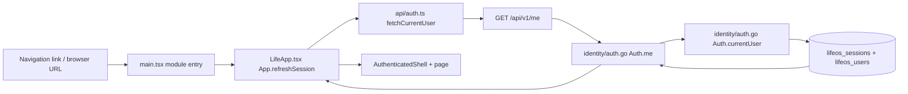
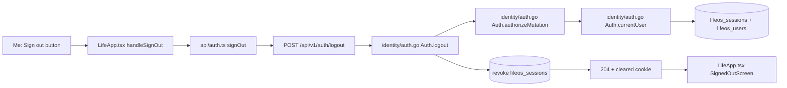

# Issue #23: Mobile-first application shell

Date: 2026-10-09

Issue: [#23](https://github.com/Faust217/LifeOS/issues/23)

Related decisions: ADR-013, ADR-014

## What changed

The Foundation demo screen became a responsive Today, Money, Plans, and Me shell. The bottom navigation is sized for phone touch; a sidebar serves wider screens. Normal links provide direct URLs and browser Back/Forward. Today links to the other areas, Money and Plans explain their pending workflows, and Me shows the confirmed user's profile and a working sign-out.

## Why this design

The existing React/Vite stack can serve these four routes through normal links and its existing SPA fallback. This avoids a routing or component-library dependency before the app needs one. `App` confirms the server session before rendering private content. The frontend does not calculate financial values or manufacture records. The browser visual check used a local synthetic API response and never accessed the personal database.

## Function-level data flow

### Session confirmation and navigation

| Step | Input → function → process → output → next | Error handling and tests |
| --- | --- | --- |
| User input | Tap a link from `apps/web/src/LifeApp.tsx` `Navigation`, `TodayPage`, or `NotFoundPage`; its real URL becomes the next browser location → `apps/web/src/main.tsx` module entry. Browser Back/Forward follows the same path. | Unknown URLs get `NotFoundPage`. `apps/web/src/navigation.test.ts` and the browser history check cover paths. |
| Frontend gate | `apps/web/src/main.tsx` renders `App`; `apps/web/src/LifeApp.tsx` `App.refreshSession` receives no arguments, sets loading, and requests a user → `fetchCurrentUser`. Visibility and persisted-page restore trigger the same check. | Stale requests are ignored. Failure shows `UnavailableScreen`, not private pages. `apps/web/src/LifeApp.test.tsx` checks the initial gate; browser error/retry and post-logout history checks cover recovery. |
| API request | `apps/web/src/api/auth.ts` `fetchCurrentUser` sends same-origin, no-store `GET /api/v1/me` with the browser session cookie → `Auth.me`. It returns `CurrentUser` or `null`. | 401 means signed out; other non-2xx errors throw. `apps/web/src/api/auth.test.ts` covers these cases. |
| Backend handler | `internal/identity/auth.go` `Auth.me` receives the request and calls `Auth.currentUser`; it returns the confirmed ID, email, admin flag, and session-bound CSRF token as JSON. | Invalid session returns 401 with no user data. Existing identity auth tests cover handler behavior. |
| Service / repository | N/A as separate layers for this existing authentication endpoint: `Auth.currentUser` performs the session lookup directly. | New feature services/repositories were not introduced in this UI issue. |
| Database | `internal/identity/auth.go` `Auth.currentUser` queries `lifeos_sessions` joined to `lifeos_users` by user ID, requiring an unrevoked, unexpired session and active user → `Auth.me`. | Missing/expired/revoked/disabled session cannot produce a user. Existing identity integration tests cover these states. |
| Response / UI | JSON returns to `fetchCurrentUser`; `App.refreshSession` sets ready; `AuthenticatedShell` calls `resolveArea` in `apps/web/src/navigation.ts` and renders the chosen page. | 401 shows `SignedOutScreen`; an API failure shows `UnavailableScreen` with a retry. Money/Plans have no data call in #23. |

### Sign-out mutation

| Step | Input → function → process → output → next | Error handling and tests |
| --- | --- | --- |
| User input | `apps/web/src/LifeApp.tsx` `MePage` button calls `App.handleSignOut` with no arguments; it reads the confirmed user's CSRF token, blocks duplicate clicks, and calls `signOut`. | On failure it restores the profile and shows a retryable error. Browser sign-out check covers the transition. |
| API request | `apps/web/src/api/auth.ts` `signOut` sends a same-origin POST to `/api/v1/auth/logout` with `X-CSRF-Token` → `Auth.logout`. | 401 is treated as an already-ended session; other failed statuses throw. `apps/web/src/api/auth.test.ts` covers this. |
| Backend handler / guard | `internal/identity/auth.go` `Auth.logout` calls `Auth.authorizeMutation`, which checks exact Origin, active `Auth.currentUser` session, and CSRF token → session revocation. | Guard failure returns a safe error without revocation. Existing identity auth integration tests cover invalid Origin/CSRF and sessions. |
| Service / repository | N/A as separate layers: the existing auth handler owns the session update through `a.pool.Exec`. | No new auth persistence code was added. |
| Database / response / UI | `Auth.logout` sets `lifeos_sessions.revoked_at`, clears the cookie, and returns 204. `App.handleSignOut` then renders `SignedOutScreen`; a direct private URL still requires fresh `/me` confirmation. | Database failure returns 503 and the frontend retains the session view with an error. Browser sign-out/direct-URL checks cover the UI. |

## Reading order and checks

1. `apps/web/src/navigation.ts` and `apps/web/src/LifeApp.tsx` for paths, auth gate, and pages.
2. `apps/web/src/api/auth.ts` and `internal/identity/auth.go` for the existing session contract.
3. `apps/web/src/lifeos.css` for mobile and desktop layout.
4. `apps/web/src/navigation.test.ts`, `apps/web/src/LifeApp.test.tsx`, and `apps/web/src/api/auth.test.ts` for focused checks.

Verification: web tests, TypeScript typecheck, production build, isolated 320 px and 390 px browser layout, touch-target, keyboard skip-link, navigation, post-logout history, and session-error checks, plus `git diff --check`. The earlier Issue #19 live Google verification is preserved; a new live OAuth round trip is not claimed for #23.

## Questions and follow-up

Connect the existing Money API in a separately authorized UI issue. Goals and data-management tools need their own backend and UI scopes. Review real mobile browser behavior with the Product Owner before release; this issue's browser fixture used synthetic identity data only.
