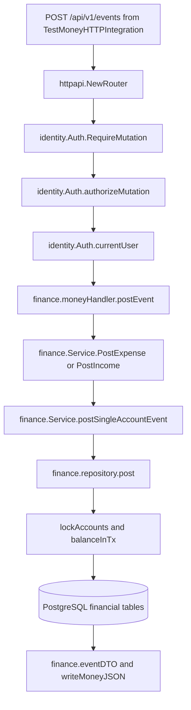

# Issue #22: Money REST API and OpenAPI Contracts

**Status:** Completed after Product Owner final review. No deployment or personal-data migration.

## What changed

The API mounts identity and Money routes together under `/api/v1`. Every Money read is wrapped by `identity.Auth.RequireRead`; every mutation is wrapped by `identity.Auth.RequireMutation`, which checks exact Origin, a live LifeOS session, and its CSRF token. The handler receives `identity.OwnerID` only from the guard. Strict JSON DTOs reject unknown fields, malformed/trailing JSON, oversized bodies, and unsupported media types. Query parameters are allowlisted. The handler calls Issue #21 services for all financial rules and maps results into explicit response DTOs.

Minor units are still signed Go `int64` values internally. JSON represents them as decimal strings because JavaScript numbers cannot exactly represent every signed 64-bit integer. The handler validates and parses the strings before calling Finance; OpenAPI generates TypeScript `string` fields. No floating-point money or cross-currency conversion is introduced.

## Actual function call chain

### Function-level Data Flow

| Step | Input → Function → Process → Output → Next |
| --- | --- |
| User input / frontend | **N/A:** Issue #22 adds no Money UI. `internal/finance/http_integration_test.go` / `TestMoneyHTTPIntegration` builds an HTTP request with an amount string, currency, category, and timestamp → `moneyHTTP`. A future React caller will use the generated contract. |
| API request | `internal/finance/http_integration_test.go` / `moneyHTTP` sends JSON, the LifeOS cookie, Origin, and CSRF header → `internal/platform/httpapi/router.go` / `NewRouter`. Missing credentials and bad headers are tested. |
| Session guard | `internal/identity/auth.go` / `Auth.RequireMutation` → `Auth.authorizeMutation` → `Auth.currentUser` checks the active, unrevoked, unexpired session and active user, then issues a server-derived `OwnerID` → `moneyHandler.postEvent`. Errors become stable JSON codes; expired/revoked/disabled, Origin, CSRF, and owner overrides are tested. GET routes use `Auth.RequireRead`. |
| Backend handler | `internal/finance/http.go` / `moneyHandler.postEvent` uses `decodeMoneyJSON`, `moneyQuery`, and `parseMinorUnit` to validate transport input and construct `finance.EventInput` → `Service.PostExpense` or `Service.PostIncome`. Unknown fields, malformed JSON, invalid timestamp/amount, and oversized bodies return JSON errors. |
| Service | `internal/finance/service.go` / `Service.PostExpense` or `PostIncome` → `postSingleAccountEvent` validates the owner, currency, amount, allocation sum, and signed movement → `repository.post`. Finance tests cover invalid input and arithmetic overflow. |
| Repository / database | `internal/finance/repository.go` / `repository.post` locks owner-scoped accounts, checks related owner/currency/category records, and inserts event, movement, and allocations in one transaction → PostgreSQL migration `db/migrations/000004_money_ledger.up.sql`. Any failure rolls back; Issue #21 tests cover concurrency, isolation, and rollback. |
| Response | `internal/finance/http.go` / `eventDTO` converts the domain result into the public DTO, including decimal-string minor units; `writeMoneyJSON` returns HTTP 201. `writeMoneyError` maps known domain errors without revealing private records. HTTP integration tests check movement signs, allocations, balances, and errors. |
| UI update | **N/A:** no Money screen in this issue. The generated `apps/web/src/api/generated/schema.ts` types are ready for the later UI issue. |

Other actual paths: `moneyHandler.listAccounts` → `Service.ListAccounts` → `repository.listAccounts`; `moneyHandler.balance` → `Service.Balance` → `repository.balance`; `moneyHandler.history` → `Service.History` → `repository.history` and child queries; `moneyHandler.transfer` → `Service.Transfer` → `repository.post`; `moneyHandler.voidEvent` → `Service.VoidEvent` → `repository.voidEvent`. The same guards, DTO mapping, and error policy apply. The API test covers those paths, empty arrays, pagination, cross-owner IDs, archived account history, and transfers excluded from category spending.

## Reading order and verification

Read `internal/identity/auth.go` guards, `internal/finance/http.go`, `internal/finance/service.go`, `internal/finance/repository.go`, `api/openapi/openapi.yaml`, and `internal/finance/http_integration_test.go`. The useful concepts are transport DTOs versus domain values, server-derived owner context, decimal strings at a JavaScript boundary, and consistent error mapping.

The new API integration test uses only a fresh disposable `*_test` PostgreSQL database. It does not use real Google tokens: a local OIDC discovery stub enables the real session guard, and test-only sessions are seeded directly. The existing live Google sign-in verification belongs to Issue #19. Verification passed: full `go test -count=1 -v ./...` with Finance, Money API, identity, and OIDC/session PostgreSQL integrations enabled on four fresh disposable databases; `go vet ./...`; OpenAPI lint and generated-type consistency; web tests, typecheck, and build; and `git diff --check`. The Money API test checks the shared auth start/callback/logout routes, exact amount boundaries and invalid forms, owner isolation, all Money operations, and a populated migration upgrade from version 3 to 4. Redocly's two pre-existing redirect-only OAuth 2xx warnings remain non-blocking. All disposable databases remain intact.

No React Money screen, personal database migration, new schema, deployment, or test-database cleanup is part of this issue. A future UI must fetch its CSRF token from `/api/v1/me` and send minor-unit strings exactly as contracted. Live browser-to-Money testing remains for that UI milestone.
