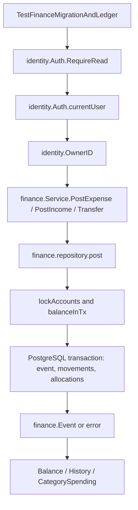

# Issue #21: Money Domain and Lightweight Ledger

**Status:** Completed after Product Owner final review. No public Money API, UI, or deployment.

## What changed and why

Migration `db/migrations/000004_money_ledger.up.sql` adds separate owner-scoped Accounts, Categories, FinancialEvents, AccountMovements, and CategoryAllocations. Composite foreign keys keep movements tied to an account/event with the same owner and currency; allocations also match the event/category kind. `internal/finance/service.go` owns validation and signed money rules. `internal/finance/repository.go` owns SQL and transactions. Finance data is not stored in one flat transaction row.

Account balance is opening position plus movements from **posted** events; voided events stay in history but leave the active balance and spending totals. Ordinary accounts may have negative balances because LifeOS records transactions rather than authorizing bank overdrafts. A credit-card account still uses a negative liability position. Same-currency bank-to-card payments use the transfer path and have no spending allocation. Category spending requires an explicit currency, so unlike units are never summed. The Product Owner explicitly approved the negative-balance policy during final Issue #21 review.

## Actual call chain

The test obtains a real `identity.OwnerID` through an active server-side session. No product HTTP endpoint or frontend calls these services in Issue #21.

| Step | Input → Function → Process → Output → Next Function |
| --- | --- |
| User input / frontend | **N/A:** no Money UI exists. `internal/finance/finance_integration_test.go` / `TestFinanceMigrationAndLedger` supplies test account, amount, currency, category, and time → service methods. |
| API request / backend handler | **N/A:** no public Money API exists. The test's `verifiedTestOwner` uses `internal/identity/auth.go` / `Auth.RequireRead` → `Auth.currentUser` to validate an active session and yield `identity.OwnerID`. Invalid sessions fail closed; Issue #20 integration tests cover that boundary. |
| Service | `internal/finance/service.go` / `Service.PostExpense`, `PostIncome`, or `Transfer`: owner plus typed input → validate UUIDs, ISO currency, positive amount, allocation sum/kinds, and same-currency transfer intent → signed `postSpec` → `repository.post`. Invalid/overflowing input returns a domain error; Finance unit/integration tests cover it. |
| Repository | `internal/finance/repository.go` / `repository.post`: `OwnerID` plus `postSpec` → begin transaction, call `lockAccounts` and `balanceInTx`, check owner-linked account/category, currency, archive, and overflow → insert event and its children → commit `Event`. A negative resulting balance is valid. Any error rolls back; integration test injects a late duplicate allocation to prove no partial rows survive. |
| Database | `db/migrations/000004_money_ledger.up.sql`: five separate tables → composite owner/currency/kind foreign keys and indexes. `account_movements.amount_minor` is signed; `category_allocations.amount_minor` is positive. The populated 3→4 upgrade and direct foreign-reference constraint tests run in `TestFinanceMigrationAndLedger`. |
| Response / UI update | `repository.post` returns an `Event` with movement/allocation IDs to the service caller; `Service.Balance`, `History`, and `CategorySpending` read owner-filtered projections. **UI update: N/A** until a later API/UI issue. Cross-owner IDs return `ErrNotFound`; integration tests cover reads, writes, and related references. |

## Additional paths and error handling

| Input → Function → Process → Output → Next Function | Errors and tests |
| --- | --- |
| Owner + account ID → `Service.Balance` → `repository.balance` sums opening position and posted signed movements → `Balance` → caller. | Missing/foreign account returns `ErrNotFound`; numeric overflow returns `ErrOverflow`. Opening and negative liability tests cover results. |
| Owner + event ID/reason → `Service.VoidEvent` → `repository.voidEvent` locks event/accounts, checks arithmetic, retains child rows, sets void metadata → nil → `History`/`Balance`. | Foreign ID is not found; repeat void conflicts; overflow fails. Voiding income may leave an ordinary account negative. Tests check retained history and totals. |
| Owner + account ID → `Service.ArchiveAccount` → `repository.archiveAccount` marks archive timestamp → nil → later posting rejects it. | Foreign ID is not found; test checks old balance/history survive. |
| Owner + page → `Service.History` → `repository.history`, `eventMovements`, `eventAllocations` → owner-filtered events with children → caller. | Invalid page returns `ErrInvalidInput`; cross-owner history is empty. Integration test checks sorting and child rows. |

## Reading order and limits

Read ADR-003, ADR-004, migration 000004, `service.go`, `repository.go`, then the tests. The useful Go concepts are integer overflow checks, private repository methods, and an `identity.OwnerID` that application callers cannot build from a client string. The SQL concepts are composite foreign keys, row locks acquired in sorted account-ID order, `numeric` intermediate sums, and transactional rollback.

`TestFinanceMigrationAndLedger` uses only a disposable `*_test` database, upgrades populated identity/session data from version 3 to 4, then exercises income, expense, transfer, card liability/payment, negative ordinary balances, multi-currency classification, archive, void, cross-owner references, atomic rollback, and concurrent spending/transfers. The populated down migration refuses to delete financial history. The separate clean migration-chain verifier reached version 4 with `dirty=false`, repeated `up` safely, and passed the isolated smoke-fixture rollback. After the negative-balance adjustment, the full Go suite ran with the Finance, OIDC/session, and identity PostgreSQL integration tests enabled; `go vet ./...`, `go mod tidy -diff`, formatting, and `git diff --check` passed. Disposable test databases were retained.

No real Google flow, public Money API, frontend, FX conversion, advanced credit-card behavior, import, or personal financial data is involved. A future correction workflow should define whether replacement events need an explicit link; this issue supplies audited void plus a separate new event, without rewriting history.
