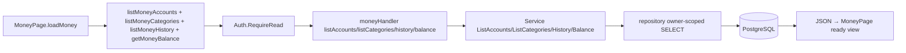
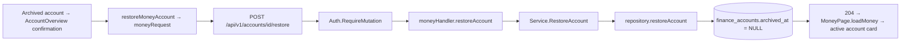

# Issue #24: Usable Money workflows

Date: 2026-10-09

Issue: [#24](https://github.com/Faust217/LifeOS/issues/24)

Status: Product Owner approved; final isolated real-stack verification passed on 2026-10-10

## What changed

The approved Sage Green shell reads real accounts, per-account balances, categories, and paginated events. Issue #24 can create accounts and categories, record income and expenses, transfer between same-currency accounts, archive and restore accounts, and void events with a reason. A top action opens an accessible transaction dialog; on mobile the action remains easy to reach while scrolling. Account and category selections are explicit. A short Account → Category → First Transaction guide handles empty setup. History shows meaningful titles, account names, signed amounts, and retained void details. A void can lead to an optional prefilled replacement with a separate review and confirm step. Today, Plans, Me, session restoration, and logout remain in the shell.

The React client uses the generated OpenAPI schemas through `apps/web/src/api/money.ts`. It sends exact decimal-string minor units, never a client owner ID. The Go service remains the authority for balance, movement, allocation, and owner rules. The minimal Restore Account service/API updates the existing nullable `archived_at` field under the verified owner; no schema migration, new library, or personal database change was made.

## Function-level data flow

### Record an expense or income

```mermaid
flowchart LR
  A[Add transaction → EntryForm.submit] --> B[parseAmountToMinor + toOccurredAt]
  B --> C[MoneyPage.runMutation]
  C --> D[postMoneyEvent → moneyRequest]
  D --> E[POST /api/v1/events]
  E --> F[Auth.RequireMutation]
  F --> G[moneyHandler.postEvent]
  G --> H[Service.PostExpense or PostIncome]
  H --> I[Service.postSingleAccountEvent]
  I --> J[repository.post]
  J --> K[(financial_events + account_movements + category_allocations)]
  K --> L[eventDTO JSON]
  L --> M[MoneyPage.loadMoney]
  M --> N[Accounts + balances + history UI]
```

| Step | Input → Function → Process → Output → Next | Errors and tests |
| --- | --- | --- |
| User/form | Typed fields → `apps/web/src/MoneyPage.tsx` `MoneyPage.openTransaction` opens the dialog → `EntryForm.submit` checks explicitly chosen active account/category and builds `EventCreate` → `parseAmountToMinor`, `toOccurredAt`. | Fields remain after failed writes; invalid fields use `aria-invalid` and an associated message. Synthetic browser checks cover this path. |
| Frontend conversion | Amount text and account currency → `apps/web/src/moneyAmount.ts` `parseAmountToMinor` → `BigInt` integer conversion with currency digits and int64 limit → minor-unit string. Local date/time → `toOccurredAt` → UTC timestamp → `EntryForm.submit`. | Rejects extra decimals, malformed/zero/negative event amounts, overflow, invalid/future dates. `apps/web/src/moneyAmount.test.ts`. |
| Frontend/API | DTO and session CSRF token → `apps/web/src/MoneyPage.tsx` `MoneyPage.runMutation` → prevents a second submission → `apps/web/src/api/money.ts` `postMoneyEvent`/`moneyRequest` → same-origin POST with cookie and `X-CSRF-Token` → `/api/v1/events`. | 401 requests a session recheck. Network/5xx/invalid-success results tell the user to check recent activity before another write. The recovery control calls read-only `MoneyPage.loadMoney`, never repeats the POST. `apps/web/src/api/money.test.ts` and synthetic browser checks. |
| Auth/handler | HTTP request → `internal/identity/auth.go` `Auth.RequireMutation` → verifies Origin, session, active user, and CSRF; supplies server-derived `OwnerID` → `internal/finance/http.go` `moneyHandler.postEvent`. The handler parses strict JSON/minor units and calls the service. | Invalid authentication/CSRF stops before Finance; bad DTO returns a stable safe error. Existing Money HTTP PostgreSQL integration test covers these paths. |
| Service | `OwnerID` and validated `EventInput` → `internal/finance/service.go` `Service.PostExpense` or `Service.PostIncome`, then `Service.postSingleAccountEvent` → checks allocation sum and signs the account movement → `repository.post`. | Rejects invalid or overflowing amounts/allocations. `internal/finance/finance_integration_test.go`. |
| Repository/DB | `postSpec` → `internal/finance/repository.go` `repository.post` → locks owner-scoped accounts, checks currency, account balance range, and owner-scoped categories; writes `financial_events`, `account_movements`, and `category_allocations` in one PostgreSQL transaction → `Event`. | Any failure rolls back all event rows. The Finance and Money HTTP PostgreSQL integration tests cover correctness and owner isolation. |
| Response/UI | `Event` → `internal/finance/http.go` `eventDTO` and `writeMoneyJSON` → JSON 201 → `moneyRequest` → `MoneyPage.runMutation` calls `MoneyPage.loadMoney` → accounts, per-account balances, categories, and history refresh. `MoneyPage.closeTransaction` returns focus to the trigger. | A saved event with failed refresh warns against a blind retry. Existing visible data stays on screen during refresh; synthetic browser checks cover the mutation and failure paths. |

### Read, transfer, and correction paths

| Action | Input → Function → Process → Output → Next | Errors and tests |
| --- | --- | --- |
| Create account/category | `AccountForm.submit` or `CategoryForm.submit` in `apps/web/src/MoneyPage.tsx` → `createMoneyAccount` or `createMoneyCategory` in `apps/web/src/api/money.ts` → POST via `moneyRequest` → `Auth.RequireMutation` → `moneyHandler.createAccount` or `createCategory` → `Service.CreateAccount` or `CreateCategory` → `repository.createAccount` or `createCategory` → PostgreSQL → JSON → `MoneyPage.loadMoney`. | Form/API errors remain visible. Exact opening balance is parsed with `parseAmountToMinor`; browser check covers creation. |
| Transfer | `TransferForm.submit` → `parseAmountToMinor` → `postMoneyTransfer`/`moneyRequest` → `Auth.RequireMutation` → `moneyHandler.transfer` → `Service.Transfer` → `repository.post` → two opposite `account_movements` and no `category_allocations` → JSON → `MoneyPage.loadMoney`. | UI offers only same-currency destinations; server independently rejects mismatches. Finance/Money API integration and browser checks cover balances/no spending. |
| History/read | `MoneyPage.loadMoney` → `listMoneyHistory` plus account/category/balance calls → `Auth.RequireRead` → `moneyHandler.history`, `listAccounts`, `listCategories`, `balance` → matching `Service` methods → owner-scoped `repository` methods → PostgreSQL → JSON → `HistorySection`, `historyTitle`, and `historyAccounts`. | Existing visible data stays during a failed refresh; initial read failures show retry. Synthetic browser checks cover pagination and readable labels. |
| Void/correction | `HistorySection.confirmVoid` → `voidMoneyEvent` → `moneyRequest` → `Auth.RequireMutation` → `moneyHandler.voidEvent` → `Service.VoidEvent` → `repository.voidEvent` → PostgreSQL → 204 → `MoneyPage.loadMoney` on the current history page. Optional `MoneyPage.openTransaction` passes the voided event to `EntryForm` or `TransferForm`; `minorUnitsToInput` prepopulates an exact amount, and `submit` requires a separate review/confirm before a new POST. | A reason is required; the void remains in history even if no replacement is made. Complex multi-allocation records are not silently simplified. Finance/API integration and synthetic browser checks cover void and replacement. |
| Archive | `AccountOverview` confirmation → `archiveMoneyAccount` → `moneyRequest` → `Auth.RequireMutation` → `moneyHandler.archiveAccount` → `Service.ArchiveAccount` → `repository.archiveAccount` → PostgreSQL → 204 → `MoneyPage.loadMoney`. | The UI warns when the current balance is nonzero; cancelled confirmation writes nothing. Finance/API integration and synthetic browser checks cover archive. |

### Restore an account

| Step | Input → Function → Process → Output → Next | Errors and tests |
| --- | --- | --- |
| User/frontend | Restore confirmation and account ID → `apps/web/src/MoneyPage.tsx` `AccountOverview` → `apps/web/src/api/money.ts` `restoreMoneyAccount`/`moneyRequest` → same-origin POST with session cookie and CSRF token. | Confirmation may be cancelled; duplicate clicks are blocked. `apps/web/src/api/money.test.ts` and synthetic browser workflow. |
| Auth/handler | HTTP request → `internal/identity/auth.go` `Auth.RequireMutation` → verifies active session, user, Origin, CSRF, then supplies server-derived `OwnerID` → `internal/finance/http.go` `moneyHandler.restoreAccount` checks URL/body and calls the service. | Missing/expired/revoked/disabled sessions, foreign owner, and bad Origin/CSRF are rejected. `internal/finance/http_integration_test.go` `TestMoneyHTTPIntegration`. |
| Service/repository | Owner ID and account ID → `internal/finance/service.go` `Service.RestoreAccount` validates them → `internal/finance/repository.go` `repository.restoreAccount` runs an owner-and-record-scoped SQL `UPDATE ... SET archived_at = NULL` on `finance_accounts`. | Missing, foreign-owned, or already active account returns `ErrNotFound`; no ledger rows are rewritten. `internal/finance/finance_integration_test.go` `TestFinanceMigrationAndLedger`. |
| Response/UI | PostgreSQL row result → `moneyHandler.restoreAccount` sends 204 → `moneyRequest` returns → `MoneyPage.runMutation` refreshes balances, accounts, and history → `AccountOverview` shows active card and local success feedback. | Failed writes leave the confirmation visible. Integration and synthetic browser checks cover the restored balance/history. |

## Verification and limits

- Web unit tests (26 passed), TypeScript typecheck, production build, full `go test ./...`, `go vet ./...`, OpenAPI lint/generated-contract check, and `git diff --check` passed again at final review. OpenAPI lint retains two known warnings for redirect-only Google OAuth endpoints. The explicit PostgreSQL runs below confirm those integration tests actually executed rather than being skipped by the ordinary suite.
- Explicit `TestFinanceMigrationAndLedger` and `TestMoneyHTTPIntegration` passed again on fresh disposable PostgreSQL databases `lifeos_issue24_close_finance_1010_test` and `lifeos_issue24_close_api_1010_test`. All earlier Issue #24 disposable databases remain intact. The isolated synthetic-browser fixture checked 320 px, 390 px, and desktop layout/navigation; keyboard focus and Escape in the dialog; onboarding; explicit selections; income, expense, transfer, balance refresh, readable history, negative credit-card liability labeling, void/replacement, archive/restore, and uncertain-write guidance.
- A separate real Edge browser smoke test used the built React bundle, normal Go API session and CSRF guards, and newly created disposable PostgreSQL v4 database `lifeos_issue24_browser_20261010_test`. It passed account and category creation, expense, income, transfer, persisted balances and history after full browser refresh, archive warning, archive, restore, and restored state after refresh at 390 px. Unauthenticated account reads returned 401; a cookie-authenticated mutation without CSRF returned 403. Database inspection was limited to the named disposable database and confirmed v4, two accounts, two categories, three events, four movements, two allocations, and no account left archived. A synthetic user/session was seeded directly into that test database only; this verifies the real Money path behind existing guards, not Google OIDC admission. Live Google sign-in was previously verified in Issue #19.
- The personal LifeOS database was not inspected, upgraded, reset, or used for Money tests. It may still be at migration v3. Using Money against it needs separate approval for a backup and non-destructive v4 migration plan.

## Reading order

1. `apps/web/src/MoneyPage.tsx`: form and screen state.
2. `apps/web/src/moneyAmount.ts`: exact amount and date conversion.
3. `apps/web/src/api/money.ts`: generated-schema API boundary.
4. `internal/finance/http.go`, `internal/finance/service.go`, `internal/finance/repository.go`: trusted server path.
5. `db/migrations/000004_money_ledger.up.sql`: persistent relationships.

## Deferred questions

- Before the private Alpha relies on real personal finance data, opening-balance effective dates/backdated-transaction semantics and owner-scoped financial-write idempotency require review and resolution. The current opening-balance warning and uncertain-result guidance are interim safeguards.
- API-backed transaction search/filtering and accurate historical post-transaction account balances are future Money enhancements. The current API only offers paginated history, and the UI does not infer historical balances from present balances.
- Whether a later Money milestone should support split allocations, correction records beyond void/replacement, or advanced credit-card behavior depends on Product Owner priority. The current UI assigns each income/expense to one category and keeps void history.
- Theme packs and personalization remain deferred; the Sage Green design is the only implemented theme.
