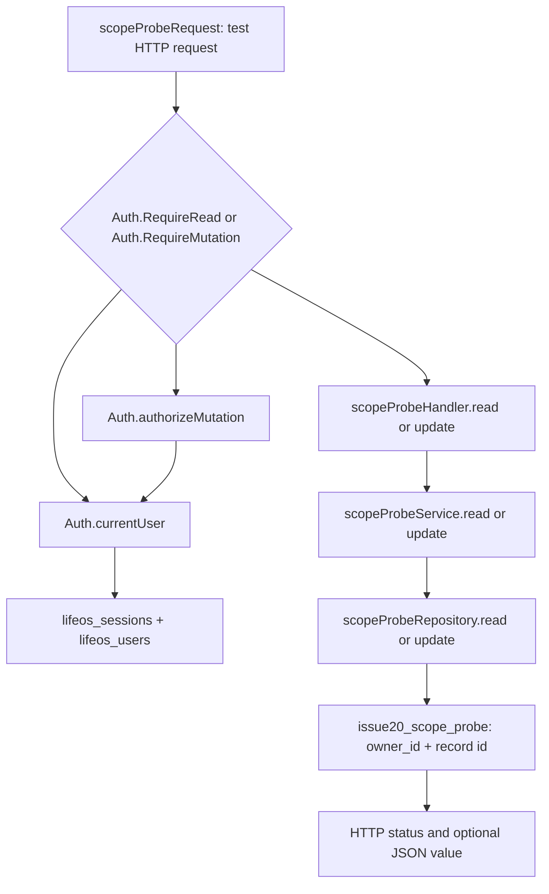

# Issue #20: Owner-Scoped Authorization Boundary

**Status:** Completed after Product Owner final review. Issue #20 was committed, pushed, and closed.

## What changed and why

Future LifeOS modules need one trusted owner value from the active LifeOS session. `internal/identity/owner.go` defines `OwnerID` with an unexported value, so another package cannot turn a request's `owner_id` into a valid owner. `internal/identity/auth.go` adds `Auth.RequireRead` and updates `Auth.RequireMutation` to pass only that value. The latter reuses the existing Origin, session, and CSRF checks. Both guards recheck the user and session on every request and mark responses `no-store`.

The SQL example is confined to `internal/identity/owner_scope_integration_test.go`. Its `issue20_scope_probe` table is created only inside an empty disposable test database. No Finance/Goals schema or public route was added. Future domain handlers still need input validation, their own owner-filtered queries, and isolation tests.

## Actual function-level data flow

The diagram's handler/service/repository/table are **test-only examples**, not a production endpoint. The guard and `OwnerID` are production code.

| Step | Input → Function → Process → Output → Next function |
| --- | --- |
| User input / frontend | **N/A:** no product UI changed. `internal/identity/owner_scope_integration_test.go` / `testOwnerScope` supplies two users, record IDs, attempted owner overrides, and session cookies → `scopeProbeRequest`. |
| API request | `internal/identity/owner_scope_integration_test.go` / `scopeProbeRequest`: method, record ID, cookie, JSON → test HTTP request → `chi.Router` → `Auth.RequireRead` or `Auth.RequireMutation`. This route is not mounted by the production API. |
| Auth guard | `internal/identity/auth.go` / `Auth.RequireRead` or `Auth.RequireMutation`: request → validate method, session, and `clientOwnerOverride`; mutation also calls `Auth.authorizeMutation` for exact Origin and CSRF → `OwnerID` → `scopeProbeHandler.read` or `.update`. Invalid sessions fail with 401; bad Origin/CSRF gives 403; owner query/header override gives 400. `TestOIDCAndSessionIntegration` covers these paths. |
| Session read | `internal/identity/auth.go` / `Auth.currentUser`: session cookie → hash token; query unrevoked, unexpired `lifeos_sessions` joined to active `lifeos_users` → `User.ID` → guard constructs `OwnerID`. Missing/invalid session fails closed. The same integration test checks it. |
| Backend handler | `internal/identity/owner_scope_integration_test.go` / `scopeProbeHandler.read` or `.update`: trusted `OwnerID`, URL record ID, optional JSON → validate write JSON and reject body owner fields → `scopeProbeService.read` or `.update`. Invalid input returns 400; cross-user not found returns 404. |
| Service | `internal/identity/owner_scope_integration_test.go` / `scopeProbeService.read` or `.update`: owner, record ID, value → validate nonblank write value → `scopeProbeRepository.read` or `.update`. Invalid value returns `ErrInvalidInput`; integration test covers the service path. |
| Repository | `internal/identity/owner_scope_integration_test.go` / `scopeProbeRepository.read` or `.update`: owner and record ID → reject zero `OwnerID`; bind both `owner_id = $1` and `id = $2` in SQL → value or update outcome → handler. Cross-user and missing IDs both produce `pgx.ErrNoRows`; tests confirm rejected writes leave data intact. |
| Database | `internal/identity/owner_scope_integration_test.go` / `testOwnerScope` creates `issue20_scope_probe` in a disposable PostgreSQL test database. The production session query uses `db/migrations/000003_auth_sessions.up.sql` tables; no Issue #20 migration exists. SQL constraints bind probe owner to `lifeos_users`; queries return only the session owner's matching row. |
| Response / UI update | `scopeProbeHandler.read` returns JSON; `.update` returns 204. Guards return 401/403 and handler returns 400/404/503. `scopeProbeRequest` checks status and stored values. **UI update: N/A**, because no product frontend or public product route was added. |

## Reading order and test evidence

Read ADR-014, `internal/identity/owner.go`, the two guards and `Auth.currentUser` in `internal/identity/auth.go`, then `internal/identity/owner_scope_integration_test.go`. The important Go idea is an opaque type: future packages can receive an `OwnerID` but cannot fill its private field from a client string. The SQL idea is to bind owner and record ID in the same statement; a read-before-write ownership check alone could race.

`go test -count=1 -v ./...` passed with both PostgreSQL integration databases enabled; its `TestOIDCAndSessionIntegration/owner-scoped_authorization` subtest explicitly passed. It exercises anonymous, owner, tester, cross-user, spoofed owner, CSRF, foreign Origin, revoked, expired, and disabled scenarios. `go vet ./...`, `git diff --check`, and the clean migration-chain verifier also passed; the latter reached version 3 with `dirty=false` and proved repeated-up and isolated fixture rollback. The test's route/table are illustrative; every future real domain module must repeat equivalent isolation tests for its own queries. There is no new migration or OpenAPI contract. Live Google and public deployment behavior are not reverified by this Issue #20 test fixture.
