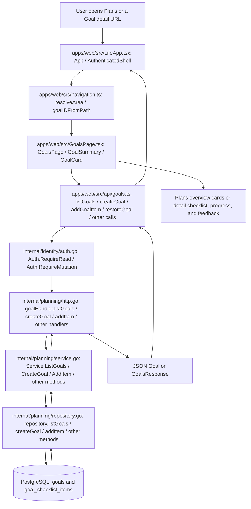

# Issue #25: Goals and checklist workflows

**Status:** Local implementation for Product Owner review. This journal is for later study; the maintained rules are in `docs/DOMAIN_MODEL.md` and `docs/V0.1_SCOPE.md`.

## What changed and why

Goals are simple, non-financial future intent. Migration `db/migrations/000005_goals.up.sql` adds separate owner-scoped `goals` and `goal_checklist_items` tables. This is smaller than a generic Plan engine and leaves Money's `financial_events` and account movements untouched. A Goal can be completed only when it has at least one step and all steps are done. Checklist changes require reopening a completed Goal; archived Goals keep their history and are read-only.

The HTTP layer reuses the existing server-verified session and Origin/CSRF guards. The frontend keeps network calls in `apps/web/src/api/goals.ts`. Plans now has a compact overview and a dedicated Goal detail URL with the full checklist. Archived Goals keep their checklist and can be restored through an owner-scoped mutation. Empty, loading, validation, session, and read/write failure states remain visible and recoverable.

The first visual fixture was wrong: it returned `{items: [...]}` for `POST /goals`, did not store created records, omitted Goal mutation routes, and returned 404 for Money reads. The real Go API returned a single Goal DTO and used owner-scoped SQL. We repaired the ignored fixture, then verified the real browser → React → guarded Go API → disposable PostgreSQL v5 path separately. Test doubles are useful for visual review only when their method, ID, parent-child, and response contracts match the application.

## Actual function-level data flow

### Read path

| Input → Function | Process → Output | Next / errors / tests |
| --- | --- | --- |
| Plans or Goal URL → `apps/web/src/LifeApp.tsx` `App` / `AuthenticatedShell` → `apps/web/src/navigation.ts` `resolveArea` / `goalIDFromPath` | Confirms the session, parses an optional Goal UUID, and renders Plans for overview or detail; direct links, reload, and browser history use normal URLs. | `apps/web/src/GoalsPage.tsx` `GoalsPage`; invalid paths show the shell's not-found page. `LifeApp.test.tsx`. |
| Confirmed owner → `apps/web/src/GoalsPage.tsx` `GoalsPage` / `GoalSummary` / `GoalCard` | `refresh` loads the list. Overview shows compact active cards and a separate archived section; detail shows the selected Goal's full checklist and restore action when archived. | `apps/web/src/api/goals.ts` `listGoals`. On 401, `onSessionExpired`; on network error, retain existing data or show retry. `LifeApp.test.tsx` and isolated browser lifecycle. |
| No client owner ID → `apps/web/src/api/goals.ts` `listGoals` / `goalRequest` | Same-origin GET `/api/v1/goals` with session cookie; parses `GoalsResponse`. | `internal/identity/auth.go` `Auth.RequireRead`. `api/goals.test.ts`. |
| Session cookie → `internal/identity/auth.go` `Auth.RequireRead` | Validates active, unexpired, non-revoked session and active user; produces `identity.OwnerID`. | `internal/planning/http.go` `goalHandler.listGoals`; 401 on invalid session. `planning_integration_test.go`. |
| Verified owner → `internal/planning/http.go` `goalHandler.listGoals` | Rejects unexpected query parameters; calls service and maps domain output to public DTO. | `internal/planning/service.go` `Service.ListGoals`; stable 400/500 errors. `planning_integration_test.go`. |
| Verified owner → `internal/planning/service.go` `Service.ListGoals` | Rejects invalid owner and asks repository for owner Goals. | `internal/planning/repository.go` `repository.listGoals`; 401-equivalent domain error. `planning_integration_test.go`. |
| Owner ID → `internal/planning/repository.go` `repository.listGoals` | Reads Goals and items in one repeatable-read snapshot; calculates completed/total counts. | PostgreSQL `goals`, `goal_checklist_items`; SQL errors propagate. Owner predicates prevent cross-user reads. `planning_integration_test.go`. |
| Rows → `goalHandler.listGoals` → `goalRequest` → `GoalsPage` | Returns JSON; UI renders progress and states without affecting Money. | End of flow. API and UI tests above; direct mobile review is a separate verification step. |

### Mutation path

| Input → Function | Process → Output | Next / errors / tests |
| --- | --- | --- |
| Goal/checklist form or control → `apps/web/src/GoalsPage.tsx` `submitGoal` / `GoalCard.perform` / `GoalsPage.mutate` | Trims and validates title, disables duplicate requests, keeps entered values on failure, updates the changed Goal and refreshes. | `apps/web/src/api/goals.ts` `createGoal`, `addGoalItem`, `renameGoalItem`, `setGoalItemCompletion`, `removeGoalItem`, `setGoalCompletion`, `renameGoal`, `archiveGoal`, or `restoreGoal`. Shows local error/notice. `LifeApp.test.tsx` and isolated browser lifecycle. |
| Validated user input → `apps/web/src/api/goals.ts` `goalRequest` | POST/DELETE under `/api/v1/goals` with same-origin cookie and CSRF header; never sends `owner_id`. | `internal/identity/auth.go` `Auth.RequireMutation`. Network and malformed response errors become `GoalApiError`. `api/goals.test.ts`. |
| Cookie + Origin + CSRF → `internal/identity/auth.go` `Auth.RequireMutation` | Verifies session, active user, Origin, and CSRF; yields server-derived `identity.OwnerID`. | `internal/planning/http.go` matching `goalHandler` method. Rejects 401/403. `planning_integration_test.go`. |
| DTO + verified owner → `internal/planning/http.go` matching `goalHandler` method | Strictly decodes bounded JSON or empty body, rejects unknown fields/query, calls service, maps result to `Goal` DTO. | Matching `internal/planning/service.go` `Service` method. Stable 400/404/409/500. `planning_integration_test.go`. |
| Owner + validated title/IDs/state → `internal/planning/service.go` matching `Service` method | Applies title/ID validation and non-financial completion rules. | Matching `internal/planning/repository.go` `repository` method. Invalid input, missing record, and conflict are explicit. `planning_integration_test.go`. |
| Owner + record IDs → `internal/planning/repository.go` `repository.createGoal` / `withEditableGoal` / `restoreGoal` / other methods | SQL filters by owner and record ID. `withEditableGoal` locks parent Goal in a transaction so checklist edits serialize with Goal completion. `restoreGoal` clears only the archived marker for that owner's archived Goal. | PostgreSQL v5 tables. Foreign IDs are hidden as not found; archived/completed edits conflict. `planning_integration_test.go`. |
| Committed rows → service `GetGoal` → handler `goalDTO` → API `goalRequest` → UI `mutate` | Returns updated Goal and recalculated progress; UI shows a contextual success notice and refreshes. | End of flow. On uncertain network result, UI asks user to check the list before retrying. `planning_integration_test.go`, `api/goals.test.ts`. |

## Migration and concepts

### Verification after Product Owner review

- The original fixture returned 404 for `/api/v1/accounts` and `/api/v1/goals/{id}/archive`, and returned a list-shaped 200 response to `POST /api/v1/goals`. These exact responses reproduced the reported UI failures.
- The repaired fixture created persistent in-memory Goal IDs, returned one Goal per mutation, retained parent-child items, and reused the existing Issue #24 Money fixture for its full synthetic Money workflow. Browser checks completed the visual-fixture Goal lifecycle, loaded Money without a false error, and created a synthetic Money account from the same preview origin.
- In a separate isolated test, the production React bundle used the real Go API with its normal session, Origin, and CSRF checks and disposable PostgreSQL v5. Browser actions covered creation/list/detail/reload, item add/rename/check/uncheck/remove, Goal completion/reopen, archive/restore with checklist retained, and Money empty-state loading. Anonymous Goals and Money reads returned 401. The local fake OIDC discovery server only allowed API startup; it did not issue or verify a Google login.
- Fresh disposable PostgreSQL databases enabled the full Go identity, auth, Finance, Money API, and Goals integration suites. `go test -count=1 ./...`, `go vet ./...`, 30 web tests, web typecheck/build, OpenAPI generated-type check, OpenAPI lint, and `git diff --check` passed. Two existing OpenAPI warnings concern redirect-only OAuth endpoints.

- `goals(owner_id, id)` and `goal_checklist_items(owner_id, goal_id)` bind each checklist row to a Goal owned by the same user. Owner predicates appear in both direct reads and changes.
- `completed_at` and `archived_at` preserve status without a generic state machine. Item removal is an explicit user action; archived Goals retain remaining items.
- The v5 down migration refuses to drop non-empty Goal data. On a populated installation, use a corrective forward migration or a verified backup rather than silent data loss.
- The read repository uses a repeatable-read snapshot for internally consistent progress. Writes lock the parent Goal row before item changes or Goal completion, so concurrent operations cannot leave a completed Goal with unfinished steps.

### Final closure check

- A second full Go run used five newly created empty `*_test` databases. `TestIdentityMigrationAndRepository`, `TestOIDCAndSessionIntegration`, `TestFinanceMigrationAndLedger`, `TestMoneyHTTPIntegration`, and `TestGoalsMigrationServiceAndHTTP` all executed and passed; no PostgreSQL integration test was skipped. The Goals test also checks a populated v4→v5 upgrade, owner isolation, CSRF/Origin, archive/restore retention, concurrency, and unchanged Money balance.
- Thirty web tests passed on a standalone run; TypeScript typecheck, production build, OpenAPI lint and generated-type check, and `go vet ./...` passed. Lint retains only the two documented OAuth redirect-only 2XX warnings. The initial sandboxed Vitest run could not read a sandbox Temp transform file; an unrestricted repeat passed without source changes.
- The existing ignored synthetic preview answered Money accounts with HTTP 200 and passed Goal create/list/item/check/archive/restore/read in memory. This fixture check is separate from the earlier real-browser-to-Go-to-disposable-v5 test and is not an auth or persistence claim.
- Developer navigation and verified local commands are consolidated in [Codebase Map](../../docs/CODEBASE_MAP.md) and [Development Guide](../../docs/DEVELOPMENT_GUIDE.md). No personal database, existing disposable database, production auth guard, or accepted ADR changed.

## Suggested reading order

1. `db/migrations/000005_goals.up.sql`
2. `internal/planning/service.go`
3. `internal/planning/repository.go`
4. `internal/planning/http.go`
5. `apps/web/src/api/goals.ts`
6. `apps/web/src/GoalsPage.tsx`
7. `internal/planning/planning_integration_test.go`

## Open questions and boundaries

Due dates, reminders, ordering, recurring steps, general Plans, and Today summaries are future decisions. This issue does not introduce budgets, travel, collaboration, or finance effects. The real-stack browser smoke used a new disposable v5 database and synthetic session, with normal Go guards; it did not repeat live Google sign-in, which was tested separately in Issue #19. The personal database and earlier disposable databases were not inspected, changed, or deleted.
