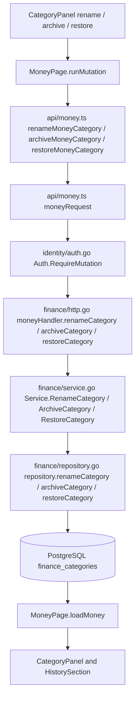
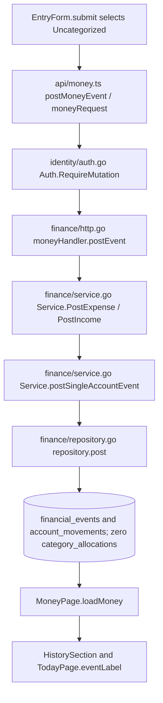

# Issue #27: Category management and Uncategorized transactions

**Status:** Product Owner approved; [Issue #27](https://github.com/Faust217/LifeOS/issues/27) completed and closed separately from Today Issue #26. Product rules are in `docs/DOMAIN_MODEL.md`; this entry explains the implementation.

## Why this design

A category is an owner-owned label with a stable ID. Renaming changes its display name; archive/restore changes only `archived_at`. Existing `CategoryAllocation` rows continue to reference the same ID. The repository serializes category-name writes with an owner-row lock, then rejects case-insensitive duplicates within the same income/expense kind, including archived names. `Uncategorized` is a reserved display label, not a shared database category. A fully uncategorized income/expense posts a normal event and account movement with zero allocations. If allocations are supplied, their sum must still equal the event amount exactly. Transfers and voided events never become spending.

## Actual function-level data flow

| Input → Function | Process → Output | Next / errors / tests |
| --- | --- | --- |
| Category action/name → `apps/web/src/MoneyPage.tsx` `CategoryPanel.submitRename` / `confirmChange` | Opens inline edit or confirmation inside the compact sheet, retains the draft on failure, and shows the returned error. | `MoneyPage.runMutation` → typed API; browser checked 320/390 px, Escape/focus, rename, archive and restore. |
| Valid category write → `apps/web/src/api/money.ts` `renameMoneyCategory` / `archiveMoneyCategory` / `restoreMoneyCategory` and `moneyRequest` | Sends same-origin POST, session cookie, and CSRF header. Rename body contains only `name`; archive/restore have no payload. | `Auth.RequireMutation`; `api/money.test.ts` checks routes and headers. |
| Session and Origin → `internal/identity/auth.go` `Auth.RequireMutation` | Verifies session, Origin, CSRF and derives `OwnerID` on the server. | `moneyHandler` methods; Finance HTTP integration checks anonymous, foreign owner, missing CSRF and bad Origin denials. |
| Category DTO → `internal/finance/http.go` `moneyHandler.renameCategory` / `archiveCategory` / `restoreCategory` | Strictly parses rename, returns category JSON or 204, maps validation/conflict/not-found errors. | `Service.RenameCategory` / `ArchiveCategory` / `RestoreCategory`; `http_integration_test.go`. |
| Owner/category/name → `internal/finance/service.go` corresponding `Service` methods | Validates IDs and name, trims whitespace, reserves `Uncategorized`; category kind is never editable. | `repository` methods; `finance_integration_test.go`. |
| Validated owner write → `internal/finance/repository.go` `repository.renameCategory` / `archiveCategory` / `restoreCategory` | Locks owner for name writes; preserves ID, kind and allocation links; updates name or `archived_at` using owner-scoped SQL. | PostgreSQL v4 tables → JSON/204 → `MoneyPage.loadMoney`; conflict/foreign owner returns error. |
| Amount/account/optional category → `apps/web/src/MoneyPage.tsx` `EntryForm.submit` | Exact minor-unit parsing; blank category sends `allocations: []`, explicit category sends one exact allocation. Draft survives validation/API error. | `postMoneyEvent`; browser posted uncategorized income and expense. |
| Event DTO → `internal/finance/http.go` `moneyHandler.postEvent` | Requires an explicit allocations array; `[]` is valid, omitted/null is rejected, decimal strings remain exact. | `Service.PostIncome` / `PostExpense`; HTTP integration checks empty/missing/null and mismatch. |
| Owner/event → `internal/finance/service.go` `Service.postSingleAccountEvent` | Checks account, currency and amount; permits zero allocations, or requires nonempty allocations to sum exactly to the event amount. | `repository.post`; Finance integration checks empty/multiple/mismatch, archived category rejection and void. |
| Validated event → `internal/finance/repository.go` `repository.post` | Atomic transaction writes `FinancialEvent` and `AccountMovement`; writes `CategoryAllocation` rows only when supplied. Owner-scoped foreign keys and active category checks remain. | PostgreSQL v4 ledger → event DTO → `MoneyPage.loadMoney`. |
| Refreshed records → `MoneyPage.loadMoney` / `HistorySection` and `apps/web/src/TodayPage.tsx` `eventLabel` | Reads guarded accounts, categories, balances and paginated history; shows current category names and explicit Uncategorized label. Balances come from server movements, not the limited event page. | UI; browser verified renamed/archived history, exact balances, Today and cross-owner separation. |

## Reading order and verification

Read `MoneyPage.tsx` `CategoryPanel` and `EntryForm`, then `api/money.ts`, `finance/http.go`, `finance/service.go`, `finance/repository.go`, and `TodayPage.tsx`. The existing v4 schema already models zero or more allocations, so no migration or new infrastructure was needed. The OpenAPI request now documents an explicit empty allocations array; generated TypeScript contracts follow it.

All 35 web tests, typecheck/build, OpenAPI generation check, and the full Go suite passed. The Go run used five new empty disposable PostgreSQL databases for migration, identity, Finance, Money HTTP, and Goals integration. An isolated Edge browser used the production React build, guarded Go API and a separate disposable PostgreSQL v5 database with synthetic owner and second-user sessions. It exercised linked-category rename/history, archive/restore, archived selection exclusion, uncategorized expense/income, balances, Today, owner isolation, and 320/390 px sheets without overflow. The earlier browser run stopped after successfully archiving due to a test harness serialization error; the harness was corrected and resumed against the same retained database. No personal database, existing disposable test database, migration, deployment or live Google sign-in was touched.

**Follow-up:** A future overall spending report must count posted expense events with empty allocations and exclude transfers/voided events. Category-specific totals alone cannot serve as overall spending. Bulk historical reclassification needs separate confirmation and audit semantics. Opening-balance effective dates, backdated entries, and financial-write idempotency remain separate Personal Data Ready work.
