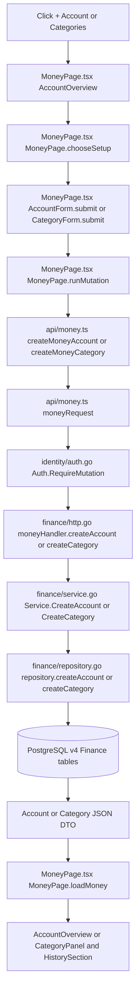

# Compact Money setup: local UX refinement

**Status:** Local and uncommitted for Product Owner review. This is separate from Issue #26's Today dashboard scope. Product rules stay in `docs/`.

## What changed and why

The permanent Account/Category setup section consumed the space between Accounts and transaction history. `MoneyPage` now renders `AccountOverview` immediately before `HistorySection`. The account heading offers `+ Account` and `Categories`; the frequent `+ Add transaction` action stays above the overview. Both setup forms use a native modal dialog styled as a bottom sheet on small screens. The Categories panel shows existing income/expense categories, including archived labels, above its Add Category form.

The forms still use their existing validation and Money APIs. They remain mounted while the dialog is closed, so validation and request failures do not erase drafts. A successful account write refreshes Money and closes the sheet; category creation refreshes the list while its panel stays open. Escape, close, and backdrop click cancel the panel; focus returns to the launcher. Closing is disabled during a pending setup write so the result remains visible. The dialog ignores a stale native close event if another setup panel has already opened; rapid Account → Categories switching exposed this timing case in the browser check. The opening-balance date warning and credit-card negative-balance guidance remain in `AccountForm`.

## Actual function-level data flow

| Input → Function | Process → Output | Next / errors / tests |
| --- | --- | --- |
| Setup button → `apps/web/src/MoneyPage.tsx` `AccountOverview` / `MoneyPage.chooseSetup` | Stores the launcher, switches the native dialog to Account or Categories, and focuses the modal. The existing transaction form can lead here when a needed account/category is missing. | `AccountForm` or `CategoryPanel`/`CategoryForm`; Escape, close, or backdrop returns focus. 320/390 px Edge checks. |
| Account fields → `apps/web/src/MoneyPage.tsx` `AccountForm.submit` | Validates name and exact integer minor units using `parseAmountToMinor`, retaining the form on error. | `MoneyPage.runMutation` → `createMoneyAccount`; client error stays beside fields, request error preserves the draft. Browser validation/error check. |
| Category fields → `apps/web/src/MoneyPage.tsx` `CategoryForm.submit` | Validates name and income/expense kind. `CategoryPanel` lists the refreshed category DTOs. | `MoneyPage.runMutation` → `createMoneyCategory`; failed write retains input. Browser creation check. |
| Validated input → `apps/web/src/MoneyPage.tsx` `MoneyPage.runMutation` | Prevents overlapping writes, reports uncertain results safely, and refreshes the page after a successful response. | `apps/web/src/api/money.ts` `createMoneyAccount` / `createMoneyCategory`, then `MoneyPage.loadMoney`; 401 expires the session. Existing Money API tests. |
| CSRF token and DTO → `apps/web/src/api/money.ts` `moneyRequest` | POSTs same-origin JSON with session cookie and CSRF header; parses the response or typed error. No client owner ID is supplied. | `internal/identity/auth.go` `Auth.RequireMutation`; `api/money.test.ts`, Money HTTP integration tests. |
| Valid session → `internal/identity/auth.go` `Auth.RequireMutation` | Verifies Origin, CSRF, session, and server-derived `OwnerID`. | `internal/finance/http.go` `moneyHandler.createAccount` / `createCategory`; invalid requests are rejected. Existing Go integration tests. |
| Request and owner → `internal/finance/http.go` `moneyHandler.createAccount` / `createCategory` | Parses DTOs and minor-unit strings, returns public 201 DTOs or stable errors. | `internal/finance/service.go` `Service.CreateAccount` / `CreateCategory`; `http_integration_test.go`. |
| Domain input → `internal/finance/service.go` `Service.CreateAccount` / `CreateCategory` | Applies Finance validation and sends the owner-scoped write to the repository. | `internal/finance/repository.go` `repository.createAccount` / `createCategory`; `finance_integration_test.go`. |
| Owner-scoped write → `internal/finance/repository.go` `repository.createAccount` / `createCategory` | Persists account/category rows in PostgreSQL v4; no schema change. | JSON DTO response → `MoneyPage.loadMoney`, which rereads accounts, categories, balances, and history; UI updates without guessed totals. |

For the frequent transaction path, `EntryForm.submit` still calls `postMoneyEvent` → `moneyRequest` → `Auth.RequireMutation` → `moneyHandler.postEvent` → `Service.PostExpense`/`PostIncome` → `repository.post` → PostgreSQL v4, then `runMutation`/`loadMoney` refresh the UI. Archive/restore and transfer flows were not modified. See the earlier Money UI and API journal entries for their full invariants.

## Concepts and reading order

Read `MoneyPage.tsx` `MoneyPage`, `AccountOverview`, `CategoryPanel`, and the two forms, then `money.css`, `api/money.ts`, the mutation guard, Finance handler/service/repository, and the v4 migration. A native `<dialog>` supplies modal keyboard behavior and focus containment; React controls open state and restores focus to the triggering action. Keeping forms mounted across close/error preserves drafts without adding storage or schema.

## Verification and remaining questions

All 33 frontend tests passed; typecheck and the production build passed. The isolated Edge browser at 320 px, 390 px, and 1280 px found no horizontal overflow, checked the account warning/guidance, closed the dialog and returned focus, and closed Categories with Escape. It preserved account fields through a validation error and an injected 503 response, then created an account, expense category, and expense through the normal guarded Go API and synthetic PostgreSQL v5 user. Today displayed the resulting account; the original preview owner's Today stayed isolated. This was a UI-only change: the existing Go/contract integration suite from Issue #26 remains the backend baseline and was not rerun for new backend behavior. Live Google sign-in and public hosting were not part of this check. The Product Owner should review the compact layout and decide whether to open a separate small UX issue for this work; Issue #26 remains Today-only.
