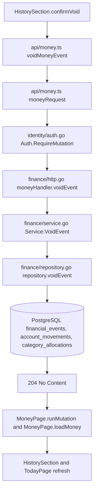

# Issue #28: Optional Void Reason

**Status:** Product Owner approved implementation and final display polish. [Issue #28](https://github.com/Faust217/LifeOS/issues/28) is separate from Today #26 and Money categories #27. The current product rule is in `docs/DOMAIN_MODEL.md`.

## What changed and why

The earlier Money flow required a typed reason even for a personal correction. The Product Owner approved an optional note. The owner must still explicitly confirm Void. If they submit no meaningful text, `Service.VoidEvent` stores `No reason provided by owner` as a **server-generated audit message**. Money displays `Void reason: N/A` for that default and the actual text for other reasons. A supplied note is trimmed and retained, up to 500 Unicode characters in Go, React and the existing database constraint. The original event, its movements and allocations remain in history as voided; its account and category spending effects stop counting. The existing v4 `void_reason` nonempty constraint remains intact because the server writes a nonempty default. No migration was needed.

## Actual function-level data flow

| Input → Function | Process → Output | Next / errors / tests |
| --- | --- | --- |
| Confirm with optional note → `apps/web/src/MoneyPage.tsx` `HistorySection.confirmVoid` | Trims the note, checks the length, and calls the mutation without demanding text. Cancel leaves the transaction untouched. | `voidMoneyEvent`; 320/390 px Edge check confirmed the optional field and blank submission. |
| Event ID, note, CSRF → `apps/web/src/api/money.ts` `voidMoneyEvent` / `moneyRequest` | Sends a same-origin POST with cookie, Origin and CSRF header; an omitted client argument sends an empty reason string. | `Auth.RequireMutation`; `api/money.test.ts` covers explicit and empty payloads; failures remain visible in Money. |
| Authenticated request → `internal/identity/auth.go` `Auth.RequireMutation` | Validates session, Origin and CSRF; derives the owner ID server-side. | `moneyHandler.voidEvent`; HTTP integration and real-API checks reject anonymous, cross-owner, missing-CSRF and wrong-Origin attempts. |
| JSON object → `internal/finance/http.go` `moneyHandler.voidEvent` | Strictly decodes the optional `reason` property and returns 204 or a stable error. | `Service.VoidEvent`; omitted, empty, whitespace and explicit requests were verified against the guarded Go API. A JSON body is still required. |
| Owner, event ID, reason → `internal/finance/service.go` `Service.VoidEvent` | Checks owner/ID, trims whitespace, rejects overlong notes, and substitutes `No reason provided by owner` when blank. | `repository.voidEvent`; Finance integration checks the stored default and existing explicit reasons. |
| Validated void → `internal/finance/repository.go` `repository.voidEvent` | In one transaction locks the owned posted event and affected accounts, verifies balance arithmetic, marks it voided, and stores time/reason. Historical movement/allocation rows are retained. | PostgreSQL v4 tables → 204; repeat void returns conflict and foreign event returns not found. |
| 204 → `apps/web/src/MoneyPage.tsx` `MoneyPage.runMutation` / `loadMoney` | Refreshes server-calculated balances, categories and history; the original row remains marked Voided. `HistorySection` displays the generated default as `Void reason: N/A` and an explicit note verbatim. | `HistorySection` and later `TodayPage` reads; browser and real-API checks confirm balance/spending restoration. |

## Verification and follow-up

The first browser test timed out because its harness expected a fixed MYR 117.00 and the first row to be a posted income. A synthetic expense had already been voided, so those assumptions were stale; the preview and guarded Go API were healthy. The corrected harness creates a uniquely named synthetic event, reads its starting balance, and selects that event by label. It passed blank-note void, retained history, Money and Today balances, and 320/390 px layouts. The final browser pass checks `Void reason: N/A` and explicit reason display. A second synthetic user on the real Go API and disposable PostgreSQL v5 passed omitted, empty, whitespace-only, and explicit notes, balance and category-spending checks, repeated-void rejection, and authorization guards. The full Go suite passed on five new empty disposable databases; focused Finance/HTTP integration passed on two more fresh databases after adding a 500-Chinese-character boundary case. All 35 frontend tests, TypeScript typecheck and production build, OpenAPI lint/generated-type check, `go vet`, and `git diff --check` passed. OpenAPI lint has only two pre-existing redirect-only OAuth 2XX warnings.

The display detects the server default by its exact text because the current ledger has no separate reason-provenance field. An owner typing that exact phrase as an explicit note would also see N/A. This edge case requires a future contract/storage decision if distinct provenance becomes important; no schema was added for this UI polish.

Read `MoneyPage.tsx` `HistorySection` first, then `api/money.ts`, the mutation guard, `finance/http.go`, `finance/service.go`, and `finance/repository.go`. A future decision about permanent deletion is separate and was not implemented. The personal LifeOS database, published migrations, and existing disposable databases were not changed or removed.
