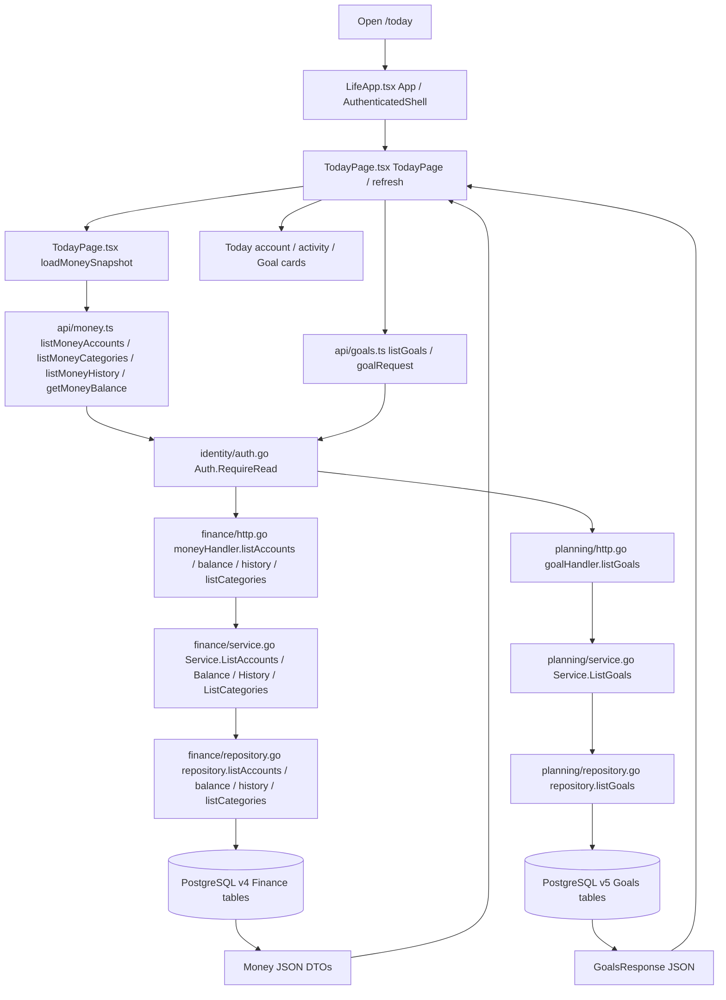

# Issue #26: Real Today dashboard

**Status:** Product Owner approved; Issue #26 completed and closed. This journal is for later study; product rules remain in `docs/`.

## What changed and why

Today now reads authenticated Money and Goals data instead of showing navigation placeholders. It displays each account's server-calculated balance in that account's currency, four recent event records with account/category context, and unfinished, unarchived Goals with the server's completed/total checklist counts. Money and Goals load independently, so a failure in one area does not replace the other with invented data. Empty sections invite the next action. The dashboard does not calculate a spending or all-currency total from paginated history.

Existing API routes and repositories already provide the required read facts. A new dashboard endpoint or migration would duplicate Finance and Planning rules without improving this MVP. A future aggregate dashboard endpoint can be evaluated if real usage exposes a measured latency or consistency need.

## Actual function-level data flow

| Input → Function | Process → Output | Next / errors / tests |
| --- | --- | --- |
| `/today` → `apps/web/src/LifeApp.tsx` `App` / `AuthenticatedShell` | Confirms `/api/v1/me` before mounting Today; passes `onSessionExpired`. | `apps/web/src/TodayPage.tsx` `TodayPage`; signed-out and API-unavailable screens hide private data. `LifeApp.test.tsx`. |
| Mounted Today → `apps/web/src/TodayPage.tsx` `refresh` | Starts Money and Goals reads together, accepts each result independently, and ignores stale responses after unmount. | `loadMoneySnapshot` and `apps/web/src/api/goals.ts` `listGoals`; errors show section-specific recovery, 401 rechecks the session. `TodayPage.test.ts`, browser check. |
| No client owner ID → `apps/web/src/TodayPage.tsx` `loadMoneySnapshot` | Gets the complete account/category lists and a four-record history page, then asks the server for each account balance. The history page is only a list, never an aggregate source. | `apps/web/src/api/money.ts` `listMoneyAccounts`, `listMoneyCategories`, `listMoneyHistory`, `getMoneyBalance`; an unavailable balance fails the Money section rather than showing a guessed number. |
| GET requests → `apps/web/src/api/money.ts` `moneyRequest` and `apps/web/src/api/goals.ts` `goalRequest` | Sends same-origin cookie requests with no owner parameter and parses typed DTOs. | `internal/identity/auth.go` `Auth.RequireRead`; network/bad JSON becomes a typed API error. `api/money.test.ts`, `api/goals.test.ts`. |
| Cookie → `internal/identity/auth.go` `Auth.RequireRead` | Validates the active session and user, deriving `identity.OwnerID` server-side. | Finance/Planning HTTP handlers; invalid/expired sessions receive 401. Existing integration tests. |
| Verified owner → `internal/finance/http.go` `moneyHandler.listAccounts`, `balance`, `listCategories`, `history`; `internal/planning/http.go` `goalHandler.listGoals` | Validates query parameters and maps service results into public JSON DTOs. | Corresponding Finance/Planning service methods; stable HTTP errors. `http_integration_test.go`, `planning_integration_test.go`. |
| Owner and IDs → `internal/finance/service.go` `Service.ListAccounts`, `Balance`, `ListCategories`, `History`; `internal/planning/service.go` `Service.ListGoals` | Checks owner/ID/input invariants and calls module repositories. | `finance/repository.go` and `planning/repository.go`; invalid owner is rejected. Existing Go integration tests. |
| Verified owner → `internal/finance/repository.go` `repository.listAccounts`, `balance`, `listCategories`, `history`; `internal/planning/repository.go` `repository.listGoals` | Owner-scoped SQL reads Finance v4 and Goals v5. Balance uses account movement semantics; Goals progress comes from stored checklist records. | PostgreSQL rows to services/handlers. Foreign owner records are excluded. Existing Go integration tests. |
| JSON response → `apps/web/src/TodayPage.tsx` `TodayPage`, `eventLabel`, `eventAccounts`, `activeGoalsOnly` | Renders account currency per value, transfer endpoint labels and neutral transfer marker, active Goal links and counts, and honest empty/error states. | UI end of flow. `TodayPage.test.ts`, responsive browser check. |

## Concepts and reading order

This is a read projection: Finance owns money arithmetic, Planning owns checklist state, and Today presents their public DTOs. Separate promises let a healthy Goals response appear even if Money is slow or fails. The account balance endpoint is authoritative; a four-item transaction page cannot reconstruct all account movements. A transfer moves value between accounts and is displayed as a transfer, not as a spending sum.

Read `apps/web/src/TodayPage.tsx`, then `apps/web/src/api/money.ts` and `api/goals.ts`, then the `RequireRead` guard, Finance/Planning handlers, services, repositories, and migration v4/v5. The existing Money and Goals journal entries explain their write paths.

## Verification and open questions

The focused frontend tests cover transfer labels and endpoints, category fallback, and Goal filtering/progress. The full frontend suite passed 33 tests, typecheck/build passed, and the generated OpenAPI contract matched. An isolated PostgreSQL v5 reached the expected clean migration version. Through the normal Go API and synthetic sessions, Finance and Goals records persisted, per-account balances remained correct beyond the four-event page, transfers were distinct from spending, Goal progress was 1/3, foreign owner IDs returned 404, and anonymous requests returned 401. Edge displayed the production React bundle at 320 px, 390 px, and desktop without horizontal overflow, showed the other user's isolated data, and showed every empty state for a third user with no records. An injected Money read error left Goals usable. Five additional new empty `*_test` databases ran the complete Go identity, auth, Finance, Money API, and Goals integration suites; `go vet`, OpenAPI lint and generated-type check, and diff checks passed. A local fake OIDC discovery endpoint allowed this test mode; it did not perform live Google sign-in. Historical running balances, month/category charts, and a cross-module snapshot endpoint remain separately scoped decisions.
