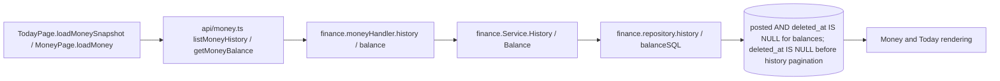

# Issue #29 — FinancialEvent Soft Delete

**Status:** Local implementation and Product Owner visual review approved on 2026-10-14. ADR-016 is Accepted. The initial physical-deletion draft was never accepted. Commit, push, and Issue #29 closure were subsequently authorized; personal-data migration and deployment remain separate gates.

## What changed and why

Delete now removes a posted or voided transaction from normal Money and Today views. A posted event's movements and allocations stay in PostgreSQL, but its balance and spending effects cease in the same commit that sets `deleted_at`. A previously voided event receives the marker without a second reversal. Void still leaves an auditable, visible record. This gives the requested app-level removal while preserving ledger integrity and the original posted/Void distinction.

Migration `db/migrations/000006_financial_event_soft_delete.up.sql` adds nullable `financial_events.deleted_at`; the down migration refuses to erase a used marker and accidentally reveal deleted records. Published migrations remain unchanged. Ordinary Finance reads use `deleted_at IS NULL`; balance and spending additionally require `status = 'posted'`. Future export, chart, search, and report code must use that same eligible set. Delete is not physical erasure; old backups may reintroduce a previously deleted event if restored without reconciliation.

## Actual function-level write flow

```mermaid
flowchart LR
  A[MoneyPage HistorySection.confirmDelete] --> B[api/money.ts deleteMoneyEvent]
  B --> C[identity.Auth.RequireMutation]
  C --> D[finance.moneyHandler.deleteEvent]
  D --> E[finance.Service.DeleteEvent]
  E --> F[finance.repository.deleteEvent]
  F --> G[finance.eventMovementSpecs]
  G --> H[finance.checkRemovalBalances]
  H --> I[(PostgreSQL financial_events.deleted_at)]
  I --> J[204 No Content]
  J --> K[MoneyPage.runMutation / loadMoney]
```

| Step | Input → function → process → output → next |
| --- | --- |
| User/UI | Confirmed posted or voided history row → `apps/web/src/MoneyPage.tsx` `HistorySection.confirmDelete` → retains confirmation until success, then clears it and moves focus to history heading → event ID and CSRF token → `deleteMoneyEvent`. Cancel restores focus to the Delete button without sending a request. |
| Frontend API | ID and CSRF → `apps/web/src/api/money.ts` `deleteMoneyEvent`/`moneyRequest` → same-origin POST with cookie and `X-CSRF-Token`, no body → 204 or `MoneyApiError` → guarded route. Network/5xx uncertainty leaves a refresh prompt rather than assuming failure. |
| Guard | Cookie, Origin, CSRF → `internal/identity/auth.go` `Auth.RequireMutation`/`authorizeMutation` → verifies active session, exact Origin, token and no owner override → server-derived `OwnerID` → handler. Missing/invalid credentials return 401/403 before domain code. |
| Handler | Event path ID, empty body → `internal/finance/http.go` `moneyHandler.deleteEvent` → rejects unexpected query/body, maps service errors → 204 or typed 400/404/409/422/5xx → service. Unknown and foreign IDs have the same 404 result. |
| Service | `OwnerID`, event ID → `internal/finance/service.go` `Service.DeleteEvent` → checks verified owner and UUID → validated input → repository. Invalid input is rejected before SQL. |
| Repository | Owned ID → `internal/finance/repository.go` `repository.deleteEvent` → begins transaction; `SELECT ... FOR UPDATE` serializes Delete/Void; repeat Delete commits without another effect. Posted events call `eventMovementSpecs` and `checkRemovalBalances` under stable account locks, then set `deleted_at = now()`; voided events set only the marker → committed result → handler. Errors roll back. |
| Database/response | `db/migrations/000006_financial_event_soft_delete.up.sql` nullable marker, retained `account_movements`/`category_allocations` and original status/Void metadata → atomic visibility and calculation change → 204 → UI. `MoneyPage.runMutation` calls `loadMoney` to refresh server balances, categories and paginated history; after success the row disappears and focus moves to the heading. |

## Actual read and race flow

`internal/finance/repository.go` `repository.categorySpending` also requires posted, undeleted expense events. `repository.voidEvent` locks the same event row and rejects `deleted_at IS NOT NULL`: Void may finish before Delete, or Delete may win and Void returns conflict. `checkRemovalBalances` computes prospective balances with integer arithmetic and rejects overflow; all account effects of a transfer disappear together. Today projects server data only and does not sum a paginated history page.

## Tests and errors

- `internal/finance/soft_delete_integration_test.go` `TestFinanceSoftDelete`: real PostgreSQL v6 for posted Expense, Income, Transfer and Uncategorized; already-voided records; retained links/audit fields; MYR/USD separation, balances and spending; history pagination; duplicate Delete; Delete/Delete and Delete/Void races; overflow; injected update failure rollback; down-migration guard.
- `internal/finance/http_integration_test.go` `TestMoneyHTTPIntegration`: real Go router and PostgreSQL for 204/repeat, 400 input, 401 sessions, 403 Origin/CSRF, 404 foreign/unknown, retained rows, and no post-Delete Void.
- `internal/finance/finance_integration_test.go` verifies a populated v4 Finance upgrade to v6. `internal/planning/planning_integration_test.go` keeps Goals and Finance regression checks at v6. Full Go suite ran on six fresh disposable databases; existing databases were retained.
- `apps/web/src/api/money.test.ts` checks typed POST and CSRF. All 35 frontend tests, TypeScript typecheck/build, OpenAPI lint/generated-contract check, and migration verification passed. OpenAPI lint retained only two prior OAuth redirect warnings.
- Real Edge with production React, guarded Go API, and new disposable PostgreSQL v6 passed 320/390 px: confirmation/cancel/focus, posted and voided Delete, balance/history/Today refresh, Goal continuity, owner isolation, empty/error states, and no horizontal overflow. Synthetic test sessions are not evidence of a new live Google sign-in.

## Reading order and open questions

Read accepted `docs/adr/ADR-016-financial-event-soft-delete.md`, then migration v6, `repository.deleteEvent`/`checkRemovalBalances`, `Service.DeleteEvent`, guarded handler, OpenAPI, and `HistorySection.confirmDelete`. The central Go/SQL idea is a database transaction that serializes state transitions with row locks; the `deleted_at` predicate changes calculations without destroying ledger rows. Later export/report/query implementations must apply the same predicate. The general Personal Data Ready backup/restore work must decide how to reconcile deleted markers when restoring an older snapshot. No undelete UI, physical erasure, Issue #30 history redesign, or AI capability was added.
