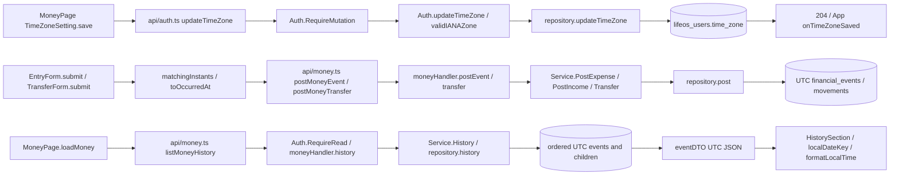

# Issue #30: Date-Grouped Money History and Owner Timezone

**Status:** Implemented, verified and approved by the Product Owner for delivery.

## What changed and why

Money now opens on a compact Transactions view with owner-local date headers and full-row expandable details. Overview remains one tap away. Each row retains a signed currency amount, title, account, category, local time, and Voided state. Existing Void, Delete, and replacement controls remain inside the details. The page groups only the current server page; the same date can have a header on adjacent pages. Transfers remain one event. No daily totals or historical running balances are inferred from a paginated slice.

The previous `datetime-local` conversion used the browser's timezone. A travelling owner could enter or see a different day on another device. Migration `db/migrations/000007_owner_timezone.up.sql` adds nullable `lifeos_users.time_zone`. The owner confirms a browser suggestion once and can later change it from Money. The Go API validates the IANA name using bundled tzdata; the database also rejects empty, overlong, or padded values. All Finance `occurred_at` values remain UTC instants. The API serializes event timestamps in UTC. Legacy events are not rewritten: their visible calendar date follows the owner's **current** preference, so a deliberate change can regroup history.

At DST gaps, no UTC instant matches the selected local wall time and the form rejects it. At overlaps, two instants match and the form requires an explicit earlier/later selection. The existing UTC transaction API contract is unchanged; only the current-user timezone contract is new.

## Actual function-level flow

### Save and read the timezone

| Input | Function | Process | Output | Next function |
| --- | --- | --- | --- | --- |
| Browser suggestion or edited IANA name | `apps/web/src/MoneyPage.tsx` `TimeZoneSetting.save` | Keep draft on failure; send confirmed name with session CSRF | Name or visible error | `api/auth.ts` `updateTimeZone` |
| Name and CSRF | `apps/web/src/api/auth.ts` `updateTimeZone` | Same-origin `PUT /api/v1/me/timezone` | 204 or error | `internal/identity/auth.go` `Auth.RequireMutation` |
| Cookie, Origin, CSRF | `Auth.RequireMutation` | Verify active session; derive owner; reject client owner override | OwnerID or 401/403/400 | `Auth.updateTimeZone` |
| OwnerID and JSON name | `Auth.updateTimeZone`, `validIANAZone` | Reject malformed JSON/unknown fields; validate named zone via `time.LoadLocation` | Validated name or 400 | `internal/identity/repository.go` `repository.updateTimeZone` |
| OwnerID and zone | `repository.updateTimeZone` | Update only the active owner row | Stored `lifeos_users.time_zone`; 204 or 503 | `apps/web/src/LifeApp.tsx` `App` `onTimeZoneSaved` |
| Next page/reload | `api/auth.ts` `fetchCurrentUser` → `Auth.me` → `Auth.currentUser` | Read preference through active session | `GET /api/v1/me` JSON with `time_zone` | `AuthenticatedShell` → `MoneyPage` / `TodayPage` |

Identity has no separate service layer: `Auth.updateTimeZone` contains the small validation/application rule and calls its own private repository. This is **N/A** for a cross-module service, not a bypass of owner authorization.

### Enter a transaction

| Input | Function | Process | Output | Next function |
| --- | --- | --- | --- | --- |
| Wall date/time in saved zone | `apps/web/src/MoneyPage.tsx` `EntryForm.submit` / `TransferForm.submit` | Validate account, amount, and time; keep form on errors | UTC timestamp or field error | `apps/web/src/moneyAmount.ts` `matchingInstants` / `toOccurredAt` |
| Local time + saved zone | `matchingInstants`, `toOccurredAt` | Round-trip candidate offsets; reject gap, require overlap choice, reject future instant | Explicit UTC ISO instant | `api/money.ts` `postMoneyEvent` / `postMoneyTransfer` |
| Existing DTO with UTC `occurred_at` | `internal/finance/http.go` `moneyHandler.postEvent` / `transfer` | Guarded existing POST parses DTO | Validated Finance input | `internal/finance/service.go` `Service.PostExpense` / `PostIncome` / `Transfer` |
| Owner and Finance input | `Service.PostExpense` / `PostIncome` / `Transfer` | Keep amount, account, category and transfer invariants | `postSpec` | `internal/finance/repository.go` `repository.post` |
| `postSpec` | `repository.post` | Insert one event and its movements/allocations atomically | UTC event row and response | `MoneyPage.runMutation` → `loadMoney` |

### Read and group a history page

| Input | Function | Process | Output | Next function |
| --- | --- | --- | --- | --- |
| Current page | `apps/web/src/MoneyPage.tsx` `MoneyPage.loadMoney` | Request `PAGE_SIZE + 1` and balances; keep previous view on refresh failure | 10 visible events + hasNext | `api/money.ts` `listMoneyHistory` |
| Limit and offset | `listMoneyHistory` → `Auth.RequireRead` | Same-origin GET and active session owner | Owner-scoped request or 401 | `internal/finance/http.go` `moneyHandler.history` |
| Owner, limit, offset | `moneyHandler.history` → `Service.History` | Validate page parameters | Query arguments or 400 | `internal/finance/repository.go` `repository.history` |
| Owner and page | `repository.history` | Filter deleted before `ORDER BY occurred_at DESC, id DESC`, limit and offset; load linked rows | Ordered UTC events | `http.go` `eventDTO` |
| Event records | `eventDTO` | Normalize `occurred_at` to UTC in JSON | API page | `MoneyPage.loadMoney` |
| Page and saved zone | `HistorySection`, `moneyAmount.ts` `localDateKey` / `formatLocalDate` / `formatLocalTime` | Emit a header at each local-date change within this page | Compact accessible rows | User expands details or changes page |

`TodayPage` uses the same saved zone with `formatLocalDate`. Without a confirmed preference, Money does not render local-date history or entry, and Today shows activity without a potentially misleading local date. The Overview still allows account/category management. Changing timezone does not update `financial_events`.

## Verification and reading order

Read `db/migrations/000007_owner_timezone.up.sql`, `internal/identity/auth.go`, `apps/web/src/moneyAmount.ts`, `apps/web/src/MoneyPage.tsx`, then `internal/finance/repository.go`. The full Go suite passed on six fresh disposable PostgreSQL databases with no skips. A separate fresh database passed the v1–v7 chain and repeat-up verification; the identity integration test also upgraded a populated user to v7. The 38 web tests, TypeScript typecheck/build, OpenAPI lint/generated contract checks, `go vet`, and `git diff --check` passed. The two pre-existing OAuth redirect warnings remain in OpenAPI lint.

Real Edge checks at 320px and 390px used a guarded Go API and fresh PostgreSQL v7 databases. They covered first-time suggestion and confirmation, compact rows, a date split across pages, account Overview, a transaction entered from a device in another timezone, UTC API output, changed timezone and reload, Today, cross-user isolation, and empty owner behavior. Synthetic sessions were used; no live Google sign-in was repeated. An old backup restore may carry a null preference or a prior preference, so Personal Data Ready still requires restore reconciliation before real finance data is used.

The final preview readiness check exposed a separate composition detail: `cmd/lifeos-api/main.go` passes `internal/platform/migrations/version.go` `CurrentVersion` to `health.NewService`, which compares it to the database migration version for `/readyz`. The constant was still 5 after the earlier v6 work. Updating it to 7 made the rebuilt isolated API report `ready` with actual and expected schema 7. The browser error/retry flow passed again after the restart.

## Visual review polish

The Product Owner's first review approved the technical timezone/date behavior in principle and asked for less permanent text. `MoneyPage.tsx` `TimeZoneSetting` now reads the browser suggestion, builds a broad IANA list with `Intl.supportedValuesOf("timeZone")`, filters it by the user's search, and keeps the selected IANA ID separate from the human label produced by `moneyAmount.ts` `timeZoneLabel`. Its `save` still calls the same guarded `api/auth.ts` `updateTimeZone` function; Cancel and request errors do not change the stored preference. After confirmation, the edit flow lives in a native Money Settings dialog with focus returned to the trigger. `HistorySection` calls offset-free `formatLocalTime` for compact category/account/time metadata. `DateTimeField` keeps `formatLocalTimeWithZone` for the two explicit DST-overlap choices. No Finance, API or database semantics changed in this polish.

The final polish pass ran 38 web tests, TypeScript typecheck and production build. A real guarded Go API and disposable PostgreSQL v7 browser fixture verified first-use browser suggestion and list selection, one-tap confirmation, save/reload, Cancel/Escape with focus restoration, immediate Settings reopen, more than 400 selectable browser-supported IANA zones, 320/390 px compact rows with long labels, Overview, pagination, expanded Void/Delete controls, owner isolation and Today. The original full Go/DST/contract/migration checks from Issue #30 remain valid because this pass changed only React, CSS and formatting helpers. Screenshots and test scripts are kept in the ignored `.cache/issue30/` review directory.
