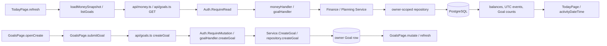

# Issue #31: Compact Today and Plans

**Status:** Final visual hierarchy approved by the Product Owner for commit, push, and Issue #31 closure.

## What changed and why

Today now starts with a plain heading, followed by Accounts, Active Goals, and Recent transactions. Account balances are still fetched from the Finance API per account and remain labelled by currency. Goal progress still comes from Planning. Recent events are a four-record preview, not a spending-total source. `activityDateTime` uses the saved LifeOS timezone: it shows a clock time for an event on the owner's current local date and a short date plus time for an older event. The underlying UTC event is unchanged.

Plans now gives the Goal list priority. `+ New goal` reveals the existing creation form; no new endpoint or rule was added. Cancel hides the form, keeps the draft for reopening, and returns focus to the trigger. A failed request leaves the draft and error visible. After a successful creation, the title clears and the refreshed list appears. An owner with no Goals sees one concise empty state. Goal detail actions continue through their existing functions.

## Actual function-level flow

### Today read and display

| Input → Function | Process → Output | Next function / error |
| --- | --- | --- |
| Page load → `apps/web/src/TodayPage.tsx` `TodayPage.refresh` | Starts independent Money and Goals reads; shows loading state | `loadMoneySnapshot`, `api/goals.ts` `listGoals`; failures show retry, 401 calls `onSessionExpired` |
| Owner session → `TodayPage.tsx` `loadMoneySnapshot` | Calls `api/money.ts` `listMoneyAccounts`, `listMoneyCategories`, `listMoneyHistory(4, 0)`, then `getMoneyBalance` per account | Existing `Auth.RequireRead` and Finance handlers; no client totals |
| Owner session → `api/goals.ts` `listGoals` | Fetches checklist Goals and their server counts | `internal/planning/http.go` `goalHandler.listGoals` → `Service.ListGoals` → `repository.listGoals` |
| Authenticated GET → `internal/finance/http.go` `moneyHandler.listAccounts`, `balance`, `listCategories`, `history` | Uses `Service.ListAccounts`, `Balance`, `ListCategories`, `History` and their owner-scoped repository methods | Existing Finance tables; malformed/unauthorized requests fail in the existing guards |
| JSON + saved zone → `TodayPage` `eventLabel`, `eventAccounts`, `activityDateTime`, `activeGoalsOnly` | Keeps currency-specific server balances and actual progress; shortens local activity date/time | Compact cards; no new database write or API contract |

### Goal creation

| Input → Function | Process → Output | Next function / error |
| --- | --- | --- |
| `+ New goal` → `apps/web/src/GoalsPage.tsx` `GoalsPage.openCreate` | Reveals form and focuses `titleInputRef` | `submitGoal`; Cancel calls `closeCreate`, keeps draft, restores trigger focus |
| Title → `GoalsPage.submitGoal` | Trims and validates with `titleValue`; calls `mutate` | `api/goals.ts` `createGoal`; local or request error stays beside retained draft |
| Cookie, Origin, CSRF, title → `internal/planning/http.go` `goalHandler.createGoal` | Existing `Auth.RequireMutation` derives owner and protects the write | `internal/planning/service.go` `Service.CreateGoal`; 401/403/validation errors unchanged |
| Validated owner/title → `internal/planning/repository.go` `repository.createGoal` | Persists only that owner's Goal | PostgreSQL Goal row → API Goal JSON |
| Created Goal → `GoalsPage.mutate` / `refresh` / `closeCreate` | Refreshes list, clears successful draft, hides form, returns focus | New Goal summary; a refresh failure retains the saved result and retry notice |

## Verification and reading order

Read `apps/web/src/TodayPage.tsx` and `today.css`, then `GoalsPage.tsx` and `goals.css`; inspect `api/money.ts` and `api/goals.ts` for the unchanged contracts. The frontend suite passed 40 tests, plus TypeScript typecheck and production build. Real Edge against the guarded Go API and isolated disposable PostgreSQL v7 fixture covered 320px, 390px, and desktop; empty and populated owners; MYR and USD accounts; real Goal checklist progress; long titles; Goal detail navigation; form focus, Cancel draft retention, request error and successful retry; loading/error/retry/expired-session presentation; and no horizontal overflow. Synthetic sessions and one-shot browser fault injection tested client recovery; live Google sign-in was not repeated. Screenshots are in ignored `.cache/issue31/`.

There is no backend change, migration, API change, or new service step in this issue. The existing Finance and Planning service/repository steps remain applicable because the same reads and Goal create call are reused. Money and the personal LifeOS database were not changed. The Product Owner approved the final visual hierarchy for commit, push, and issue closure.

## Final visual hierarchy pass

The Product Owner approved the layout and requested only clearer type hierarchy. `apps/web/src/today.css` now separates the section headings from record names with a modest size and weight difference, consistent dark text, a subtle divider, and right-aligned wrapping for the History link at 320px. `apps/web/src/goals.css` makes the Goals list heading consistent without changing Goal cards. This is a CSS-only pass: the function flow above, data semantics, and error handling remain the same. The final responsive screenshots are under ignored `.cache/issue31/hierarchy-*.png`.
