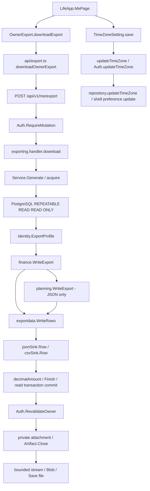

# Me and Owner Data Export — Issue #32

Date: 2026-10-20. Non-normative learning notes. [ADR-017](../../docs/adr/ADR-017-owner-data-export.md) is Accepted; [Export Design](../../docs/EXPORT_DESIGN.md) is authoritative. The Product Owner approved screenshots and independently reviewed actual synthetic JSON/CSV files, then authorized final delivery after verification. ADR-015 remains Proposed.

## Actual function call chain

## Why a dedicated coordinator?

UI history is paginated and several UI DTOs omit persisted timestamps. Exporting those responses would risk incomplete data and mixed read times. `internal/exporting` composes module-owned projections with the same `pgx.Tx`. The coordinator never selects another module's tables directly. `internal/platform/exportdata` only provides row/sink plumbing and timestamp formatting; domain SQL stays in Identity, Finance and Planning.

PostgreSQL's first owner read acquires the snapshot. Later module queries see that same committed view, even while another connection renames a Goal or deletes an event. A retry starts a new snapshot. A deletion committed after snapshot acquisition can still appear in the older file; downloaded copies cannot be revoked. The read transaction ends before network delivery, so a slow download does not hold that snapshot open.

## User input and UI state

| Input → Function | Process → Output → Next function |
| --- | --- |
| Authenticated route → `apps/web/src/LifeApp.tsx` `MePage` | Render existing profile/sign-out, shared timezone editor and `OwnerExport`; no new profile business rules. |
| Format button → `apps/web/src/OwnerExport.tsx` `downloadExport` | AbortController and pending state prevent duplicate requests → `api/export.ts` `downloadOwnerExport`. Keep errors/retry visible; 401 calls the shell session refresh. |
| CSRF, format, abort signal → `downloadOwnerExport` | Same-origin no-store POST with no owner/filter IDs → guarded API. Validate MIME, fixed filename and length; read at most 64 MiB. Truncated, aborted or oversized bytes never become a successful Blob. |
| Complete Blob → `OwnerExport.downloadExport` | Trigger a fixed-name download and show explicit Save file fallback. Revoke URL on replacement/cancel/unmount or after five minutes. “Ready” is not proof of a saved disk file. |

Errors: non-401 responses get safe user messages; cancellation keeps retry; route/sign-out unmount cancels outstanding work and releases object URLs. No localStorage, IndexedDB or server artifact store is added. Browser/OS internals and user-saved files are outside that guarantee.

Tests: `apps/web/src/api/export.test.ts`, `api/exportSchema.test.ts`, `LifeApp.test.tsx`; real Edge checks cover downloads, failure/retry/cancel, fallback, expired session, sign-out and navigation.

## Guard, application service and database

| Input → Function | Process → Output → Next function |
| --- | --- |
| Session, Origin, CSRF → `internal/identity/auth.go` `Auth.RequireMutation` | Existing owner override/session/Origin/CSRF checks → `internal/exporting/http.go` `handler.download`. Fail closed with no private file. |
| JSON body → `handler.download` | Require POST/application-json, at most 1 KiB, exact format and no unknown/query fields → `Service.Generate`. All errors retain no-store and remove attachment headers. |
| Verified owner → `internal/exporting/service.go` `Service.Generate` / `acquire` | One slot/owner, two/process; 120-second generation context; begin read-only repeatable-read transaction → `identity.ExportProfile`. Slot remains held until artifact delivery ends. |
| Owner/transaction → `internal/identity/export.go` `ExportProfile` | Read active owner and actual nullable timezone → Finance projection. No session/Google/CSRF/invitation fields are exported. |
| Same owner/transaction → `internal/finance/export.go` `WriteExport` | Validate exact retained event shape with numeric sums; stream all accounts/categories and nondeleted events/children → `exportdata.WriteRows`. Voided records keep original data; archives are retained. |
| Same owner/transaction → `internal/planning/export.go` `WriteExport` | Stream all retained Goals/items including completion/archive timestamps → `WriteRows`. **N/A for CSV:** that format is Finance-only. |
| SQL/owner → `internal/platform/exportdata/records.go` `WriteRows` | Scan ordered rows, format UTC timestamps, retain money strings → sink `Begin`/`Row`/`End`; propagate row/query/writer/cancellation errors. Close rows before the next query on the connection. |

Database mutations are **N/A** for export: PostgreSQL enforces read-only access. Persistent recovery/import is **N/A** because no importer/restore capability is implemented. No migration or schema change is needed for existing v7 data.

Generation errors roll back and release capacity. The real integration test queried isolation/read-only settings and deliberately attempted a prohibited write, then confirmed that financial facts were unchanged by export itself.

## Serialization and response

| Input → Function | Process → Output → Next function |
| --- | --- |
| Record → `internal/exporting/json.go` `jsonSink.Row` | Exact independently versioned root/collections; int64 decimal strings, [] for empty arrays, null preference/timestamps → `Finish` with collection counts. No derived balances or audit-author claims. |
| Record → `internal/exporting/csv.go` `csvSink.Row` | Fixed column order; one event/transaction row; exact movements/splits → `decimalAmount` and quote-all CSV encoder. |
| Integer text/currency → `decimalAmount` | Parse canonical int64 text, read pinned standard currency scale, shift digits/pad fractional places → exact decimal text. No float, rounding, cash increment or two-digit fallback. Negative int64 minimum is handled as signed text. |
| CSV cell → `csvSink.line` | Apostrophe guard every user text and minor/decimal cell; double quotes, quote all cells, CRLF, UTF-8 BOM → bounded ZIP entry. README explains removing one guard and spreadsheet resave risks. |
| Finished sinks → `Service.Generate` | Check raw/output caps and ZIP close; commit read transaction → complete in-memory `Artifact`. No 200 before all generation succeeds. |
| Artifact/request → `internal/identity/export.go` `Auth.RevalidateOwner` | Re-read the same cookie's active session/owner with a bounded context → `handler.download` private attachment. Revocation before release prevents the file; already-delivered bytes cannot be revoked. |
| Artifact → `handler.download` / `Artifact.Close` | Exact length/type/fixed filename, no-store/nosniff and separate 120-second write deadline → client; close releases owner/process slot after success, cancellation or write failure. |

Transfer rows retain one event with from/to account IDs; signed movement rows express its two effects. Multi-category events have separate allocation rows and no repeated transaction amount. Uncategorized means no allocation rows. Status/flags make voided records audit-only; deleted events and dependents are excluded. JSON retains stored audit text without pretending it was user-authored.

CSV adds human-readable values next to original minor-unit columns: JPY `1234` → `1234`; MYR `1234` → `12.34`; KWD `1234` → `1.234`; CLF `12345` → `1.2345`. JSON is unchanged and authoritative. Money cells are guarded strings, not spreadsheet formulas.

## Shared timezone path

| Input → Function | Process → Output → Next function |
| --- | --- |
| Me timezone action → `apps/web/src/TimeZoneSetting.tsx` `save` | Existing searchable list/browser suggestion; preserve draft on errors; native modal/focus return → `api/auth.ts` `updateTimeZone`. |
| IANA zone/CSRF → `updateTimeZone` | Existing guarded PUT → `internal/identity/auth.go` `Auth.updateTimeZone` → `internal/identity/repository.go` `repository.updateTimeZone`. |
| Valid saved preference → Me callback / `AuthenticatedShell` state | Refresh the same owner preference → Money/Today; no device-zone fallback or duplicate business rule. Money Settings links to `/me#timezone`. |

UTC events and existing DST gap/overlap input rules do not change. The shell retains profile and sign-out. Me only relocates the existing editor.

## Verification evidence and limits

- Full Go suite: 112 passed tests/subtests, no actual test skipped; all seven integration variables pointed at distinct fresh disposable `*_test` databases. Package-level “skip” for packages without tests is not a skipped test. `go vet` passed.
- A later export-only run on another fresh database passed added HTTP 429/Retry-After/privacy and ZIP-limit checks. No earlier disposable database was deleted or reused as an empty test target.
- Frontend: 46 tests, typecheck/build, OpenAPI lint/generated checks; only the two pre-existing OAuth redirect warnings. JSON golden/schema checks reject extra sensitive keys, non-string money and non-UTC timestamps.
- Two final sandbox runs failed on missing Windows Temp SSR transformation files before some test suites could load; the full standalone rerun outside the sandbox passed 46/46. This reproduces the existing environment limitation and did not require a code or tool configuration change.
- Real PostgreSQL: owner isolation, complete relationships/order/counts, archives, splits/transfers/Uncategorized, mixed currencies/int64 limits, deleted/voided semantics, session expiry/revocation/disable, Origin/CSRF/request denial, caps/failure/cancel/slot recovery and no sensitive log canaries.
- Deterministic pause after accounts: concurrent account and Goal renames, timezone change and posted Finance Delete commit in another connection. All later reads still match the older snapshot; a new request sees later changes. Database read-only enforcement was tested directly.
- Substantial fixture: 10,029 events, 4,988,425-byte complete JSON and approximately 629 KB ZIP. Limit tests inject smaller caps/deadlines instead of creating 64 MiB private files or waiting 120 seconds. This is not a peak-RSS benchmark or an unlimited capacity claim.
- Existing migration v1–v7 chain and repeat-up passed on a separate fresh disposable target; published migrations unchanged. The personal database was never accessed.
- Windows Edge: native JSON/ZIP downloads; desktop and 320/390px emulation; timezone setup/search/reload with device zone different from saved owner; focus/Escape; Money/Today/Plans navigation; no overflow; error/retry/cancel/fallback; real sign-out and simulated expired-session UI. Synthetic local sessions use real Go guards/PostgreSQL; live Google admission was not reverified.
- A separate browser run suppressed the automatic attachment click, then dispatched an actual user gesture on the Save file link; a valid native JSON download arrived. This checks the fallback action as well as its presence.
- Sample files parsed using Go `encoding/csv` plus Python standard CSV/ZIP/Decimal readers. **Excel/LibreOffice initial-open and physical iOS/Android tests were not run.** CSV resaving may remove guards. Physical mobile download compatibility remains an explicit follow-up verification limitation.

## Final delivery gate

The final mobile check used the real isolated API and Windows Edge with 320×568, 390×844 and 800×600 viewports. Privacy text and touch downloads were reachable, but sequential Tab navigation initially scrolled a focused export button behind the fixed bottom bar. `apps/web/src/me.css` now applies `scroll-margin-block-end: calc(6rem + env(safe-area-inset-bottom))` to Me buttons at the existing mobile breakpoint. This changes focus scrolling, not card typography/layout or the bottom navigation. After correction, the privacy notice and both buttons passed unobscured hit checks, native touch downloads and keyboard focus/order at every size. No other cosmetic change was made.

Final full Go regression used seven more fresh disposable databases: 112 tests/subtests passed, no actual test skipped; `go vet` passed. Frontend 46 tests, typecheck/build, OpenAPI/generated checks and diff checks passed again. Excel/LibreOffice and physical iOS/Android were still not tested. Ignored review profiles, downloads and screenshots are excluded from delivery. No new schema/migration or personal-data access occurred.

## Reading order and next action

1. Read [Export Design](../../docs/EXPORT_DESIGN.md) and [ADR-017](../../docs/adr/ADR-017-owner-data-export.md).
2. Read `apps/web/src/OwnerExport.tsx` and `api/export.ts` for user state and byte handling.
3. Read `internal/exporting/http.go` and `service.go` for guard, artifact and transaction lifetime.
4. Read each module's `export.go`, then `internal/platform/exportdata/records.go`.
5. Read `json.go`, `csv.go`, exact format schema and integration tests.

Local review: `http://127.0.0.1:5195/__test_login_owner` opens synthetic Me data. Samples/screenshots live in ignored `.cache/issue32/`. Product Owner visual/file review and final delivery authorization are complete; Issue #32 records the delivered commit/closure. Wait for the next authorization before beginning another milestone. Import, restore, deployment, localization and unrelated Finance corrections remain out of scope. Personal Data Ready still requires backup/restore, deletion-state reconciliation and safe upgrade evidence.
