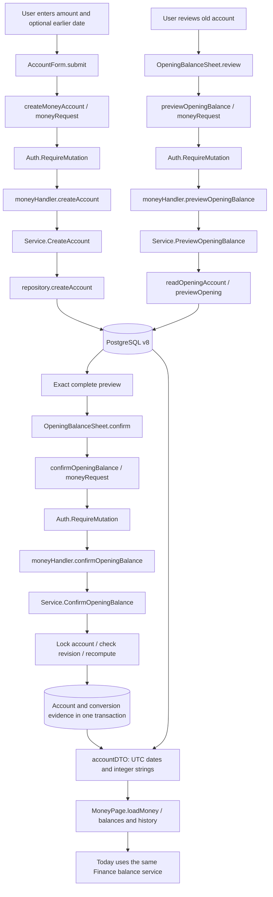

# Issue #33 — A known balance at a precise instant

Status: implemented under Accepted ADR-018; Product Owner approved UI/artifacts and authorized final delivery on 2026-10-23. This journal is non-normative; the ADR and domain documents define product rules.

## Actual function flow

### New account

| Step | Input → Function → Process → Output → Next |
| --- | --- |
| Input | Amount/name/currency → `apps/web/src/MoneyPage.tsx` `AccountForm` → suggest the current instant when opening an untouched form; retain edited drafts and optional earlier date → review text → `submit`. |
| Conversion | Local wall time → `apps/web/src/moneyAmount.ts` `toOccurredAt` / `matchingInstants`; amount → `parseAmountToMinor` → saved IANA zone, DST gap rejection, explicit repeated-time selection, exact BigInt minor units → UTC/string → `apps/web/src/api/money.ts` `createMoneyAccount`. |
| Request | Explicit amount/instant → `moneyRequest` → same-origin POST `/api/v1/accounts`, cookie and CSRF → `internal/identity/auth.go` `Auth.RequireMutation`. No owner ID supplied by client. |
| Application | Guarded owner/body → `internal/finance/http.go` `moneyHandler.createAccount` → strict parsing → `internal/finance/service.go` `Service.CreateAccount` → validate fields/date, truncate new timestamps to microseconds → `internal/finance/repository.go` `repository.createAccount`. |
| Database | Validated input → `repository.createAccount` → transaction + `requireOpeningZone` (Identity `ExportProfile`), insert dated account/revision1, `readOpeningAccount`, commit → `accountDTO` → `runMutation` / `MoneyPage.loadMoney`. No fabricated income/opening event. |

### Existing account preview and confirmation

| Step | Input → Function → Process → Output → Next |
| --- | --- |
| Preview UI | Date and preserve-current/known amount → `apps/web/src/OpeningBalanceSheet.tsx` `review` → saved-zone conversion, draft validation → `api/money.ts` `previewOpeningBalance` → POST `/accounts/{id}/opening-balance/preview`. |
| Preview handler | Cookie/CSRF/body → `Auth.RequireMutation` → `internal/finance/opening_http.go` `moneyHandler.previewOpeningBalance` → strict date/amount/query validation → `internal/finance/opening_balance.go` `Service.PreviewOpeningBalance`. |
| Complete read | Owned legacy account/date → `Service.PreviewOpeningBalance` → read-only REPEATABLE READ + `requireOpeningZone`, `readOpeningAccount`, `previewOpening` → complete posted/nondeleted movement sums, counts, exact old/suggested/chosen/new/delta and revision → UI. Database write: N/A, preview is read-only. |
| Review | Preview → `OpeningBalanceSheet` → show currency, local/UTC date, before/after/delta, calculated-not-bank-verified warning; nonzero change needs acknowledgement → `confirm`. Native modal focus stays inside and returns to trigger. Cancel preserves fields in `MoneyPage`'s in-memory `openingDrafts`; reopening obtains a new preview. No localStorage/private financial persistence. |
| Confirm request | Reviewed values/revision/ack → `api/money.ts` `confirmOpeningBalance` → guarded POST `/accounts/{id}/opening-balance/confirm` → `moneyHandler.confirmOpeningBalance` → canonical integer/revision and required boolean → `Service.ConfirmOpeningBalance`. |
| Atomic write | Verified owner/expected revision → `Service.ConfirmOpeningBalance` → `readOpeningAccount` FOR UPDATE, reject already converted/stale, recompute `previewOpening`, validate int64/ack → update amount/date/revision and insert `finance_opening_confirmations` → commit → `accountDTO`. An evidence failure rolls everything back. |
| Response | Account → `http.go` `accountDTO` / `utcOpeningInstant` → emit canonical UTC even when Windows/pgx supplies offset timestamps → `OpeningBalanceSheet.confirm` `onSaved` → clear draft, `MoneyPage.loadMoney` → visible balances/history refresh. |
| Uncertain result | Network/malformed success/5xx/conflict → `confirm` → `listMoneyAccounts` → compare server date and amount with reviewed values; matching confirmed state resolves success, otherwise keep safe error/draft. Never perform an automatic second conversion. |

### Finance effects and export

| Step | Input → Function → Process → Output → Next |
| --- | --- |
| Balances | Owner/account → `service.go` `Service.Balance` → `repository.balance` / `balanceSQL` → legacy opening + all eligible movements, or dated opening + eligible movements at/after date → int64 balance → Money and `TodayPage.tsx` `loadMoneySnapshot`. Each account/currency stays separate. |
| Posting | Expense/income/transfer → `Service.postSingleAccountEvent` / `Service.Transfer` → normalize NEW timestamps to UTC microseconds before comparing and storing → `repository.post` → stable `lockAccounts`, per-leg date eligibility and overflow checks, insert unchanged event/children, `bumpBalanceRevisions`, commit. |
| Removal | Void/Delete → `repository.voidEvent` / `deleteEvent` → event lock, `checkRemovalBalances` and stable account locks, `subtractMoney` only for effective contributions, update status/marker and revision → commit. Pre-date effects are zero for current balance; spending still follows status/visibility. Already-voided Delete does not remove money twice. |
| Export | Me click → `OwnerExport.tsx` `downloadExport` → `api/export.ts` `downloadOwnerExport` with version2 → `exporting/http.go` `handler.download` → `Service.Generate` → same complete read-only snapshot → `finance/export.go` `WriteExport`. |
| Compatibility | Explicit version → `WriteExport` → v1 refuses any dated owner with 409; v2 adds only the three approved account fields → `json.go` `newJSONSink` or `csv.go` `newCSVSink` / `csvSink.headers` / `Row` / `Finish` → existing release-time session revalidation → bounded private attachment → Blob / Save file. Existing v1 schema/golden unchanged. |

## Why this arithmetic is necessary

For legacy opening L=1,000, movements before the date -100 and on/after -50 give current850. Preservation suggests a dated amount900, producing900-50=850. Keeping1,000 at that date instead changes the recorded balance to950 and requires acknowledgement of +100. Counts/sums come from complete database data, never the visible ten-row page.

The date precedes **all** equal-time events. New occurrence timestamps are truncated to PostgreSQL microseconds before validation/storage so a sub-microsecond request cannot pass a pre-date check and then round into the effective period. Existing stored UTC events are never rewritten.

SQL SUM uses arbitrary-precision numeric; Go uses `math/big.Int` before testing required int64 outputs. The suggested amount can be outside int64 even when current balance is valid. In that case the UI requires a representable known amount; it does not clamp. Signed deltas are wide exact strings. No float or mixed-currency sum is used.

Transfers have one FinancialEvent and two offsetting movements, but different account dates can make only one leg affect a current recorded balance. The other leg is already covered by its owner's starting assertion. This is not transfer spending or a historical bank verification. Existing future-dated posted events still count in the recorded position; scheduling is not introduced.

## Migration, rollback and tests

- New paired migration8 leaves every legacy opening value/date/formula unchanged; adds only nullable dates, revision metadata and owner/account confirmation evidence. Published migrations1–7 stay untouched. Down8 refuses confirmed data/evidence. Personal data upgrades/restores remain separately gated.
- Full Go suite: **126 tests/subtests passed, zero actual skips**, with eight separate fresh disposable targets (`lifeos_i33_check_20261020_100249_*_test`); `go vet` passed. Finance tests cover populated7→8, boundaries, current/future recorded position, splits/spending, legacy/different-date transfers, pre/post Void/Delete, stale/repeated/concurrent confirmation versus post/Void/Delete, overflow and evidence rollback. `opening_http_test.go` locks down UTC DTO output.
- `internal/exporting/export_integration_test.go` validates complete >10k-event conversion preview, native v2 headers/formulas/relationships, v1 incompatibility versus unconverted-owner compatibility, and an all-old v2 snapshot across concurrent conversion. Existing session revocation, Origin/CSRF, caps, cancellation, owner separation and CSV precision tests remain.
- **50 frontend tests** passed, typecheck/build and OpenAPI lint/generated checks passed (two pre-existing redirect-only OAuth warnings). Independent JSON Schemas validate actual synthetic v1/v2 goldens and reject version/basis/date/internal-field mismatches. Existing v1 golden/schema remain unchanged.
- Fresh migration-chain test reached clean8, repeated up reported no change, isolated smoke up/down passed. No old disposable database was deleted. No personal database was accessed.
- Real guarded Go API + PostgreSQL + Windows Edge browser: 320/390/1280px, new-account retry/draft, saved-vs-device zones, exact preview/ack/stale conflict, cancel/focus, lost confirmation response reconciliation, native v2 downloads, Money/Today/Plans/Me and no overflow passed. DST gap/repeated-time input and timezone-change persistence also passed. Screenshots and preview helpers stay ignored under `.cache/issue33/`.
- Physical iOS/Android, Excel/LibreOffice initial-open and a new live Google OAuth round trip were not tested. Synthetic sessions use the real application guards. No deployment or Personal Data Ready claim follows.

## Reading order and remaining work

1. ADR-018 and `docs/DOMAIN_MODEL.md`.
2. Migration8, `opening_balance.go`, `repository.go` balance/write paths and `opening_http.go`.
3. `OpeningBalanceSheet.tsx`, AccountForm and API contracts.
4. Export v2 schema, `docs/EXPORT_DESIGN.md`, integration tests and golden fixture checks.

#33 visual/export approval passed; delivery commit and closure evidence are recorded in [Issue #33](https://github.com/Faust217/LifeOS/issues/33). #34 idempotency, #35 Edit and #36 historical running balances remain unstarted and require separate authorization. A dated assertion cannot currently be rebased/edited. Reconciliation, backup/restore and safe upgrades remain Personal Data Ready gates; ADR-015 remains Proposed.

## Final delivery verification — 2026-10-23

The Product Owner independently reviewed and reconstructed the JSON/CSV v2 ledger, accepted the UI and authorized commit/push/closure. No further cosmetic changes were made.

- Repeated the full Go suite: 126 tests/subtests passed, zero skipped, using eight new disposable databases with prefix `lifeos_i33_delivery_20261023_025859`; `go vet` passed.
- All 50 frontend tests, TypeScript checks, production build and generated OpenAPI checks passed. Lint retains only the two existing redirect-only OAuth warnings.
- Contract review corrected the export incompatibility 409 to an explicit `export_version_incompatible` error schema and listed the existing 413/503 responses on the new account routes. The generated TypeScript contract was refreshed; product behavior and approved visuals were unchanged.
- Clean v1–v8 chain, repeated up and isolated smoke rollback passed on fresh `lifeos_i33_close_chain_20261023_030137_test`. Populated v7 preservation, conversion concurrency/rollback and v1/v2 exports also passed in the full suite.
- Published migrations1–7, the v1 schema/golden and unrelated accepted ADRs were checked unchanged; ADR-015 stays Proposed. All disposable databases and ignored artifacts were retained. Personal database access and deployment did not occur.
- Retained the already approved 320/390/1280px real guarded API/browser evidence; physical iOS/Android and Excel/LibreOffice remain untested. #34–#36 remain unstarted pending separate authorization. Personal Data Ready backup/restore/upgrade gates remain.