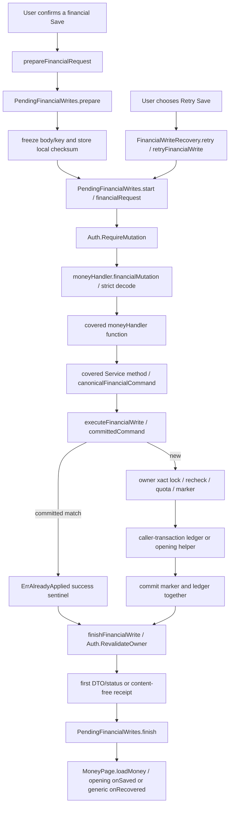

# Issue #34 — Financial Write Idempotency

Date: 2026-10-26. Non-normative engineering notes. [ADR-019](../../docs/adr/ADR-019-owner-scoped-financial-write-idempotency.md) is Accepted; the Product Owner approved the final recovery UX and authorized final Issue #34 delivery. No personal database access or deployment is part of this work.

## Actual function-level data flow

### 1. Prepare and send

| Input → Function | Process → Output → Next function |
| --- | --- |
| Account/event/transfer/confirmation/void/delete form → `apps/web/src/api/money.ts` `prepareFinancialRequest` | Serialize once, preserving exact minor strings, UTC instants and all allocations → `PendingFinancialWrites.prepare` |
| Owner-bound path/body → `apps/web/src/pendingFinancialWrite.ts` `PendingFinancialWrites.prepare` | Reserve preparation across asynchronous hashing; reject existing pending state; generate UUIDv4, identify operation/target, compute local checksum and verify bounded storage write → frozen record |
| Frozen record → `PendingFinancialWrites.start` | Check same owner/exact stored record and SHA-256 checksum; corrupted/unavailable state sends no HTTP → `financialRequest` |
| Frozen record + fresh CSRF → `financialRequest` | POST exact stored body/key with same-origin cookies/no-store → authenticated Go route |

Browser recovery stores no CSRF/session/Google token. It contains private submitted draft data, not encrypted against same-origin scripts. It is one per-tab record, not a queue. An owner change retains the unresolved record as a hidden blocker; another owner cannot see its contents or silently replace its key. Tests in `pendingFinancialWrite.test.ts` exercise concurrent preparation, no overwrite, reload into a new manager, storage get/set/remove failures, JSON/checksum corruption, owner changes, stale completion and bounds. `api/money.test.ts` checks lost response/retry, unchanged bytes/key, fresh CSRF, conflicts, auth expiry, rejected retries and malformed success.

### 2. Authenticate and normalize

| Input → Function | Process → Output → Next function |
| --- | --- |
| HTTP POST → `internal/identity/auth.go` `Auth.RequireMutation` | Current session, Origin, CSRF and owner-override checks → server-derived `identity.OwnerID` |
| Authorized request → `internal/finance/idempotency_http.go` `moneyHandler.financialMutation` | Ten-second parent context, shared eight-slot handler admission, single canonical key check → existing handler |
| JSON → `internal/finance/http.go` `decodeMoneyJSON` and `idempotency_http.go` `uniqueJSONObject` | 16 KiB/UTF-8 limits, object and duplicate/lowercase member checks, unknown-field/type/trailing-document rejection → typed DTO |
| Typed DTO → `http.go` `createAccount/postEvent/transfer/voidEvent/deleteEvent`, or `opening_http.go` `confirmOpeningBalance` | Parse exact int64 strings and required fields; pass explicit key → covered Service method |
| Input/key → `service.go` `CreateAccount/PostExpense/PostIncome/Transfer/VoidEvent/DeleteEvent` or `opening_balance.go` `ConfirmOpeningBalance` | Validate stateless values; lowercase UUIDs, trim only approved fields, normalize UTC microseconds and sort complete allocations → canonical command + caller-tx callback |

Mutable state is checked after the committed-key lookup. A successful opening confirmation retry must not fail merely because the account is now dated or its revision changed. Notes retain their whitespace; generated Void mode is distinguished in the fingerprint before applying the existing stored audit default. No new audit provenance is fabricated.

### 3. Coordinate the database transaction

| Input → Function | Process → Output → Next function |
| --- | --- |
| Owner/command → `internal/finance/idempotency.go` `canonicalFinancialCommand` / `canonicalFinancialBytes` | Immutable fixed-order JSON v1 bytes and SHA-256 digest → `executeFinancialWrite` |
| Owner/key/digest → `committedCommand` | Query only owned key; compare retained version/digest → successful `ErrAlreadyApplied`, conflict, unsupported version or miss |
| Miss → `executeFinancialWrite` | READ COMMITTED; owner transaction advisory lock; new-statement recheck; exact capacity count; insert marker before domain locks → callback |
| New command → `repository.go` `repository.createAccountInTx/postInTx/voidEventInTx/deleteEventInTx` | Existing owner predicates, ordered account/category locks, currency/overflow/anchor/status rules and rows/revisions; no independent commit → coordinator |
| Opening confirmation → `opening_balance.go` `confirmOpeningBalanceInTx` | Saved-zone rule, locked account, current revision, complete preview sums/acknowledgement and evidence → coordinator |
| Successful callback → `executeFinancialWrite` | Commit marker and all financial changes once; rollback both on known failures → result/success sentinel/error |

The table in migration9 contains only owner/key, operation, fingerprint version/digest and registration timestamp. There is no request/response cache, result ID, processing state or expiry. Committed marker visibility is the durable success evidence. `ErrAlreadyApplied` deliberately carries **no resource**; HTTP code interprets it as successful acknowledgement. Normal exports never include the markers.

`testdata/financial-command-v1.json` supplies immutable byte/digest fixtures for all six operations and both Void modes. Integration tests cover normalization of UUID/offset/split order, payload conflicts and all guarded mutations. The owner lock avoids an extra quota-counter table. A marker's owner FK check precedes domain locks, retaining compatibility with existing category-name writes that lock the owner row first.

### 4. Release the outcome and recover the UI

| Input → Function | Process → Output → Next function |
| --- | --- |
| Result or `ErrAlreadyApplied` → `idempotency_http.go` `moneyHandler.finishFinancialWrite` | Domain errors use stable safe envelopes; success first revalidates the same request session after releasing Finance transaction → `Auth.RevalidateOwner` |
| Active same-owner session → `internal/identity/export.go` `Auth.RevalidateOwner` | First DTO/status with replay=false, or `200 {"outcome":"already_applied"}` with replay=true, private/no-store → `financialRequest` |
| Valid response → `PendingFinancialWrites.finish` | Clear only matching frozen record; an old completion cannot erase a newer owner's record → `MoneyPage.loadMoney` or opening-sheet generic `onRecovered`; a fresh opening confirmation alone calls `onSaved` for its specific notice |
| Uncertain response → `PendingFinancialWrites.finish` | Keep record/key; preserve form and block another financial Save → `FinancialWriteRecovery` |
| Manual retry → `FinancialWriteRecovery.tsx` nested `retry` → `api/money.ts` `retryFinancialWrite` | Verify/use stored record with fresh CSRF; no body/time/revision reconstruction → same server flow |
| Explicit conflict recovery → `FinancialWriteRecovery` nested `clear` → `clearAcknowledged` | Require acknowledgement of checked activity/lost key; cannot undo/prove failure → editable new intent |

Final session revalidation can deny a response after the ledger committed. Therefore 401/403, network failure or malformed success cannot be treated as proof of rollback. A failed retry also cannot disprove a previous success. Replays do not return old DTOs after Void/Delete or any future Edit. The latter is a replay contract, not an implementation of Issue #35.

Read-only opening preview and ordinary data reads have **N/A key registration**, because they do not mutate financial state. Category/account archive operations, Goals, timezone and export remain outside these six keyed writes.

## Capacity and recovery operations

`capacityBand/observeCapacity` warn at 90,000 and reject new keys at 100,000, without private identifiers/content in logs. Existing-key replay still works at capacity. No expiry/eviction is allowed. [The runbook](../../docs/FINANCIAL_WRITE_RECOVERY.md) explains privacy-safe aggregate headroom checks, reviewed increases, bounded handlers/timeouts, old-client cutover, backups and stale retries after restore. An older restored backup can lose newer markers; Personal Data Ready is not passed by this issue.

## Verification evidence

- Full Go suite and `go vet` passed against nine new disposable databases: **147 tests/subtests, zero skips** in the recorded full run. This includes populated v8→v9, empty down/up, populated down refusal, original ledger/Goals/anchor/export/security regressions, all six contracts, 24 concurrent identical requests, rollback after inserted event/marker, real PostgreSQL backend termination, lost HTTP response and two separate OS processes reusing a key.
- Real capacity test inserts 89,999 owned markers, verifies warning on the 90,000th committed command, reaches exactly 100,000, rejects a new key and replays an existing one. Warning logs are inspected for excluded private IDs/key/text.
- **68 frontend tests** passed after final recovery-copy/layout polish, with TypeScript/build and OpenAPI/generated-contract checks. Lint retains only the two existing OAuth redirect warnings. `FinancialWriteRecovery.test.tsx` covers the concise pending prompt, secondary options, storage/owner privacy and conflict copy.
- Real guarded synthetic browser preview: ordinary expense Save needs no extra dialog; a proxy discards the reply only after the Go API completes, leaving a frozen disabled form/recovery record; Retry Save acknowledges the original commit and refreshes one transaction. Desktop/mobile viewport checks use the Windows in-app browser. A 320px classic-scrollbar overflow was corrected with `html/body min-width:0`; the content width then equals the available client width. Capture paths are ignored under `.cache/issue34/`.
- Same-tab storage reinitialization/reload, corrupted/unavailable/full storage and pending-record replacement are automated frontend tests. The in-app browser's pending-Save navigation warning cancels automated reload; do not claim that attempt performed a real page reload. Physical iOS/Android and other browsers were not verified.
- Final visual pass at 320px, 390px and desktop checked normal, uncertain Save, conflict and storage-unavailable states, keyboard focus, 44px disclosure/touch targets, fixed bottom navigation and no horizontal overflow. The real guarded API committed a synthetic expense while a review proxy dropped its finished HTTP response; Retry Save returned `already_applied`, refreshed exactly one history row and reenabled Add transaction. Conflict and storage-unavailable browser visuals were injected only by the ignored `.cache/issue34/preview.mjs` review helper; these do not claim a real server conflict or persistent browser-storage failure. Screenshots are ignored under `.cache/issue34/`.
- Published migrations v1–v8 and normal export v1/v2 fixtures remain unchanged. All old/new disposable databases are retained. No personal database, deployment, commit/push, #35 or #36 work.

## Reading order and concepts

1. ADR-019 and the operations runbook: transport identity versus financial identity, retained-key semantics and explicit limits.
2. `pendingFinancialWrite.ts` and its tests: reserve before awaiting, freeze exact intent, detect corruption, compare before clearing.
3. `api/money.ts`, guarded handlers and Service methods: normalized intent plus server-derived owner, with no implicit fallback.
4. `idempotency.go`, transaction helpers and integration tests: READ COMMITTED statement snapshots, transaction advisory locks, unique constraints, commit uncertainty and atomic rollback.
5. Migration9 and unchanged export projections: operational state belongs in consistent backups, not normal portability exports.

Deferred: Edit/revision evidence (#35), historical running balances (#36), offline sync, import/restore implementation and secure personal-data operation. None is inferred from a working retry mechanism.
