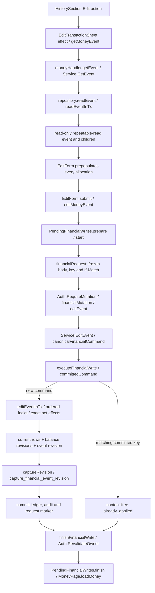
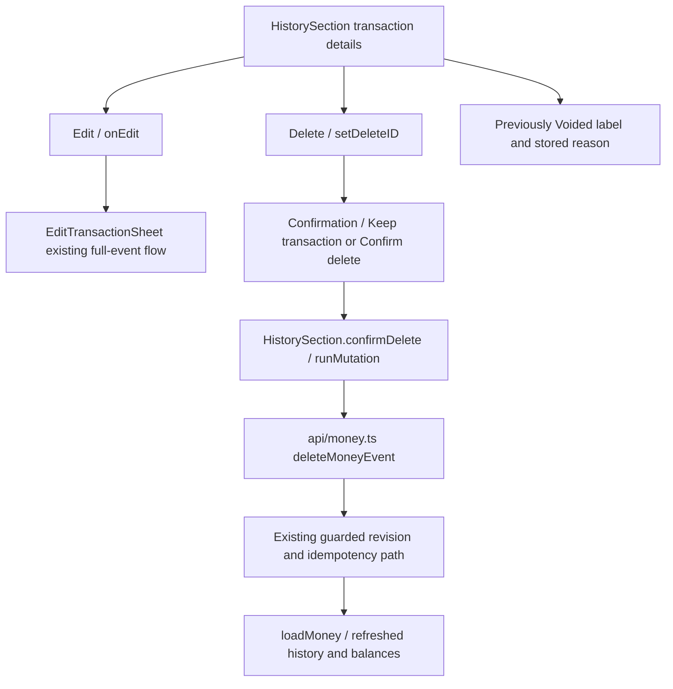
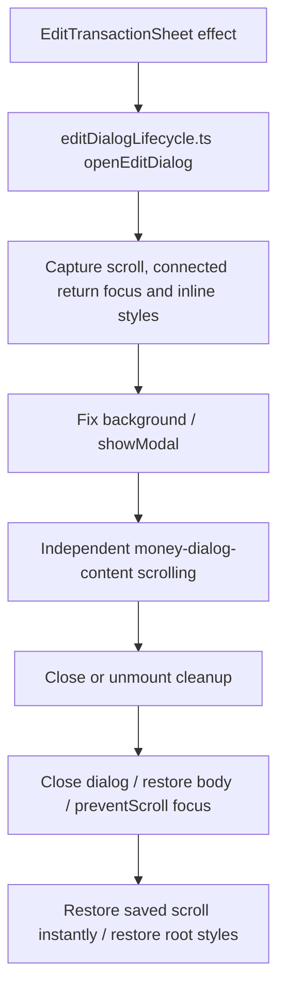

# Issue #35 — Atomic Transaction Editing

This English learning note describes the implementation of Accepted ADR-020. The Product Owner accepted the final simplified UI and synthetic financial evidence and authorized delivery on 2026-11-02. All examples and database checks use synthetic disposable data. Delivery commit/remote evidence is recorded in Issue #35; Issue #36 needs separate authorization.

## Read and prepopulation

| Input → Function | Process → Output → Next |
| --- | --- |
| History Edit → `apps/web/src/MoneyPage.tsx` `HistorySection` | Select an event ID → `EditTransactionSheet` |
| ID → `apps/web/src/EditTransactionSheet.tsx` effect → `apps/web/src/api/money.ts` `getMoneyEvent` / `moneyRequest` | Guarded GET, no owner parameter, no cache → complete event or safe read error |
| Request → `internal/finance/edit_http.go` `moneyHandler.getEvent` → `Service.GetEvent` in `edit.go` | Session-derived owner and valid ID → `repository.readEvent` in `event_read.go` |
| Owner/ID → `readEventInTx` | One read-only repeatable-read transaction reads header and children; foreign/missing/deleted is 404 → `eventDTO` with revision and ETag |
| Complete event → `EditForm` | Prepopulate amount, account(s), owner-local date, exact original UTC instant, note and all splits; retain archived existing associations → user draft |

## Save and atomic persistence

| Input → Function | Process → Output → Next |
| --- | --- |
| Draft → `EditForm.submit` | Exact BigInt split totals, saved IANA/DST resolution, preserve original UTC when unchanged → complete `EventEdit` |
| Payload/revision → `api/money.ts` `editMoneyEvent` / `prepareFinancialRequest` | Freeze complete body, operation, target, random key and quoted If-Match → `PendingFinancialWrites.prepare/start` in `pendingFinancialWrite.ts` |
| Frozen record → `financialRequest` | Store/verify before send; fresh CSRF with unchanged key/body/precondition on retry → POST `/events/{id}/edit` |
| HTTP → `Auth.RequireMutation` in `internal/identity/auth.go` → `moneyHandler.financialMutation` in `idempotency_http.go` | Session, Origin, CSRF, admission/deadline and key checks → `moneyHandler.editEvent` |
| Strict JSON/header → `editEvent` / `eventPrecondition` in `edit_http.go` | Required complete kind-specific shape; strong positive If-Match; malformed/null/unknown fields fail → `Service.EditEvent` |
| Typed input → `Service.EditEvent` in `edit.go` | Canonical IDs, sorted complete splits, positive exact amounts and immutable request meaning → `executeFinancialWrite` |
| Owner/key/version → `canonicalFinancialCommand` / `committedCommand` in `idempotency.go` | Retained versioned SHA-256 comparison; completed replay precedes current state → receipt or new owner-locked transaction |
| New command → `repository.editEventInTx` in `edit.go` | Lock event, check posted/nondeleted revision, lock sorted union of old/new accounts and categories, validate references → exact net balance checks |
| Old/new account contributions → `lockAccounts` / `balanceInTx` in `repository.go` | Apply each account's own anchor; Go `big.Int` checks final `current - old + new` within int64 → current root/child update |
| Current state → `bumpBalanceRevisions` / `captureRevision` | Preserve child IDs for the same relationship; new relationship gets new ID; increment affected account/event tokens → SQL snapshot capture |
| Owner/event/action/key → `capture_financial_event_revision` in migration v10 | Complete resulting header/children as JSONB with string money and UTC timestamps → one shared commit with marker |

The revision table is outside ordinary ledger queries. Its primary/composite foreign keys protect owner relationships; a trigger rejects UPDATE, DELETE and TRUNCATE. This is internal append-only evidence, not protection against a privileged database operator. A v9 baseline records only the observed upgrade state; it does not invent earlier audit history.

## Response, conflicts and recovery

| Input → Function | Process → Output → Next |
| --- | --- |
| Committed result/receipt → `finishFinancialWrite` in `idempotency_http.go` | Release Finance transaction, then `Auth.RevalidateOwner` → first updated DTO/ETag or content-free receipt |
| Valid success → `PendingFinancialWrites.finish` → `MoneyPage.loadMoney` | Clear only the matching pending command; refresh accounts/history → close sheet and display current data |
| 412 → `EditForm` / `reviewLatest` | Preserve the draft, disable stale Save, focus review action and GET current state → explicit choice of latest values or retaining changes against the reviewed state |
| Validation/request error → `EditForm` | Preserve draft; no partial ledger update → correct fields or retry |
| Uncertain response → `FinancialWriteRecovery.retry` → `retryFinancialWrite` | Protect original body/key/If-Match; block new financial commands; retry safely → first success or already_applied |
| New Void/Delete → `Service.VoidEvent/DeleteEvent` → `voidEventInTx/deleteEventInTx` | Same revision/key guards, increment and capture actual status/marker change; already-deleted no-op adds no revision |
| Old v1 pending command → `PendingFinancialWrites` / retained marker comparison | Keep original record/checksum and missing If-Match. A committed v9 marker can acknowledge only; a new old-style Void/Delete fails 428 |

Audit-read API/export: **N/A**, deliberately internal only. AI/MCP path: **N/A**, no runtime AI permission or tool was added.

## Verification and concrete results

- Full Go suite and vet: **163 tests/subtests, zero skips**, using ten newly created disposable databases per complete run. The edit suite covers populated v9→v10 backfill for posted/voided/deleted events, full snapshots, immutable audit, stable IDs, split/Uncategorized, archived relationships, exact anchors, wide arithmetic, injected rollback, Edit/Edit/Void/Delete races, guarded API errors, retained v1 keys and a separate OS-process Edit replay. New v2 canonical byte/digest fixtures supplement unchanged v1 goldens.
- History uses a traced real PostgreSQL read to pause after its header query while Edit commits; the returned header and children remain the old consistent revision. Export integration likewise holds its snapshot while Edit changes amount/splits and Delete changes visibility. Subsequent exports see current state. Normal export v1/v2 schemas/goldens remain unchanged.
- Frontend: **74 tests**, typecheck and production build passed. API/recovery tests preserve exact split payloads, UTC microseconds and If-Match across response loss; v9 pending records retain their original checksum/bytes; stale failure preserves caller input. OpenAPI lint/generated checks pass with only the two established OAuth redirect warnings.
- Migration verifier: new disposable `lifeos_i35_chain_20261027_024140_test` reached clean v10; repeated up was a no-op; independent smoke up/down passed. Populated upgrade and rollback refusal run in integration tests. Published migrations v1–v9 are unchanged.
- Browser: Windows Chromium in-app browser at **320px, 390px and 1280px**. Amount autofocus, native date keyboard input, complete archived Medical/Food split, validation draft preservation, two-tab stale review, explicit merge choice, one-action successful Save and a truncated committed response followed by Retry Save were exercised. No horizontal overflow; at 320px the Save target was 44px high and reachable above the viewport bottom despite fixed navigation. Cancel/close uses an inline Keep editing / Discard changes confirmation. Browser checks verified focus on Keep editing, retained field values when continuing, explicit discard and focus return without saving. Screenshots and helpers are ignored under `.cache/issue35/`.
- The synthetic proxy discarded the completed API response and sent an incomplete JSON response to force uncertainty. Before and after Retry, the same event remained at revision 8 with one current movement, two allocations and eight audit snapshots; all account balances were unchanged by replay. A plain early socket-close attempt did not expose recovery because the browser completed its retry; that attempt is not claimed as visible recovery evidence.
- Browser amount scenario: MYR 10.00 expense (Food 7.00 / Medical 3.00) became MYR 12.00 (Food 7.00 / archived Medical 5.00). The same event/movement/allocation relationships remained; Everyday bank moved from MYR 187.22 to MYR 185.22. Later note corrections/retries did not change that balance.
- Browser Transfer scenario: MYR 50.00 Cash→Savings moved from 15 October to 21 October. Cash's 10 October anchor kept its current balance at MYR 50.00; Savings' 20 October anchor changed its current balance from MYR 200.00 to MYR 250.00. The event ID stayed stable with two movements and one visible history row.

Physical iOS/Android, Safari, screen-reader hardware and an actual pending-Save browser reload were not verified. Storage reinitialization is automated-test evidence, not a claim about physical browser reload or cross-device recovery. Tab/storage loss still cannot recover a lost key. Backup/restore reconciliation and secure persistent operation remain Personal Data Ready gates.

During initial migration verification, an incorrect environment-variable name was ignored and a connection attempt used the default localhost port. The environment blocked it before a database connection was established; no query or migration ran there. Subsequent migration commands set every database host/port/name/user explicitly to the new Issue #35 environment on port 55435. No personal database was read or changed, and no disposable database was deleted.

## Reading order and concepts

### 2026-11-02: ordinary action simplification

The Product Owner chose Edit as the primary everyday correction and confirmed Delete as the secondary action. `HistorySection` no longer offers the Void form or its immediate post-Void replacement prompt. Existing replacement form support, the Void API, versioned recovery commands, regression tests, historical labels/reasons and all financial rules remain. No backend, contract, schema or audit changes belong to this refinement.

| Input → Function | Process → Output → Next |
| --- | --- |
| Posted record → `MoneyPage.tsx` `HistorySection` | Primary Edit / secondary Delete, compact wrapping 44px targets → existing `onEdit` or confirmation state |
| Confirm Delete → `HistorySection.confirmDelete` | Existing `deleteMoneyEvent` / `runMutation` path; errors retain confirmation, uncertain commands retain frozen recovery → refreshed history/balances on success |
| Voided record → `HistorySection` | Display Voided and stored reason (generated default displays N/A), no Edit → confirmed Delete remains available |

Frontend regression coverage: `MoneyPage.test.tsx` checks posted expense/income/Transfer actions, no ordinary Void or More menu, preserved explicit/generated Void reason display, and disabled actions while pending. Existing API and pending-command tests remain unchanged. Browser verification of this refinement, the requested new 320px screenshot and background-scroll behavior are still blocked by unavailable browser/native automation connections; do not infer visual approval from static rendering tests. Physical mobile keyboards remain unverified.

Verification: all 80 frontend tests (13 files), TypeScript typecheck, production build and `git diff --check` passed. PowerShell selected the blocked `npm.ps1` shim initially; invoking the existing `npm.cmd` shim ran the checks without changing execution policy or development tools. An HTTP smoke check confirmed that the isolated preview serves the new build and its guarded Me read returns 200. This frontend-only refinement did not rerun Go/database tests, execute SQL or run migrations; the existing isolated synthetic API was used, and the personal database was not accessed.

## Final delivery verification — 2026-11-02

- Full Go suite and `go vet` passed: **163 tests/subtests, zero skips** on ten new `lifeos_i35_full_20261102_023856_*_test` databases. The export integration test ran, including concurrent Edit/read snapshot consistency. All databases are retained.
- Migration chain reached clean v10, repeated up was a no-op, and the independent smoke fixture upgraded/rolled back on new `lifeos_i35_final_chain_20261102_024010_test`. Populated v9→v10 backfill and populated-down refusal passed in the integration suite. No published v1–v9 file or export v1/v2 schema/golden fixture changed.
- All **86 frontend tests** (14 files), TypeScript, production build, OpenAPI lint/generated checks and diff checks passed. OpenAPI retains its two existing OAuth redirect-only warnings. Edit complete-body/retry/stale input and Delete/Void compatibility remain covered by API, recovery and real Go tests; action rendering tests cover hidden Void, labelled historical Voided records and disabled actions during protected recovery.
- Non-Computer-Use review found that native modal/inert behavior was not an explicit page scroll lock. The focused `openEditDialog` lifecycle now fixes the background at its saved scroll offset, retains the scrollbar width, and restores prior inline values/priorities, position and connected return focus on cleanup. Only sheet content retains `overflow-y: auto` with overscroll containment. Six DOM-interface unit cases cover 320/390/1280px geometry inputs, restoration/idempotent cleanup and failed modal opening. CSS review confirms the existing mobile width/max-height, single-column split controls at 320px, wrapping action row and 44px minimum targets. These checks do **not** measure browser layout or simulate a physical mobile keyboard.
- Browser access host/native pipe were unavailable for final automation. No new screenshot, actual background touch-scroll test, final 320/390px browser rerun, physical iOS/Android keyboard, Safari, screen-reader hardware or actual pending-Save browser reload is claimed. Earlier real guarded Chromium checks and Product Owner review are separate evidence. No alternative browser automation bypass was used. Personal Data Ready backup/restore/stale-retry and secure persistence remain open gates.

| Input → Function | Process → Output → Next |
| --- | --- |
| Modal element / prior focus → `editDialogLifecycle.ts` `openEditDialog` | Save offsets/styles, lock page → native `showModal`; no API/DB step |
| Close/unmount → returned `restore` callback | Close, restore body, focus without scrolling, restore exact offsets/root styles → original History position |
| Opening failure → `restore` | Release styles/position before rethrow; repeat cleanup is harmless → existing React error handling |

API → handler → service → repository → database: **N/A for this scroll-only correction**; the existing financial call chain above remains unchanged. Actual physical focus/touch behavior remains an unverified browser limitation.

### Reading the implementation

Read ADR-020, `edit_http.go`, `edit.go`, `idempotency.go`, migration v10, `event_read.go`, then the edit/export integration tests. The key concepts are optimistic concurrency (what state the user reviewed), row/advisory locks (serialize committed mutations), one transaction (all-or-nothing ledger/audit/key), repeatable-read snapshots (consistent read projections), and exact net arithmetic (validate the final replacement effect).

Issue #36's snapshot-aware running-balance pagination is still deferred. A future portable audit export needs its own format/privacy decision; no export v3 or audit viewer was added here.
