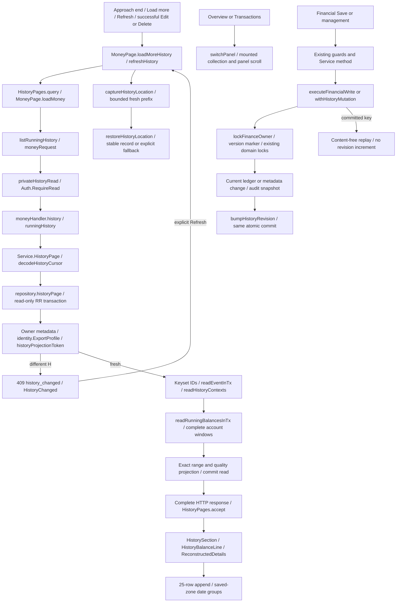

# Issue #36: Historical account balances and stable History pages

Date: 2026-11-02. Non-normative learning record. The approved rules are in `docs/HISTORY_BALANCE_DESIGN.md` and accepted ADR-018/020. Final delivery update: 2026-11-04. Product Owner manual 390px review and continuous History testing passed; final delivery was authorized and regressions passed. ADR-015 stays Proposed.

## Actual function call chain

## Browser and contract

| Input -> Function | Process -> Output -> Next |
| --- | --- |
| Sentinel / Load more -> `apps/web/src/MoneyPage.tsx` `loadMoreHistory` | One in-flight read; append next 25 under H; error stops auto-load -> `HistoryPages.query` / `listRunningHistory` |
| Refresh / successful Edit or Delete -> `MoneyPage.refreshHistory` | Build a separate fresh visited prefix (max 8 batches), restore stable record/neighbor or explain fallback -> `loadMoney` / `restoreHistoryLocation` |
| Next batch -> `apps/web/src/historyPages.ts` `HistoryPages.query` | Bind limit 25/H/cursor; stop at end -> `api/money.ts` `listRunningHistory` |
| Query -> `listRunningHistory` / `moneyRequest` | GET with same-origin credentials/no-store and no owner ID -> guarded History route |
| Complete response -> `HistoryPages.accept` | Validate H/zone/IDs/advancing cursor before merging items and referenced contexts -> `HistorySection` |
| Snapshot events/contexts -> `MoneyPage.tsx` `HistorySection` / `HistoryBalanceLine` | Group using response timezone; one account line or two Transfer lines; hide pre-anchor numbers in summary -> `ReconstructedDetails` / expandable Edit/Delete |

New opt-in query: `/api/v1/events?view=running_balances&limit=25`. Continuation adds the returned `history_revision` and `next_cursor`. The old limit/offset response still serves Today. The OpenAPI projection is separate from the unchanged closed event/export schemas.

An unrelated write returns 409 for a stale boundary. The UI replaces stale rows with explicit Refresh; it does not splice pages or silently adopt another token. Existing Edit drafts, split values and frozen financial command bytes/key/If-Match are outside History state. Refresh cannot resolve an uncertain Save. Open date forms retain their visibly identified entry zone when a newer saved preference arrives; the existing shell callback synchronizes the shared preference separately.

## Server read

| Input -> Function | Process -> Output -> Next |
| --- | --- |
| Request -> `internal/finance/history_http.go` `privateHistoryRead` / `identity.Auth.RequireRead` | Repeat session/owner authorization; privacy headers cover guard denials -> `moneyHandler.history` |
| Opt-in query -> `moneyHandler.runningHistory` | Reject duplicates, owner overrides, offset/body and malformed limit -> `Service.HistoryPage` |
| Validated owner/query -> `internal/finance/history_page.go` `Service.HistoryPage` | Canonical cursor/H validation and 5-second bound -> `repository.historyPage` |
| Owner/H -> `repository.historyPage` | One read-only REPEATABLE READ snapshot, 4-second statement timeout; metadata plus `identity.ExportProfile` timezone -> `historyProjectionToken` |
| Snapshot metadata -> `historyProjectionToken` | SHA-256 of the versioned ordered owner/epoch/revision/timezone array; compare expected H -> keyset read or 409 |
| Keyset IDs -> `internal/finance/event_read.go` `readEventInTx` | Complete current header/movements/allocations, excluding deleted roots -> `readHistoryContexts` |
| Referenced IDs -> `readHistoryContexts` | Same-snapshot owned account/category names, archive states, anchors; sorted UUIDs -> `readRunningBalancesInTx` |
| Relevant accounts -> `readRunningBalancesInTx` | Exact numeric complete-partition windows; page event filter stays outside windows -> range/basis projection |
| Complete page -> `runningHistory` | Map current DTOs plus positions; no partial success -> browser `HistoryPages.accept` |

Reason precedence is `voided`, then `anchor_required`, then `amount_out_of_range`. Anchored/pre-anchor/legacy basis is separate from availability. Go `math/big.Int` checks the final int64 range; an overflowing historical position is null without damaging other rows. Real storage/consistency failures return 503, not a partial page. Cancelled reads fail closed. All new History outcomes are private/no-store/nosniff; stale errors reveal no current token or data.

History business writes are **N/A**: the GET is read-only. The transaction ends before the user reads the page. REPEATABLE READ makes one response coherent; the revision token detects changes between separate responses. A token is not a credential or long-lived database snapshot.

## Writer and upgrade

| Input -> Function | Process -> Output -> Next |
| --- | --- |
| Existing guarded command -> `idempotency.go` `executeFinancialWrite` | Reuse approved fingerprints/admission/retained-key replay -> `history_write.go` `lockFinanceOwner` for a new command |
| Management action -> `repository.go` methods / `withHistoryMutation` | Short explicit transaction, same owner-before-name/row order -> `lockFinanceOwner` |
| Owner -> `lockFinanceOwner` | Unchanged ADR-019 advisory key plus transaction-local v11 marker -> existing domain mutation |
| Actual change -> `repository.go`, `edit.go`, `opening_balance.go` mutation helpers | Preserve current ledger/anchors/audit/key semantics -> `bumpHistoryRevision` once |
| Owner -> `bumpHistoryRevision` | Lazy epoch/1 insert or guarded counter+1; MaxInt64 fails -> shared commit or full rollback |

Replay, same-name category rename, already-deleted no-op, reads, preview, export and failures do not advance the counter. Timezone is included in H without cross-module Finance writes. A genuine Edit still changes the current event revision/audit under ADR-020; #36 does not redefine it as a no-op.

Only new migration `db/migrations/000011_finance_history_revisions.*.sql` changes schema. It adds operational owner/epoch/counter metadata and statement-level compatibility fences. Bounded table locks drain old DML before baseline creation; an old prepared connection fails SQLSTATE 55000 afterward. Production writers set a transaction-local marker, never a persistent pool bypass. The fence guards binary compatibility, not privileged database operators. Explicit fixture pools alone allow deliberate SQL upgrade/fault fixtures.

Populated v10 ledger/audit/key digests survive upgrade. Baseline-only down/re-up creates new epochs; nonzero counters block down. A future separately authorized restore must rotate epochs, reset client paging and reconcile stale pending keys before reopening access. The Personal Data Ready restore gate remains open. No personal database or old disposable database was operated on or removed.

## Synthetic financial examples

| Scenario | Exact result |
| --- | --- |
| Bank 1,000 / Cash 200; expense 50 | Bank after expense 950 |
| Then Transfer 100 | One event, Bank after 850 / Cash after 300 |
| Edit old expense to 80 | Same event ID; expense after 920, later Transfer 820 / 300, including across pages |
| Void or Delete the expense | Transfer becomes 900 / 300; Void visible/non-effective, Delete absent |
| Bank anchor 1,000 on Oct 10; expenses 30 Oct 8 and 20 Oct 9 | Reconstructed after-values 1,020 and 1,000; current remains 1,000 |
| Cash anchor Oct 10 / Savings anchor Oct 20; Transfer 50 Oct 15 | Cash after 50; Savings reconstructed 200; moving to Oct 21 makes Savings 250 |
| MaxInt64 current balance with a backdated +1 before a later -1 | Earlier position null/amount_out_of_range; current remains valid |

The actual localhost guarded HTTP fixture additionally checks expense 50 -> 80, stable identity, two Transfer positions, stale-page 409, page uniqueness, unchanged Today reads, foreign-owner token denial, anonymous denial and wrong-Origin denial. Its records, sample evidence and helper files are synthetic and ignored.

## Option B: understand a balance after a pre-anchor expense

The known synthetic account asserts 100,000 MYR minor units at 2026-10-30T00:00:00Z (08:00 Kuala Lumpur). Event `4cb3a2ef-a39b-489c-a2bd-547155f955d6` occurs at 2026-10-29T16:00:00Z (00:00 Kuala Lumpur). A read-only inspection of immutable revisions 4/5 confirms 40,000 -> 80,000 minor units, with unchanged event ID/time. At each recorded checkpoint the subsequent pre-anchor expenses total 728 minor units.

- After = 100,000 - (-728) = 100,728, or MYR 1,007.28, for both revisions.
- Before = after + the expense: 140,728 -> 180,728, or MYR 1,407.28 -> 1,807.28.
- The event's own amount cancels between its prefix and the complete pre-anchor sum. No formula fix is needed. These are reconstructed positions, not bank-verified observations.
- Later synthetic edits are still present. The current preview is not a frozen reproduction of revision 4/5. Inspecting their stored snapshots avoided changing Product Owner review data.

`HistoryBalanceLine` now shows Before balance date without the numeric value. `ReconstructedDetails` inside the event disclosure shows the representable number, Not bank verified, a backwards-calculation explanation and the account's confirmed local date/time. A Transfer applies this independently to both positions. Voided positions remain non-effective without numbers; legacy accounts retain confirmation guidance.

`history_optionb_test.go` `verifyHistoryOptionB` reproduces 400 -> 800 and 100,728 after on a fresh owner. 73 initial records are traversed in 25-row batches. Anchored current remains 93,500. New later post-anchor expense: earlier after stays 99,900, current 93,300. Edit earlier post-anchor expense from 100 -> 300: its after becomes 99,700, later after/current 93,100. Delete an older loaded expense: remove exactly one ID/effect; move another older record to a later date: preserve ID and deterministic new order. Old H is rejected. Existing independent reference covers tied timestamps and mixed Transfer/anchor states.

A later post-anchor event does not rewrite an earlier after-position. A newly recorded event between an earlier pre-anchor event and its later confirmed balance can correctly change that earlier reconstruction. This follows the accepted model; suppressing that change would be a correctness defect.

## Continuous UI and recovery

| Input -> Function | Process -> Output -> Next |
| --- | --- |
| Near end -> `MoneyPage.tsx` `HistorySection` effect | IntersectionObserver 400px margin, only while visible/idle; manual fallback always exists -> `loadMoreHistory` |
| HTTP failure -> `loadMoreHistory` | Keep items/cursor; stop automatic retries -> Retry loading / Refresh history |
| View switch -> `MoneyPage.switchPanel` | Save per-panel scroll, keep hidden views mounted -> animation-frame scroll restore; no query |
| Edit/Delete -> `historyPosition.ts` `captureHistoryLocation` | Save stable record + two neighbor IDs and viewport top -> guarded mutation / fresh read |
| Fresh visited prefix -> `restoreHistoryLocation` | Focus with preventScroll, correct offset once; missing/hidden IDs fail explicitly -> fallback notice and Transactions heading |
| Changed event UTC instant -> `refreshHistory` | Compare saved occurrence; announce new ordering instead of pretending old location -> restored event/neighbor |

The fresh prefix is limited to min(previously visited batches, 8), at most 200 events. Load more continues safely afterward; this is a bounded read restoration, not a history-size limit. Pending commands, allocations, pinned entry zones and Edit drafts live separately; no read changes frozen payload/key/operation/target. Manual append focuses the first newly added summary; automatic append never moves focus. Summary scroll margins reserve fixed-navigation space. Product Owner manual 390px review passed; automated focus/clearance and 320px/physical-mobile coverage remain unverified.

Frontend tests cover summary/detail separation, date groups across appended records, manual/retry/loading/end labels, coherent contexts, duplicate/revision/zone/non-advancing rejection and stable neighbor/fallback recovery. DOM-interface tests are not a real rendered browser or screen-reader test. Earlier native automation was blocked by unavailable host/pipe. No agent-generated screenshot or automated mobile scroll/focus pass is claimed; Product Owner manual 390px acceptance is recorded separately below.

## Verification

Final delivery run (2026-11-04): 185 Go tests/subtests and go vet passed on eleven fresh `lifeos_i36_full_20261104_063033_*_test` databases. One opt-in benchmark was skipped in the ordinary suite and passed separately on its own fresh database. All 103 frontend tests, TypeScript checks, production build, OpenAPI lint/generated-contract checks and diff checks passed. The v1-v11 chain/no-op/smoke verifier passed on `lifeos_i36_chain_20261104_063057_test`; populated upgrade/down guards run in the History suite. All databases and ignored artifacts are retained.

- `TestRunningHistoryIntegration`: populated upgrade/drain/prepared-writer fence, digest preservation, down guards, empty owner, account confirmation counter/replay, exact anchor ties and 0/2/3/4-scale currencies, negative/future positions, old Edit effects, independent many-page reference, pre-anchor/Transfer rules, complete archived splits, management no-ops, Void/Delete, timezone/owner tokens, coherent snapshots while Edit/Void/Delete commit, session/privacy denials, cancellation and counter rollback/replay at exhaustion.
- `history_reference_test.go` `verifyHistoryReference`: 102 varied current events, multiple accounts/currencies, splits, anchored/legacy positions, edits, archives and status changes. Every 7-row page is checked against an independent Go forward/backward big-integer calculation over all current rows. Other-owner writes do not invalidate it.
- `TestHistoryCursorAndToken`: byte goldens and strict canonical/version/size/UUID validation. No published fingerprint or export fixture changed.
- Existing full Go suites cover Finance/Goals, retained v9/v10 keys, Edit races, sessions/Origin/CSRF, export snapshot consistency and v1/v2 compatibility. `go vet`, frontend regression tests, TypeScript/build, OpenAPI lint/generated checks and `git diff --check` are required gates. The optional benchmark is executed separately; its ordinary-suite skip is intentional.
- `historyPages.test.ts`, `MoneyPage.test.tsx`, `api/money.test.ts`, existing DST/timezone tests and pending-command tests cover coherent append/replacement streams, snapshot labels, exact money/null reasons, one Transfer/two lines, stale recovery, protected actions and unchanged old API consumers. Existing `editDialogLifecycle.test.ts` checks scroll/focus through DOM interfaces at 320/390/desktop widths.
- **Review distinction:** Product Owner manual 390px screenshot/continuous-History review passed on 2026-11-04. Native automation was previously blocked by unavailable browser host/pipe. No agent-generated rendered 320px/desktop screenshot, automated overflow/focus, mobile-keyboard/touch/zoom, physical-mobile or screen-reader pass is claimed. DOM/SSR checks are not rendered layout tests. Excel/LibreOffice compatibility was not retested or changed.

## Benchmark method and resources

`TestHistoryPerformance` is opt-in and accepts only the explicitly named new Issue #36 container/database. It retains both owners' 10k/100k current ledgers, 5% one-event Transfers, income/expenses, varied complete splits, archived Medical references, 5% Voided and 5% Soft Deleted events plus full baseline snapshots. Each size receives 3 PostgreSQL-restart first requests and 30 warm requests through an actual guarded localhost HTTP server, using 10 rows/page. These retained baseline measurements predate the 25-row continuous UI; no new 25-row cold/warm benchmark is claimed.

The benchmark uses two MYR accounts per owner; mixed-currency correctness is covered separately by the integration/reference tests.

PostgreSQL 18.6; dedicated container capped at 2 CPUs/2 GiB; shared_buffers 128MB, work_mem 4MB, max_connections 100. Restart clears PostgreSQL shared buffers, **not** the host disk cache. These are local single-client measurements, not production throughput guarantees. The synthetic combined 110k-event database including allocations/audit/indexes is 233,248,447 bytes.

| Events | PG-restart first requests (ms) | Warm median / p95 (ms) |
| --- | --- | --- |
| 10,000 | 91.413 / 64.549 / 63.138 | 36.937 / 42.348 |
| 100,000 | 301.324 / 327.014 / 339.992 | 178.105 / 208.169 |

EXPLAIN confirms full account windows before event filtering: 9,500 / 95,000 effective movement rows. Existing account movement index is used at 10k; sequential scans/hash joins are chosen for the broad 100k partitions. Final window query execution is 19.304 / 275.370ms; these instrumented query timings are distinct from the HTTP distribution above. The 100k external sort uses 8,376kB disk; query temp reads/writes 3,791/3,140 8-KiB blocks under default work_mem. Small in-memory sort: 1,275kB. No audit or allocation join multiplies the window.

An earlier same-workload comparison before adding split rows removed forced CTE materialization: warm 100k p95 improved 248.702 -> 203.235ms and temp writes 4,090 -> 3,140 blocks. The final representative split workload is reported separately above. No extra index, work_mem override, cache or new infrastructure was justified by these results. Both provisional warm targets (500ms/2s) were met locally.

## Reading order and remaining questions

1. Read ADR-018 and `docs/HISTORY_BALANCE_DESIGN.md` for anchor semantics and deterministic UTC order.
2. Follow `history_page.go`, then `history_http.go`, then `history_write.go` and migration v11.
3. Read `history_reference_test.go` before the integration/performance evidence.
4. Follow `historyPages.ts` and `MoneyPage.tsx`; keep recovery/draft ownership separate from read navigation.

## Final delivery record (2026-11-04)

On 2026-11-04 the Product Owner manually reviewed the updated 390px Money Transactions screenshot and tested continuous History, then explicitly approved final delivery. This is a passed Product Owner manual 390px review, not automated browser evidence. 320px, physical mobile, desktop rendered regressions, full native browser automation, mobile keyboard/zoom and screen-reader checks remain unverified for the final UI. No new screenshot or native-browser pass is claimed.

Final delivery checks on 2026-11-04 passed: 185 Go tests/subtests and go vet on eleven new lifeos_i36_full_20261104_063033_*_test databases; 103 frontend tests; TypeScript typecheck and production build; OpenAPI lint and generated-contract checks; v1-v11 chain/repeated-up/smoke verification on lifeos_i36_chain_20261104_063057_test; git diff --check. One opt-in performance test is intentionally skipped in the ordinary suite; its separately completed 2026-11-02 measurements are retained, not rerun or relabelled as 25-row UI benchmarks. Lint has only the two established OAuth redirect warnings.

Published migrations v1-v10, accepted ADRs and export v1/v2 schemas/golden fixtures are unchanged; ADR-015 remains Proposed. Populated v10-v11 preservation, old in-flight/prepared-writer fencing, owner history revision increments/no-ops/replays/rollback, coherent concurrent reads and export compatibility passed in the full integration suites. Only disposable data was used and all test databases/ignored artifacts were retained. No personal database operations or deployment occurred. Personal Data Ready still requires separately approved restore/reconciliation, safe upgrades and secure persistent operation. Issue #37, Goal Delete and Backup/Restore implementation have not started; wait for separate authorization.

The Product Owner authorized commit/push/closure after these checks. Issue #36 will record the final SHA and remote verification after verified delivery. Stop after delivery and await the next authorization. The actual function-level Mermaid/table flow above is unchanged by this delivery step.
