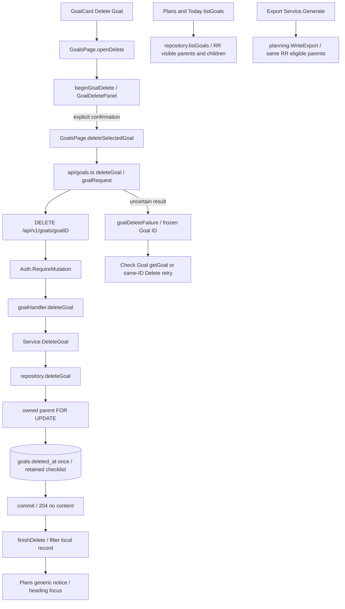

# Safe Goal Delete — Issue #38

**Date:** 2026-11-04. **State:** implementation complete and final regressions passed. The Product Owner manually verified successful deletion and approved final delivery. No deployment or personal-data operation is authorized.

## Actual call chain

## Why this design stays small

The command has a fixed target and a terminal persisted state. A row lock and one nullable marker make repeats safe without financial request keys, a receipt, Trash, an audit framework or another service. The parent and every checklist row present at deletion remain internally. Completion and archive keep their original meanings; archived Goals have only the explicitly approved Delete exception to their ordinary read-only state.

Accepted ADR-021 explicitly allows the **new deleted-Goal state only** to be omitted from normal JSON v1/v2 without a format bump. Existing schemas/goldens and visible active/completed/archived records remain unchanged. ADR-017's historical file is unchanged; this is no general permission for unversioned changes. Finance CSV contains no Planning data and is unchanged. ADR-015 remains Proposed.

## Frontend input and state

| Input → function | Process → output → next function |
| --- | --- |
| Detail action → `apps/web/src/GoalsPage.tsx` `GoalCard`, `openDelete` | Reject competing pending work; use `beginGoalDelete` → fixed target/title/confirm state → `GoalDeletePanel` |
| Keep/Escape → `GoalsPage.cancelDelete` | Only before an uncertain/sending command; leave GoalCard mounted and drafts intact → clear confirmation → focus original Delete trigger |
| Confirm → `GoalsPage.deleteSelectedGoal` | Shared synchronous in-flight gate; retain target; disable competing controls → `api/goals.ts` `deleteGoal` |
| CSRF/ID → `apps/web/src/api/goals.ts` `deleteGoal`, `goalRequest` | Same-origin empty DELETE, no-store, 15-second AbortController wait; require exactly 204 and never parse JSON → resolve `void` or `GoalApiError` |
| Network/timeout/5xx/unexpected 2xx → `apps/web/src/goalDeleteState.ts` `goalDeleteFailure` | Preserve target and previous uncertainty; a later protection error cannot disprove an earlier commit → accessible error + Check/Retry |
| Check → `GoalsPage.deleteSelectedGoal(true)`, `getGoal`, `goalDeleteChecked` | A visible GET is only a snapshot, so uncertainty remains; retry same target to settle → no competing edits enabled |
| 204 → `GoalsPage.finishDelete` | Filter record locally before navigation; generic `/plans#goal-deleted` → Plans consumes/clears fragment, announces status, focuses heading |
| 404 → `finishDelete(attempt, true)` | Generic unavailable notice, not proof this attempt deleted it → `/plans#goal-unavailable` |

`GoalDeletePanel` uses an inline labelled group, Keep initial focus, reachable errors and status announcements. It is not a modal and does not trap focus or lock the page. Cancel before sending restores focus; sending/checking disables cancellation. The attempt is in page memory, not durable storage. Navigation/reload/sign-out can lose the UI context; no lost-key recovery is promised. Session refresh unmounts the authenticated page; no automatic retry occurs under a new owner.

Other Goal methods still expect JSON. The Delete path is separate from `mutate`, which inserts a returned Goal into the current list. Passing a successful empty response into that existing path would be incorrect.

## Guard, service and transaction

| Input → function | Process → output → next function |
| --- | --- |
| DELETE → `internal/planning/http.go` `RegisterRoutes` | Existing mutation guard → `internal/identity/auth.go` `Auth.RequireMutation` |
| Session/headers → `Auth.RequireMutation` | Revalidate session/admission, Origin, CSRF and owner override denial on every retry → server-derived `OwnerID` → `goalHandler.deleteGoal` |
| Request → `goalHandler.deleteGoal` | `validQuery` and `emptyGoalBody`; no client ownership/body/query → `Service.DeleteGoal` |
| Owner/ID → `internal/planning/service.go` `Service.DeleteGoal` | Require valid OwnerID/UUID → `repository.deleteGoal` |
| Owner/ID → `internal/planning/repository.go` `deleteGoal` | READ COMMITTED; 10s context, 2s lock timeout, 8s statement timeout, 10s idle transaction timeout → owned parent `FOR UPDATE` |
| Locked parent → `repository.deleteGoal` | Missing/foreign → `ErrNotFound`; existing marker → no UPDATE; first deletion → marker and `updated_at = now()` once → commit |
| Commit → `goalHandler.deleteGoal` | Return no-store 204 only after commit → frontend result handling |

Failures roll back using a short cleanup context independent of a cancelled request. A commit error or client response loss remains uncertain; it is never described as proof of rollback. Repeat Delete locks the retained row including its marker, so it preserves the first timestamp even after restart. Errors use existing neutral Goal messages and omit private titles/checklist text/raw database errors.

## Visibility, mutation races and exports

| Input → function | Process → output → next function |
| --- | --- |
| List/detail → `Service.ListGoals` / `GetGoal`, `repository.listGoals` | One read-only REPEATABLE READ transaction filters parents and children by the same eligible owner Goal set → coherent visible DTOs |
| Checklist/completion → `repository.lockGoal` | Require `deleted_at IS NULL` before parent lock; child IDs cannot bypass it → existing child operation or safe 404 |
| Rename/archive/restore → corresponding repository method | Owner-scoped parent UPDATE also requires null marker; implicit row lock and predicate recheck serialize against Delete → normal response or 404 |
| Plans/Today → `GoalsPage.refresh`, `TodayPage.refresh` / `activeGoalsOnly` | Existing `listGoals` supplies filtered records; Today still applies active-only projection → no client-only deletion rule |
| JSON export → `internal/exporting/service.go` `Service.Generate`, `internal/planning/export.go` `WriteExport` | Shared read-only RR snapshot; same eligible parent set for Goal and checklist projections → unchanged v1/v2 records/counts/relationships |
| Finance/CSV → N/A | Goal Delete performs no Finance write and Planning is not in Finance CSV; no balance/history/key/audit mutation |

If a checklist mutation wins the parent lock, its valid committed state is retained before Delete. If Delete wins, the mutation waits and then returns 404 without a child write. Existing mutation services read the Goal again after commit: Delete can win before that response read, so a 404 can follow an already committed prior mutation. This safe terminal outcome is documented instead of being mistaken for rollback.

A read/export snapshot predating Delete can finish with the whole old parent/checklist. A fresh snapshot after commit has neither. Already rendered tabs/downloaded files are not revoked. No polling/cross-tab infrastructure was added.

## Migration and operational concepts

- `db/migrations/000012_goal_soft_delete.up.sql` adds only nullable `deleted_at timestamptz`; all prior rows stay visible and no child/FK changes occur. `internal/platform/migrations/version.go` requires v12 readiness.
- Down takes a bounded `SHARE ROW EXCLUSIVE` lock before checking markers, then refuses if any exist. Removing the column after deletion would silently resurrect Goals. A forward correction is preferred after use.
- Before a future separately approved activation, stop admission and drain old Planning/API readers/writers and exports; apply the upgrade with a tested backup plan; start matching API/UI and verify readiness/filtering before reopening access. Finance v11 fencing is **not** a Goal fence. No rolling mixed-version guarantee exists.
- Normal JSON is not a complete database backup. Internal storage, WAL, backups and prior exports may retain deleted Goals; restoring an older backup can resurface them. This remains part of the general Personal Data Ready restore/reconciliation gate, without a special inventory or new restore feature.

## Verification evidence

| Check | Actual result |
| --- | --- |
| Full Go integration suite + vet | 217 tests/subtests passed; one intentional opt-in History benchmark skip; vet passed. Twelve new retained databases, prefix `lifeos_i38_full_20261104_080138_*_test`. |
| Lifecycle/security | Empty/active/completed/archived/completed+archived; stable repeat markers; all deleted-parent mutations denied; missing/foreign IDs, expired/revoked/disabled sessions, Origin/CSRF/query/body checks passed. |
| Parent locking | 22 deterministic cases: 11 competing operations in both orders, including duplicate Delete. Existing parent/child state and terminal 404 verified. |
| Failure handling | Injected UPDATE and deferred COMMIT failures, cancellation and held-parent lock timeout leave valid prior state. Real HTTP server commits then drops reply; same-ID retry returns empty 204. |
| Real preview/process restart | Guarded API at 18107 via 5207 production-bundle proxy; active/completed/archived delete/repeat/list/GET/export checks passed. Committed reply dropped; retry passed. Restarted only the verified task-owned Go process; retry again returned 204 with unchanged marker/update timestamps. |
| Exports/Finance | Both JSON versions held across Delete: whole old parent+child vs whole excluded fresh set. Visible archived/completed remain, child links/counts exact. Finance CSV data files unchanged. Finance data digest/balance and existing History continuation unchanged. |
| v12 migration | Populated v11 parents/checklists plus Finance data preserved; repeat-up, no-marker down/re-up, marked down refusal passed. Complete chain/repeated-up/smoke rollback passed on retained `lifeos_i38_chain_20261104_080140_test`. |
| Web/contracts | 112 frontend tests; TypeScript, production build, OpenAPI lint/generated check and diff checks passed. Only two existing OAuth redirect warnings. |

Main new tests: `internal/planning/delete_integration_test.go` `TestGoalSoftDeleteIntegration`; `delete_race_test.go` `verifyGoalDeleteRaces`; the deleted-Goal snapshot subtest in `internal/exporting/export_integration_test.go`; `apps/web/src/GoalDeletePanel.test.tsx` and `api/goals.test.ts`.

Older Finance rollback tests assumed the latest migration was the version whose guard they exercised. v12 exposed that assumption. Tests now explicitly target published v9/v10 guards inside rollback-only test transactions, while the History migration test explicitly targets v11. This preserves those regression checks without changing published SQL or Finance business logic.

Protected migrations v1–v11, export v1/v2 schemas/goldens and older accepted ADR files were checked unchanged. Existing databases/artifacts were retained; personal data was not accessed.

## Preview and remaining verification limits

Open `http://127.0.0.1:5207/__test_login_owner` for the new isolated synthetic owner. After login, `/__review/320`, `/__review/390` and `/__review/1280` provide width wrappers. Active/completed/archived review records remain. The fixture uses synthetic sessions and local fake OIDC discovery with normal Go session/Origin/CSRF guards; it does not test live Google login.

The normal browser inventory returned **“The browser access host is unavailable”** and native pipe error 2. The Product Owner subsequently manually tested successful Goal deletion and approved final delivery on 2026-11-04. That functional acceptance does not verify all responsive/accessibility scenarios. Full rendered 320px/390px/desktop overflow, screenshots, keyboard, focus restoration, draft interaction, bottom-navigation/scroll and mobile-keyboard coverage remains incomplete. Unit/SSR/state tests cover markup and recovery rules, not rendered browser behavior. Physical iOS/Android remain untested. No browser security restriction was bypassed.

## Suggested reading order

1. Accepted ADR-021 and `docs/GOAL_DELETE_DESIGN.md` for exact domain/API decisions.
2. `GoalDeletePanel.tsx`, `goalDeleteState.ts`, `GoalsPage.tsx` and `api/goals.ts` for UI state and empty-response handling.
3. Planning HTTP/service/repository for ownership, locking and terminal visibility.
4. v12 up/down and Planning export queries for upgrade/relationship safety.
5. Goal-delete race/integration and export tests for the guarantees and their limits.

Final delivery was explicitly authorized after the Product Owner manually confirmed successful Goal deletion. Final Go/vet, frontend/typecheck/build, contracts, migration and diff checks passed. Record the commit SHA and verified remote/closure result in Issue #38. Preserve the incomplete rendered 320px/390px, keyboard/focus and physical-mobile checks; do not claim they passed. Stop after delivery. No Backup/Restore, Cloud/PWA, #37 or unrelated feature began.
